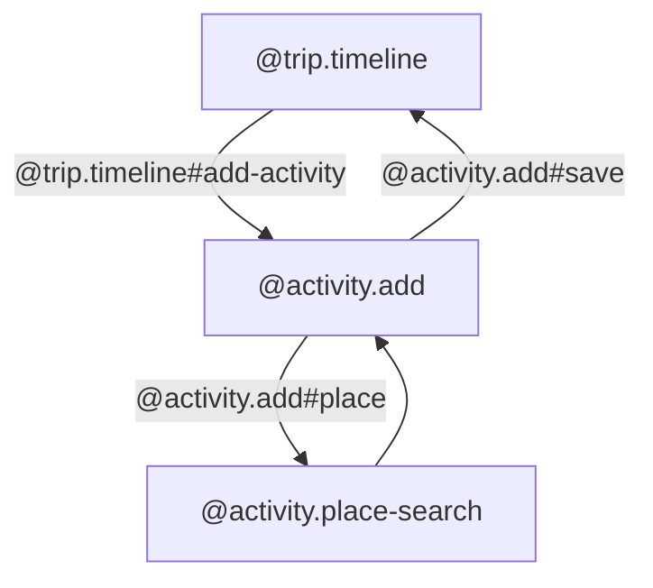

A **flow** describes one thing a person does with the app, such as adding an
activity to a trip, from where they start to where they finish. Each flow is
a Markdown file in `docs/flows/flows/`, named after its ID.

Flows are where the reference says what screens are *for*. The registry
says what exists and where each link goes; a flow says which of those
links a person takes, in which order, and why.

## An example

`examples/travel-app/docs/flows/flows/add-activity.md`:

````markdown
---
id: add-activity
title: Add an activity
status: shipped
actors: [traveller]
entry: trip.timeline
---

**Goal:** put something on one day of the trip, at a place.



## Steps

1. Tap @trip.timeline#add-activity.
   - If the traveller cannot edit logistics, the button is hidden.
2. Name it in @activity.add#title.
3. Choose the day in @activity.add#day.
4. Pick a place in @activity.place-search#results.
5. Tap @activity.add#save; the activity appears on @trip.timeline#days.
````

## The parts

- **Front matter** names the flow: its `id` (the file name without `.md`),
  `title`, `status`, the `actors` who do it, the `entry` screen it starts
  on, and optionally the `platforms` it applies to.
- **Goal** is one paragraph on what the person wants.
- **The diagram** is a Mermaid flowchart. Nodes that are screens are written
  as references; decisions and system events are plain text.
- **Steps** are a numbered list under a `## Steps` heading. Each step's
  first reference is *where* it happens. Nested bullets are branches: what
  happens otherwise.
- **Platform adaptations**, an optional `## Platform adaptations` section,
  says how the flow differs on one platform.

## References

A reference is `@` followed by a screen ID, optionally with `#` and a
region: `@trip.timeline`, `@trip.timeline#add-activity`. References can go
anywhere in the text, the steps and the diagram. They are plain text, so
they read well in any Markdown viewer, and you, a reviewer or an agent can
find every use of a screen with a text search for `@trip.timeline`.

`starboard lint` checks every reference:

- it must name a registered screen, and a region that screen's layout has
  ([ref-unresolved](../../rules/ref-unresolved/));
- a step should have one ([step-without-ref](../../rules/step-without-ref/));
- a screen the steps refer to should appear in the diagram
  ([flow-ref-not-in-diagram](../../rules/flow-ref-not-in-diagram/));
- a `shipped` flow must not depend on anything still `proposed`
  ([shipped-flow-proposed-ref](../../rules/shipped-flow-proposed-ref/)).

## Steps as a storyboard

Because each step starts with a place, a flow can be played back as a
storyboard: the web app's **Walk through** shows, for each step, the
wireframe of the step's screen with its region highlighted, and the step's
branches beside it.

A flow is one path through the app. For every place a person *can* go, see
the app map: [The app map and flows](../map-vs-flows/).

The [flow file reference](../../reference/flow-files/) has the complete
format.
