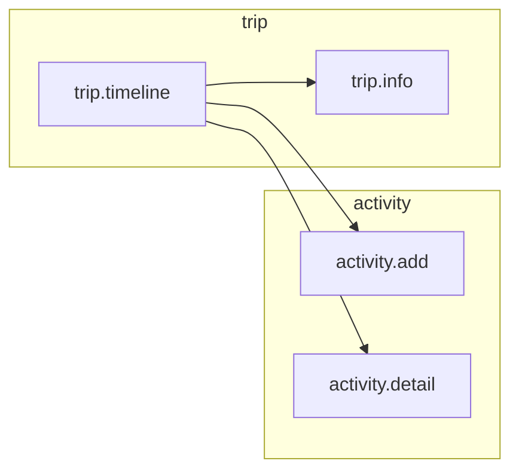

Starboard shows navigation two ways, and keeps them separate on purpose.
The web app says it in one line, under its map:

> The map shows every place a person *can* go. A flow is one path someone
> *does* take, in order — open it from Flows › Walk through.

## The app map

The **app map** is the navigation structure: every `to:` in `screens.yaml`,
drawn as an arrow from the screen that links to the screen it links to.
That includes links in list items, in tab bars and in menus, and in every
form factor's layout.

It has no order and no action wording. An arrow from `trip.timeline` to
`activity.add` says only that the timeline can open the editor; which
button does it, and when a person would, is not the map's business.

`starboard generate` writes it as `generated/app-map.md`, a Mermaid
flowchart with one box per area, which GitHub renders in place. Part of the
travel app's map:

A project with more than 60 screens also gets one map per area, below the
whole map. In the web app's **App map** view, selecting a screen highlights its
links in and out.

The map answers questions about structure: can a person get here at all
([unreachable-screen](../../rules/unreachable-screen/) warns when nothing
links to a screen), what does removing this screen break, and does the web
layout keep the phone layout's links
([edge-parity](../../rules/edge-parity/)).

## Flows

A **flow** is one ordered path: a person with a goal, starting on one
screen, taking particular links in a particular order, with the branches
that matter. Its steps name the screen and region of each move, so it can
be checked against the registry and played back as a storyboard (the web
app's **Walk through**). See [Flows](../flows/).

A flow answers questions about behaviour: what does adding an activity
involve, where does it end, and what happens when the person cannot edit.

## Why both

Neither can stand in for the other. Drawing every flow onto one map loses
the order and the reasons; deriving flows from the map would invent paths
nobody takes. So the map comes from the registry alone and is regenerated
on every change, and flows are written by people, refer to the registry,
and are checked against it. A screen in no flow is reported by
[orphan-screen](../../rules/orphan-screen/), which is how you find what the
flows do not cover yet.
