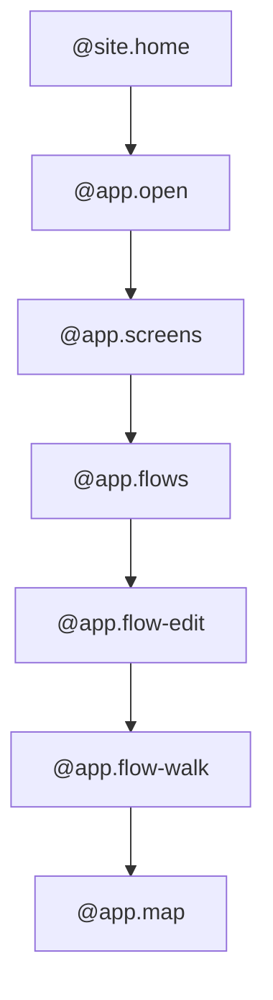

Open the bundled example, then compare its screens, flows and app map.

## Steps

1. Follow @site.home#editor to the browser editor.
2. Choose @app.open#example to open the example.
3. Browse @app.screens#screen-list and inspect a wireframe.
4. Use @app.screens#navigation to open Flows, then pick one from @app.flows#flow-list.
5. Choose @app.flow-edit#walk and follow @app.flow-walk#steps.
6. Use @app.flow-walk#map to open the project map and inspect @app.map#graph.
