<!-- Generated by starboard. Do not edit. -->

# Screens

## site

### Starboard homepage (`site.home`)

- Purpose: Introduce Starboard and help visitors start with the docs or browser editor.
- Presentation: root
- Status: shipped
- Platforms: web

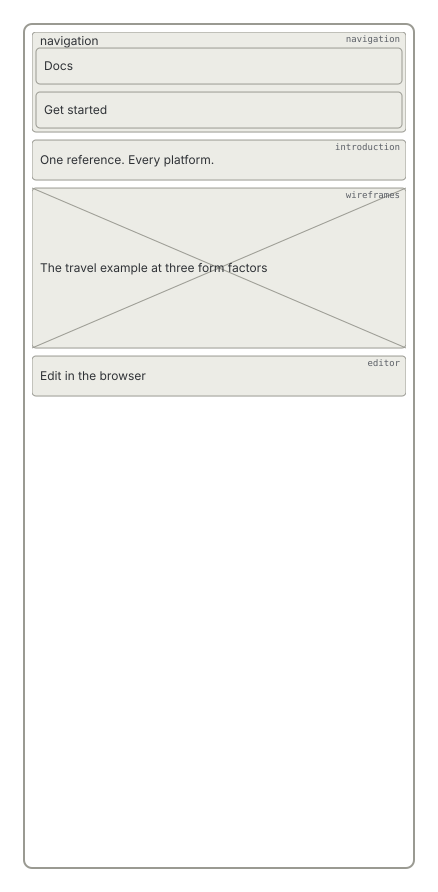
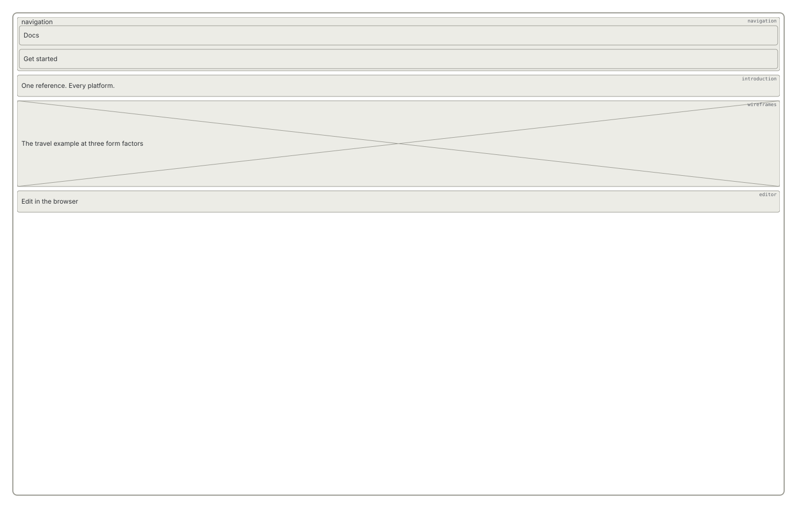

Files:

- web: [website/src/pages/index.astro](../../../website/src/pages/index.astro)

Screenshots: none.

Navigates to:

- `app.open`

Reached from: none.

Used in flows:

- [Explore the example project](../flows/explore-example.md)

## app

### Flow editor (`app.flow-edit`)

- Purpose: Edit a flow's Markdown and inspect the rendered preview and references.
- Presentation: route
- Status: shipped
- Platforms: web

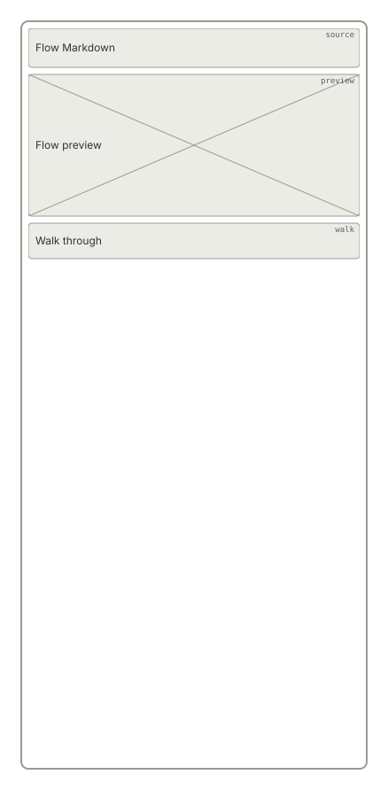
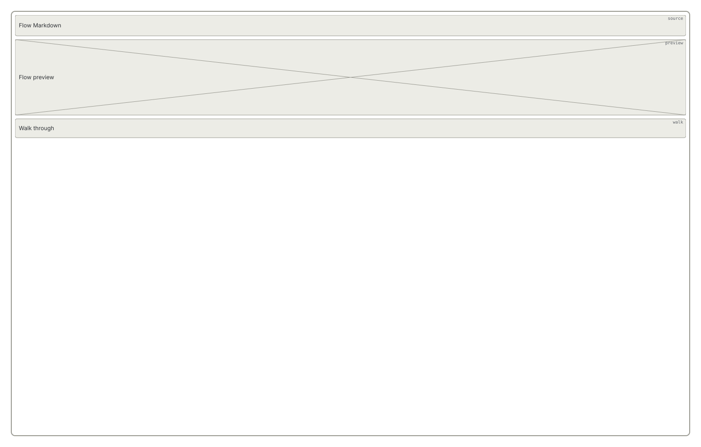

Files:

- web: [web/app/src/views/FlowEdit.tsx](../../../web/app/src/views/FlowEdit.tsx)

Screenshots: none.

Navigates to:

- `app.flow-walk`

Reached from:

- `app.flow-walk`
- `app.flows`

Used in flows:

- [Explore the example project](../flows/explore-example.md)

### Flow walkthrough (`app.flow-walk`)

- Purpose: Follow the selected flow one step at a time with its screen previews.
- Presentation: route
- Status: shipped
- Platforms: web

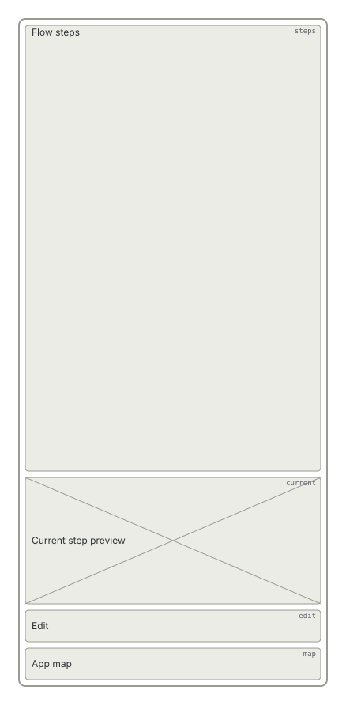
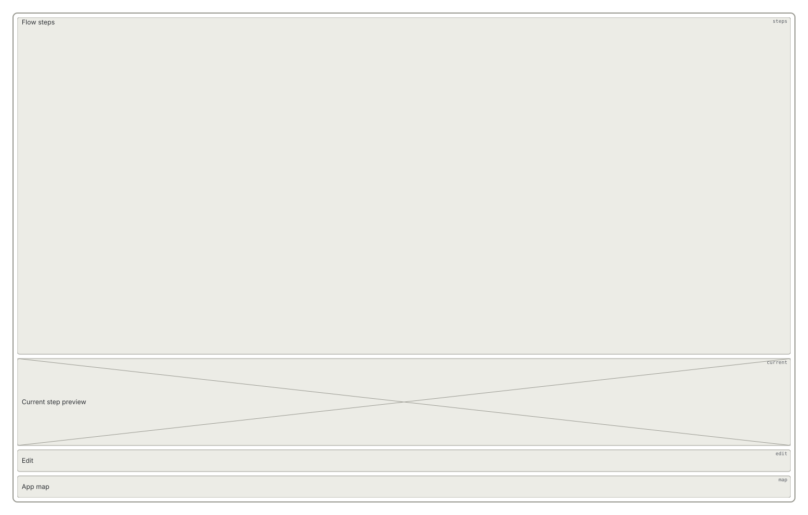

Files:

- web: [web/app/src/views/FlowWalk.tsx](../../../web/app/src/views/FlowWalk.tsx)

Screenshots: none.

Navigates to:

- `app.flow-edit`
- `app.map`

Reached from:

- `app.flow-edit`

Used in flows:

- [Explore the example project](../flows/explore-example.md)

### Flows (`app.flows`)

- Purpose: Find and open the project's user flows.
- Presentation: tab
- Status: shipped
- Platforms: web

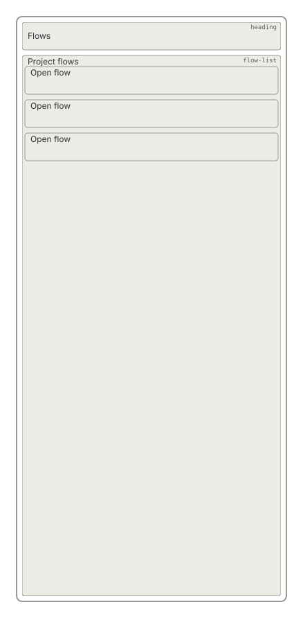
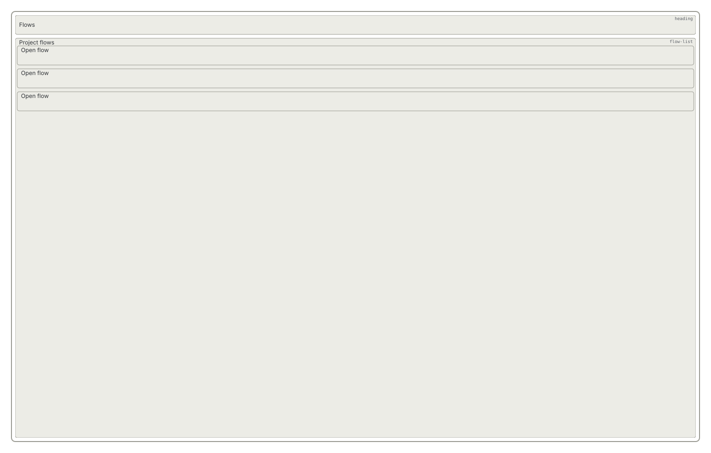

Files:

- web: [web/app/src/views/Flows.tsx](../../../web/app/src/views/Flows.tsx)

Screenshots: none.

Navigates to:

- `app.flow-edit`

Reached from:

- `app.screens`

Used in flows:

- [Explore the example project](../flows/explore-example.md)

### App map (`app.map`)

- Purpose: Explore how the screens in the open project connect.
- Presentation: tab
- Status: shipped
- Platforms: web

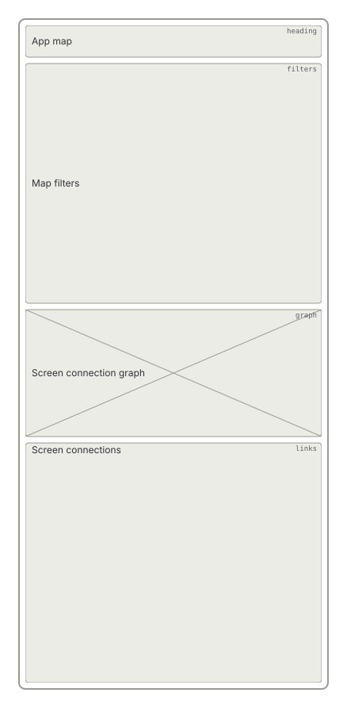
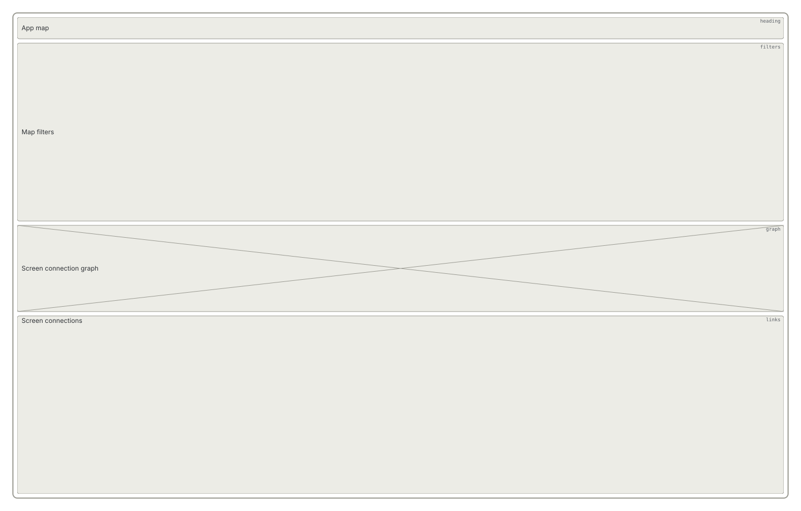

Files:

- web: [web/app/src/views/AppMap.tsx](../../../web/app/src/views/AppMap.tsx)

Screenshots: none.

Navigates to: none.

Reached from:

- `app.flow-walk`
- `app.screens`

Used in flows:

- [Explore the example project](../flows/explore-example.md)

### Route not found (`app.not-found`)

- Purpose: Return visitors to the screen registry after an invalid app address.
- Presentation: route
- Status: shipped
- Platforms: web

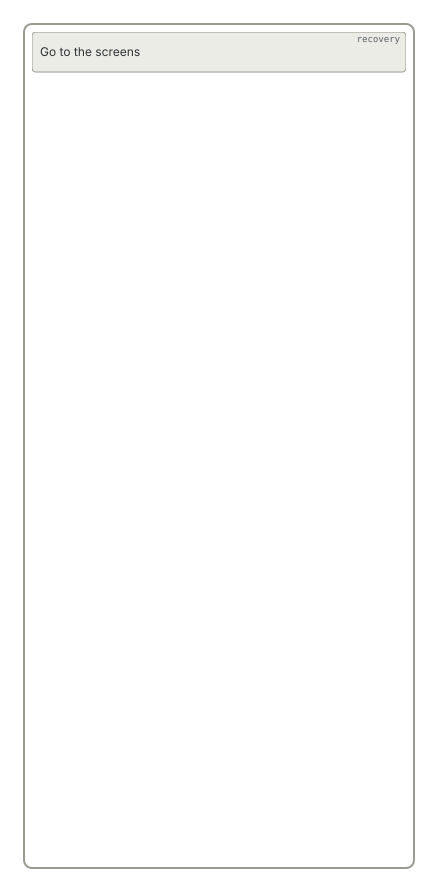
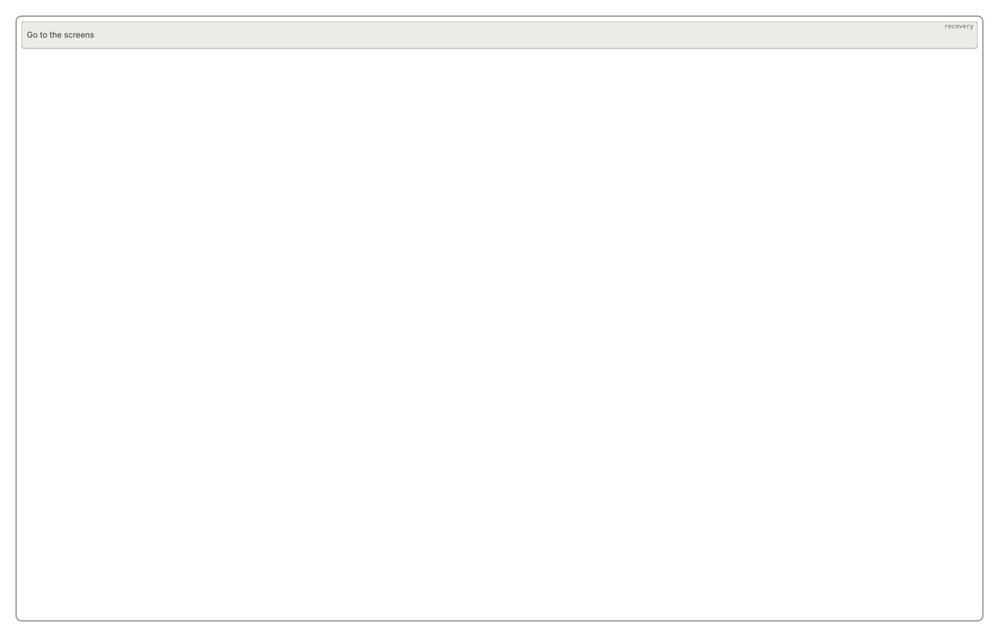

Files:

- web: [web/app/src/views/NotFound.tsx](../../../web/app/src/views/NotFound.tsx)

Screenshots: none.

Navigates to:

- `app.screens`

Reached from: none.

Used in flows:

- [Recover from an invalid app address](../flows/recover-invalid-route.md)

### Open a Starboard project (`app.open`)

- Purpose: Open a local project or explore the bundled travel example.
- Presentation: root
- Status: shipped
- Platforms: web

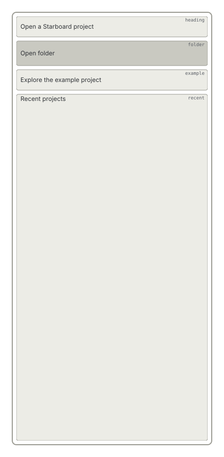
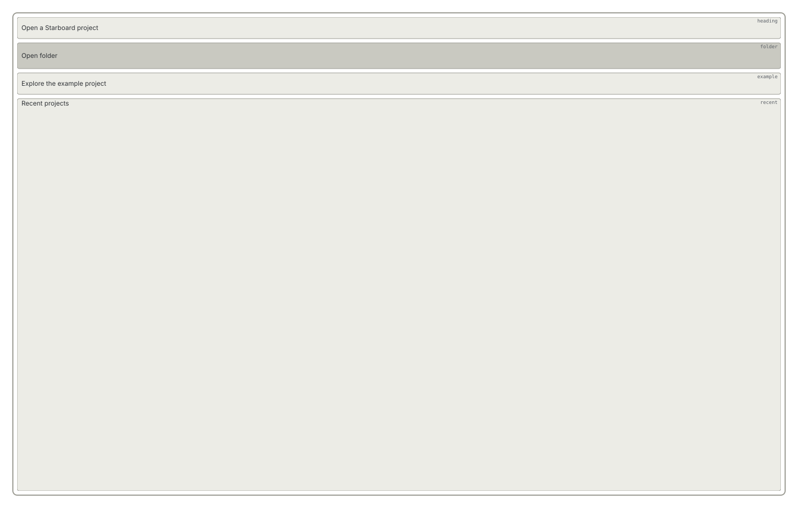

Files:

- web: [web/app/src/views/Open.tsx](../../../web/app/src/views/Open.tsx)

Screenshots: none.

Navigates to:

- `app.screens`

Reached from:

- `site.home`

Used in flows:

- [Explore the example project](../flows/explore-example.md)

### Screens (`app.screens`)

- Purpose: Browse, inspect and edit the screens in the open project.
- Presentation: tab
- Status: shipped
- Platforms: web

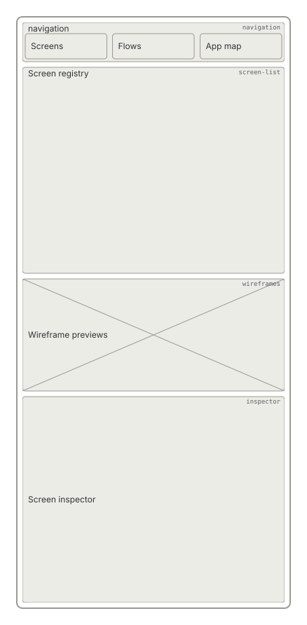
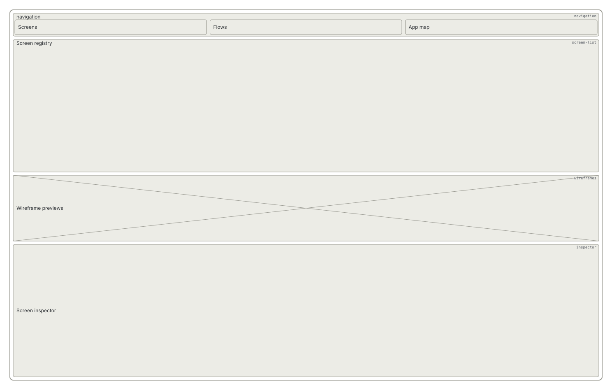

Files:

- web: [web/app/src/views/Screens.tsx](../../../web/app/src/views/Screens.tsx)

Screenshots: none.

Navigates to:

- `app.flows`
- `app.map`
- `app.screens`

Reached from:

- `app.not-found`
- `app.open`
- `app.screens`

Used in flows:

- [Explore the example project](../flows/explore-example.md)
- [Recover from an invalid app address](../flows/recover-invalid-route.md)
