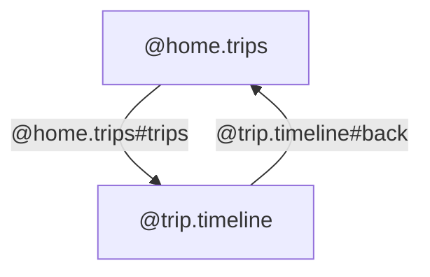

This page starts a Starboard project from nothing: a trip-planning app with
two screens on iOS and the web, and one flow that goes between them. Every
command and file on this page is run by Starboard's own tests, in this
order, so what you see is what you get.

Run the commands at the root of your app's repository. Starboard keeps
everything in plain files there: `starboard.yaml` and a `docs/flows/`
directory.

## Create the project

<!-- verified: empty -->
```bash
starboard init --platform ios --platform web
```

`init` lists every file it writes:

<!-- output -->
```text
.gitattributes
docs/flows/README.md
docs/flows/flows/example.md
docs/flows/generated/app-map.md
docs/flows/generated/screens.md
docs/flows/generated/wireframes/home.main.phone.svg
docs/flows/generated/wireframes/home.main.web-narrow.svg
docs/flows/generated/wireframes/home.main.web-wide.svg
docs/flows/screens.yaml
starboard.yaml
```

- `starboard.yaml` is the project's configuration. Its directory is the
  project root: every command finds the project by looking for it, from the
  working directory upward.
- `docs/flows/screens.yaml` is the **registry**: one entry per screen. `init`
  writes one example screen, `home.main`.
- `docs/flows/flows/example.md` is an example **flow**.
- `docs/flows/generated/` is written by `starboard generate`. Never edit it
  by hand.
- `docs/flows/README.md` tells people who find the directory what it is.
- `.gitattributes` gets three lines that keep these files' line endings the
  same on every operating system. Keep them.

`init` wrote this `starboard.yaml`:

<!-- verified-contents: empty starboard.yaml -->
```yaml
version: 1
platforms:
  ios:
    formFactors: [phone]
    screenFiles: ['**/*View.swift']
  web:
    formFactors: [web-narrow, web-wide]
    screenFiles: ['**/*.{tsx,svelte,vue}']
areas: [home]
```

Each platform draws its wireframes at its **form factors**: iOS at `phone`,
the web at a narrow and a wide browser window. `areas` are the parts of the
product, in the order the generated pages list them. See
[Projects, platforms and form factors](../../concepts/projects-platforms-form-factors/)
for what each setting means.

## Register your screens

Add a `trip` area for the second screen. Edit `starboard.yaml`:

<!-- verified-file: empty starboard.yaml -->
```yaml
version: 1
platforms:
  ios:
    formFactors: [phone]
    screenFiles: ['**/*View.swift']
  web:
    formFactors: [web-narrow, web-wide]
    screenFiles: ['**/*.{tsx,svelte,vue}']
areas: [home, trip]
```

Then replace the example screen in `docs/flows/screens.yaml` with two of
your own: the list of trips, and one trip's timeline.

<!-- verified-file: empty docs/flows/screens.yaml -->
```yaml
screens:
  home.trips:
    title: Your trips
    area: home
    purpose: Every trip you plan or travel on, the next one first.
    presentation: root
    layout:
      - {region: title, kind: header, label: Trips}
      - region: trips
        kind: list
        item: {kind: card, label: Trip · dates · people, to: trip.timeline}
        empty:
          label: No trips yet
      - {region: new-trip, kind: primary-action, label: New trip}
  trip.timeline:
    title: Timeline
    area: trip
    purpose: The trip's days in order, with what happens on each.
    presentation: push
    layout:
      - region: app-bar
        kind: bar
        children:
          - {region: back, kind: action, label: Trips, to: home.trips}
          - {region: title, kind: header, label: Trip name · dates}
      - region: days
        kind: list
        item: {kind: card, label: Time · activity · who is going}
        empty:
          label: No activities yet
      - {region: add-activity, kind: primary-action, label: Add activity}
```

Each screen has a stable dotted ID (`home.trips`), a title, an area, a
purpose and a **presentation**: how a person gets there (`root`, `push`,
`tab`, `sheet`, `dialog`, `window` or `route`). Its `layout` is a tree of
named **regions**, each of a fixed **kind** such as `list` or
`primary-action`. A `to:` is a link to another screen. See
[Screens and regions](../../concepts/screens-and-regions/).

The example flow still refers to `home.main`, which is gone, so delete
`docs/flows/flows/example.md`.

<!-- verified-remove: empty docs/flows/flows/example.md -->

Now format the files, regenerate `generated/` and check the project:

<!-- verified: empty -->
```bash
starboard fmt
starboard generate
starboard lint
```

<!-- output -->
```text
wrote docs/flows/generated/app-map.md
wrote docs/flows/generated/screens.md
removed docs/flows/generated/wireframes/home.main.phone.svg
removed docs/flows/generated/wireframes/home.main.web-narrow.svg
removed docs/flows/generated/wireframes/home.main.web-wide.svg
wrote docs/flows/generated/wireframes/home.trips.phone.svg
wrote docs/flows/generated/wireframes/home.trips.web-narrow.svg
wrote docs/flows/generated/wireframes/home.trips.web-wide.svg
wrote docs/flows/generated/wireframes/trip.timeline.phone.svg
wrote docs/flows/generated/wireframes/trip.timeline.web-narrow.svg
wrote docs/flows/generated/wireframes/trip.timeline.web-wide.svg
docs/flows/screens.yaml:2: warn orphan-screen: no flow references home.trips (screens.home.trips)
docs/flows/screens.yaml:15: warn orphan-screen: no flow references trip.timeline (screens.trip.timeline)
0 errors, 2 warnings
```

- `fmt` rewrites files that are not in canonical form and lists them. These
  files already were, so it printed nothing.
- `generate` wrote the app map, the screen catalog and one wireframe per
  screen per form factor, and removed the example screen's wireframes.
- `lint` found no errors, and two warnings: no flow mentions either screen.
  Warnings do not fail `lint` unless you pass `--strict`. Each finding names
  its rule; [orphan-screen](../../rules/orphan-screen/) explains this one.

## Write your first flow

A flow is one thing a person does, as a Markdown file in `docs/flows/flows/`.
It refers to screens as `@screen.id` and to regions as `@screen.id#region`.
Create `docs/flows/flows/open-a-trip.md`:

<!-- verified-file: empty docs/flows/flows/open-a-trip.md -->
````markdown
---
id: open-a-trip
title: Open a trip
status: shipped
actors: [traveller]
entry: home.trips
---

**Goal:** see what is planned on a trip.



## Steps

1. Tap the trip in @home.trips#trips.
   - With no trips yet, the list says so; start one with @home.trips#new-trip.
2. Read the plan, day by day, in @trip.timeline#days.
````

The file name, less `.md`, is the flow's `id`. Each numbered step starts
with the place it happens; nested bullets are branches. See
[Flows](../../concepts/flows/) for the rest of the format.

The screen catalog lists the flows that use each screen, so it is now out of
date. `lint --fix` formats the sources and regenerates `generated/` before it
checks:

<!-- verified: empty -->
```bash
starboard lint --fix
```

<!-- output -->
```text
wrote docs/flows/generated/screens.md
0 errors, 0 warnings
```

## Look at a wireframe

`generate` keeps every wireframe under `docs/flows/generated/wireframes/`.
To draw one screen while you work on its layout, use `render`:

<!-- verified: empty -->
```bash
starboard render trip.timeline -o timeline.svg
starboard render trip.timeline --form-factor web-wide -o timeline-wide.svg
```

<!-- output -->
```text
wrote timeline.svg
wrote timeline-wide.svg
```

Without `-o`, `render` prints the SVG. Without `--form-factor`, it draws the
screen's first form factor, here `phone`.

## Commit it

Commit `starboard.yaml`, `.gitattributes` and `docs/flows/`, generated pages
included: they are what people read on GitHub, and `lint` checks they match
the sources. Then [check the reference in CI](../ci/), so it cannot fall out
of date.

If you work with a coding agent, install Starboard's skills next, so the
agent edits the reference the same way: see
[Working with coding agents](../../guides/agents/).
