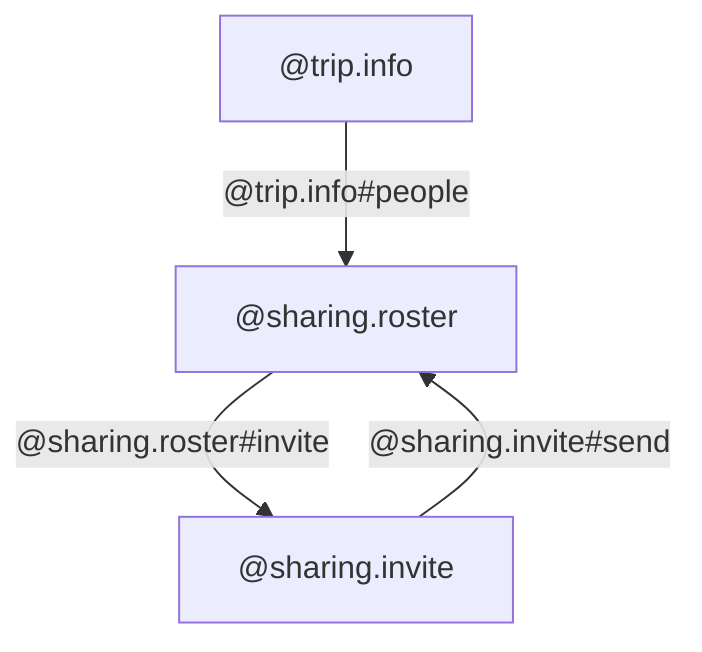

Platforms rarely ship a change on the same day. Starboard records where
each screen has shipped, so the reference can say "on iOS and the web, not
yet on Android" and lint can hold every flow to it. This guide follows one
screen in `examples/travel-app`: inviting someone to a trip by email,
`sharing.invite`, which iOS and the web have and Android does not.

## A screen shipped on some platforms

The screen's `status` is a mapping from platform to status:

```yaml
  sharing.invite:
    title: Invite someone
    area: sharing
    purpose: Send an invitation to the trip by email.
    presentation: sheet
    status:
      ios: shipped
      android: proposed
      web: shipped
    files:
      ios: [src/ios/Screens/Sharing/InviteView.swift]
      android: [src/android/InviteScreen.kt]
      web: [src/web/components/InviteSheet.svelte]
```

The Android file is named already, but does not exist yet. That is allowed:
a screen's files are only checked on the platforms where it has shipped
([file-missing](../../rules/file-missing/)). The generated catalog shows
the mapping: `Status: ios: shipped, android: proposed, web: shipped`.

A platform the mapping leaves out counts as `shipped`, so list every
platform while they differ.

## Flows across platforms

The travel app's flow `invite-a-traveller` goes through `sharing.invite`,
and is `proposed`. Marking it `shipped` as it stands claims it works on
every platform, Android included, so lint refuses:

<!-- verified-file: examples/travel-app docs/flows/flows/invite-a-traveller.md -->
````markdown
---
id: invite-a-traveller
title: Invite a traveller
status: shipped
actors: [organizer]
entry: trip.info
---

**Goal:** bring someone onto the trip by email, with the role they need.



## Steps

1. Tap @trip.info#people to open @sharing.roster.
2. Tap @sharing.roster#invite.
   - Without the manageMembers capability, the button is hidden.
3. Type their address in @sharing.invite#email.
4. Choose what they may do in @sharing.invite#role.
5. Tap @sharing.invite#send; they appear in @sharing.roster#people as
   invited.

## Platform adaptations

- **android:** @sharing.invite is proposed; until it ships, organizers on
  Android share the join code from @trip.info#join-code instead.
````

<!-- verified: examples/travel-app exit 1 -->
```bash
starboard lint
```

<!-- output -->
```text
docs/flows/flows/invite-a-traveller.md:14: error shipped-flow-proposed-ref: shipped flow references @sharing.invite, which is proposed on android
docs/flows/flows/invite-a-traveller.md:15: error shipped-flow-proposed-ref: shipped flow references @sharing.invite#send, which is proposed on android
docs/flows/flows/invite-a-traveller.md:23: error shipped-flow-proposed-ref: shipped flow references @sharing.invite#email, which is proposed on android
docs/flows/flows/invite-a-traveller.md:24: error shipped-flow-proposed-ref: shipped flow references @sharing.invite#role, which is proposed on android
docs/flows/flows/invite-a-traveller.md:25: error shipped-flow-proposed-ref: shipped flow references @sharing.invite#send, which is proposed on android
docs/flows/flows/invite-a-traveller.md:30: error shipped-flow-proposed-ref: shipped flow references @sharing.invite, which is proposed on android
6 errors, 0 warnings
```

There are two honest ways to write it:

- Keep the flow `proposed` until every platform has shipped it. This is the
  right choice while the flow itself is still being decided.
- Mark it `shipped` on the platforms that have it, with `platforms` in its
  front matter. Lint then checks it only on those, and the **Platform
  adaptations** section tells readers what Android does instead:

<!-- verified-file: examples/travel-app docs/flows/flows/invite-a-traveller.md -->
````markdown
---
id: invite-a-traveller
title: Invite a traveller
status: shipped
actors: [organizer]
entry: trip.info
platforms: [ios, web]
---

**Goal:** bring someone onto the trip by email, with the role they need.


## Steps

1. Tap @trip.info#people to open @sharing.roster.
2. Tap @sharing.roster#invite.
   - Without the manageMembers capability, the button is hidden.
3. Type their address in @sharing.invite#email.
4. Choose what they may do in @sharing.invite#role.
5. Tap @sharing.invite#send; they appear in @sharing.roster#people as
   invited.

## Platform adaptations

- **android:** @sharing.invite is proposed; until it ships, organizers on
  Android share the join code from @trip.info#join-code instead.
````

<!-- verified: examples/travel-app -->
```bash
starboard lint
```

<!-- output -->
```text
0 errors, 0 warnings
```

## Shipping on the last platform

When the Android screen is built, the same pull request:

1. adds `src/android/InviteScreen.kt`, the file the screen already names;
2. changes the screen's status to `android: shipped`, or, now that every
   platform agrees, back to a single `status: shipped`, or removes it,
   since `shipped` is the default;
3. removes the flow's `platforms`, so the flow is checked everywhere again,
   and its Android adaptation, which no longer applies;
4. runs `starboard lint --fix`, so the catalog shows the new status.

Lint confirms each step: the file must exist once Android is `shipped`, and
the flow must be true on Android once it applies there.

## Regions and navigation items

A screen that has shipped can carry a proposed part. A region or an entry
of a `tabs`, `nav` or `menu` takes `status: proposed`:

```yaml
      - {region: packing, kind: action, label: Packing list, to: trip.packing, status: proposed}
```

A region's status is one value, not a mapping: a region proposed on a
screen is proposed on every platform that screen is on. When one platform
will build it first, say so in the platform adaptations of the flows that
use it. See
[Status](../../concepts/status/) for the full rules.
