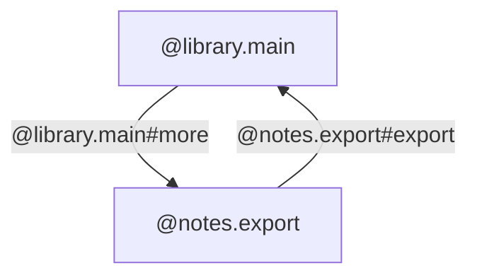

A flow is a Markdown file in `flows/` under the content root:
`docs/flows/flows/<id>.md`. [Flows](../../concepts/flows/) explains what
flows are for; this page is the format.

## Front matter

The file starts with YAML front matter between two `---` lines
([flow-frontmatter-invalid](../../rules/flow-frontmatter-invalid/)):

```yaml
---
id: export-a-note
title: Export a note
status: shipped
actors: [writer]
entry: library.main
platforms: [macos, windows]
---
```

| Key | Required | Value |
| --- | --- | --- |
| `id` | yes | Lowercase letters, digits and hyphens, starting with a letter. It must be the file's name without `.md` ([flow-id-mismatch](../../rules/flow-id-mismatch/)). |
| `title` | yes | The flow's name for people. |
| `status` | yes | `shipped` or `proposed`. A shipped flow may not refer to anything proposed on its platforms ([shipped-flow-proposed-ref](../../rules/shipped-flow-proposed-ref/)). |
| `actors` | no | Who does it, as a list: `[traveller]`, `[organizer, traveller]`. |
| `entry` | yes | The ID of the screen the flow starts on ([ref-unresolved](../../rules/ref-unresolved/)). A flow's entry screen counts as reachable for [unreachable-screen](../../rules/unreachable-screen/). |
| `platforms` | no | The platforms the flow applies to. Default: every configured platform. |

`starboard fmt` writes the keys in the order above and removes trailing
whitespace from the file; it leaves the Markdown and the diagram as they
are. Anchors and aliases are not allowed
([yaml-alias-not-allowed](../../rules/yaml-alias-not-allowed/)).

## References

Anywhere in the body, `@screen.id` refers to a screen and
`@screen.id#region` to a region of it: `@trip.timeline`,
`@trip.timeline#add-activity`. The screen must be registered, and the
region must be in one of its layouts
([ref-unresolved](../../rules/ref-unresolved/)). An `@` directly after a
letter, a digit, `_`, `@` or `.` does not start a reference, so e-mail
addresses are left alone.

## Body

The body is ordinary Markdown. Starboard reads these parts of it:

**Goal.** A paragraph, by convention starting `**Goal:**`, saying what the
person wants. It is for readers; Starboard does not check it.

**The diagram.** A fenced `mermaid` block holding a flowchart. Screen nodes
are references in quotes, and edge labels can be region references:



References in the diagram are checked like any other.
[flow-ref-not-in-diagram](../../rules/flow-ref-not-in-diagram/) warns when
the text refers to a screen the diagram leaves out.

**Steps.** The first numbered list after a heading named `Steps` (any
level, any case). Each item is one step, numbered in order whatever number
the Markdown gives it. The step's first reference is where it happens,
which the web app's walk-through shows;
[step-without-ref](../../rules/step-without-ref/) warns about a step
without one. A step's nested bullets are its branches. The list ends at the
next heading, an unindented bullet, or an unindented line after a blank
line.

```markdown
## Steps

1. Select the note in @library.main#notes.
2. Choose Export from @library.main#more.
3. Choose a format in @notes.export#format and a place in
   @notes.export#location.
4. Tap @notes.export#export.
```

**Platform adaptations.** By convention, a `## Platform adaptations`
section lists how the flow differs on a platform, one bullet each:

```markdown
## Platform adaptations

- **web:** @notes.export is proposed; the web app cannot export yet.
```

Starboard checks its references like any others and reads nothing else from
it.

These examples are `examples/desktop-notes/docs/flows/flows/export-a-note.md`.
