`screens.yaml`, in the content root (`docs/flows/` by default), is the
**registry**: every screen, its layout, and the screen files deliberately
left out. Its JSON Schema is
`https://starboard.c65llc.com/schema/v1/screens.json` (see
[JSON Schemas](../schemas/)); a problem with it is reported as
[schema-invalid](../../rules/schema-invalid/), or under a more specific
rule named below.

From `examples/desktop-notes`:

```yaml
screens:
  library.main:
    title: Library
    # ...
unmapped:
  - path: src/macos/Notes/QuickLookWindow.swift
    reason: a floating preview of the note selected in library.main#notes, not a screen
```

| Key | Value |
| --- | --- |
| `screens` | The screens, keyed by screen ID. |
| `unmapped` | Files that match a platform's `screenFiles` but are deliberately not screens, each with a `path` and a `reason`. A file listed here must not also be claimed by a screen ([unmapped-and-claimed](../../rules/unmapped-and-claimed/)). |

`starboard fmt` sorts screens by their area's place in `areas`, then by ID,
and writes each field in the order of the tables below.

## Screens

A screen ID is two or more dot-separated parts, each of lowercase letters,
digits and hyphens starting with a letter: `trip.timeline`,
`auth.sign-in` ([id-invalid](../../rules/id-invalid/),
[duplicate-screen](../../rules/duplicate-screen/)).

| Field | Required | Value |
| --- | --- | --- |
| `title` | yes | The screen's name for people. |
| `area` | yes | One of `areas` in `starboard.yaml` ([unknown-area](../../rules/unknown-area/)). |
| `purpose` | no | One sentence on what the screen is for ([missing-purpose](../../rules/missing-purpose/) warns without it). |
| `presentation` | yes | `root`, `push`, `tab`, `sheet`, `dialog`, `window` or `route` ([unknown-presentation](../../rules/unknown-presentation/)). |
| `status` | no | `shipped` (the default) or `proposed`, or a mapping of platform to either. See [Status](../../concepts/status/). |
| `platforms` | no | The platforms the screen is on. Default: every configured platform ([unknown-platform](../../rules/unknown-platform/)). |
| `platformNote` | with a `platforms` subset | Why the screen is not on every platform ([platform-note-missing](../../rules/platform-note-missing/)). |
| `states` | no | Names of the states the screen can be in, such as `empty` or `read-only`, for readers. Starboard does not check them. |
| `files` | no | Per platform, the source files that implement the screen: exact paths from the project root, not patterns. Each must exist unless the screen is proposed on that platform ([file-missing](../../rules/file-missing/)). Two screens may claim the same file. |
| `screenshots` | no | Per platform, one screenshot: an exact path from the project root ([screenshot-missing](../../rules/screenshot-missing/)). The catalog shows it beside the wireframes. |
| `layout` | no | The default layout: a list of regions. |
| `layouts` | no | Layouts for particular form factors, keyed by form factor. Each replaces the whole default layout for that form factor ([unknown-form-factor](../../rules/unknown-form-factor/)). |

A screen whose `presentation` is `sheet` or `dialog` is drawn over a dimmed
generic screen, and a `window` gets window chrome.

## Regions

Each entry of `layout`, of a `layouts` override, of a container's
`children` and a list's `item` is a region:

| Field | Value |
| --- | --- |
| `region` | The region's name: lowercase letters, digits and hyphens, starting with a letter. Required everywhere except on a list's `item`. Unique within one layout tree, `item`s included ([duplicate-region](../../rules/duplicate-region/)). |
| `kind` | Required. One of the [kinds below](#kinds) ([unknown-kind](../../rules/unknown-kind/)). |
| `label` | What the content is, not its final copy. Without one, the wireframe shows the name. [label-too-long](../../rules/label-too-long/) warns past 40 characters. |
| `to` | The ID of the screen it links to (a screen, never `screen#region`). It must be registered ([edge-unresolved](../../rules/edge-unresolved/)) and share a platform with this screen, unless this region has a `platformNote` ([edge-platform-mismatch](../../rules/edge-platform-mismatch/)). |
| `requires` | One name for what a person must be allowed to do to see or use the region. Checked against the `requires` vocabulary when there is one ([vocabulary-unknown](../../rules/vocabulary-unknown/)). |
| `status` | `shipped` or `proposed`. A proposed region on a shipped screen proposes a change; a shipped region on a proposed screen is an error ([status-conflict](../../rules/status-conflict/)). |
| `platformNote` | Why this region links to a screen on other platforms. |
| `width` | For a child of a `row`: pixels (`220`) or a fraction of the row (`1/3`). |
| `children` | Containers only: the regions inside, a list of regions. |
| `item` | `list` only: the one region each row is drawn as. |
| `empty` | `list` only: the empty state, `{label: …}`. |
| `items` | `tabs`, `nav` and `menu` only: the entries. |

Each entry of `items` has a `label` (required), and may have `to`,
`requires` and `status`, which mean what they mean on a region.

Every `to`, including those in `item` and `items`, is a link in the
[app map](../../concepts/map-vs-flows/).

A `layouts` override uses the same region names as the default layout for
the same parts of the screen, so a flow's `@screen#region` reference holds
on every form factor. [edge-parity](../../rules/edge-parity/) warns when an
override drops a link the default layout has. See
[Desktop and web layouts](../../guides/desktop-and-web/).

## Kinds

Each kind below shows a layout and the wireframe `starboard render` draws
from it, in a small 360 × 320 frame. In a full screen, the regions of a
layout stack top to bottom: a `bar` first in the layout pins to the top of
the frame, `tabs` last pins to the bottom, and `list`, `form` and the
containers share the height that is left. Region names appear in small
monospace at the top right, a `requires` shows a lock and its name, and a
`proposed` region is dashed. What does not fit is clipped, with a marker.

### `column`

A container that stacks its `children` top to bottom.

```yaml
- region: details
  kind: column
  children:
    - {region: title, kind: header, label: Activity name}
    - {region: when, kind: text, label: Day and time}
    - {region: notes, kind: text, label: Notes}
```

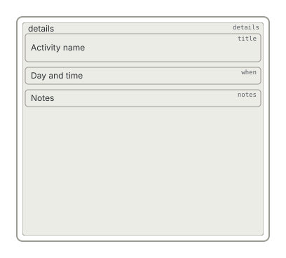

### `row`

A container that sets its `children` side by side. A child's `width` is
pixels or a fraction of the row; children without one share the rest
equally.

```yaml
- region: shell
  kind: row
  children:
    - {region: when, kind: text, label: Day and time, width: 1/3}
    - {region: where, kind: map, label: Place}
```

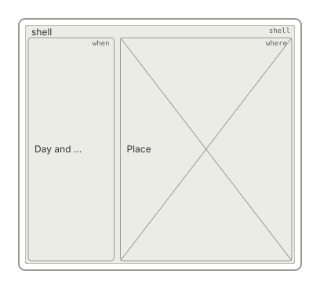

### `section`

A container that groups related regions under one name, stacked like a
`column`.

```yaml
- region: credentials
  kind: section
  children:
    - {region: email, kind: field, label: Email address}
    - {region: password, kind: field, label: Password}
```

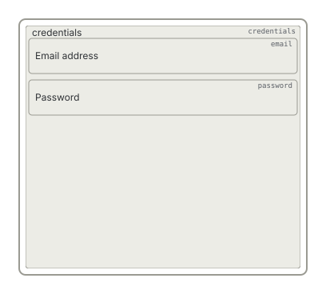

### `bar`

A container for a toolbar or app bar: its `children` sit side by side. A
`bar` first in a layout pins to the top of the frame.

```yaml
- region: app-bar
  kind: bar
  children:
    - {region: title, kind: header, label: Trip name · dates}
    - {region: info, kind: action, label: Info, requires: viewTrip}
```

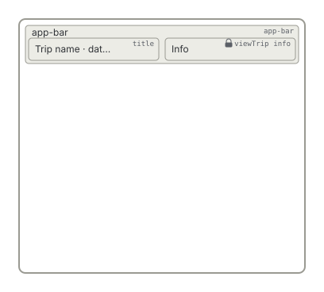

### `tabs`

A tab bar: its `items` side by side. `tabs` last in a layout pins to the
bottom of the frame.

```yaml
- {region: title, kind: header, label: Checklist}
- region: tabs
  kind: tabs
  items:
    - {label: Timeline}
    - {label: Checklist}
    - {label: Inbox}
    - {label: Map}
```

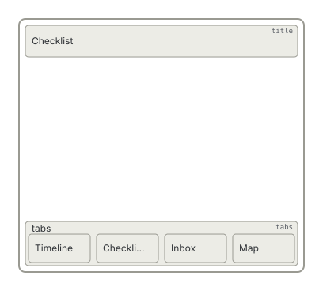

### `nav`

A sidebar: its `items` stacked top to bottom. On a wide layout it is
usually the first child of a `row`.

```yaml
- region: notebooks
  kind: nav
  items:
    - {label: All notes}
    - {label: Pinned}
    - {label: Trash}
```

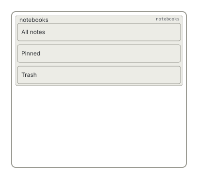

### `menu`

A menu, or a set of choices such as a picker: its `items` in a row.

```yaml
- region: category
  kind: menu
  items:
    - {label: Food}
    - {label: Sight}
    - {label: Travel}
```

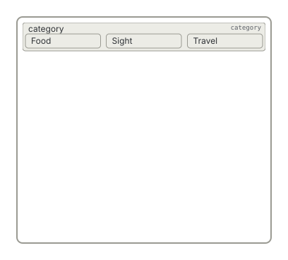

### `header`

A heading or title.

```yaml
- {region: title, kind: header, label: Trip name · dates}
```

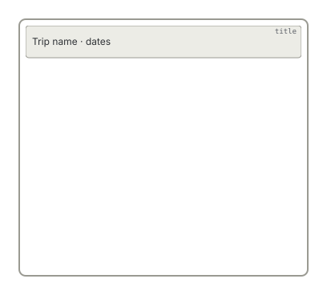

### `text`

A line or paragraph of text.

```yaml
- {region: summary, kind: text, label: Dates · places · nights}
```

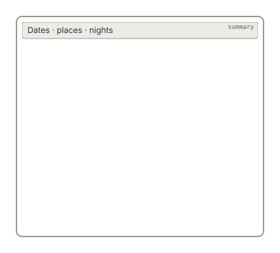

### `list`

A list of rows. Its `item` is drawn three times; its `empty` label is the
list's empty state.

```yaml
- region: days
  kind: list
  item: {kind: card, label: Time · activity · who is going}
  empty:
    label: No activities yet
```

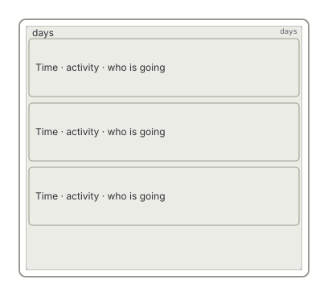

### `card`

One card: a self-contained summary, often a list's `item`.

```yaml
- {region: next-trip, kind: card, label: Trip · dates · people}
```

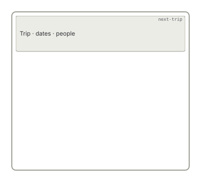

### `media`

An image or video, drawn as a crossed box.

```yaml
- {region: hero, kind: media, label: Illustration of a map and a suitcase}
```

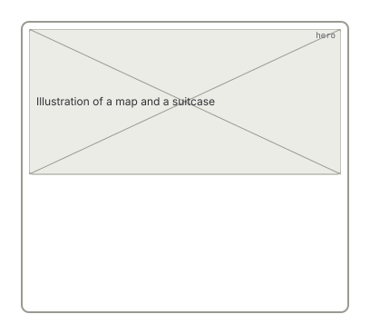

### `map`

A map, drawn as a crossed box taller than `media`.

```yaml
- {region: map, kind: map, label: Activities on the map}
```

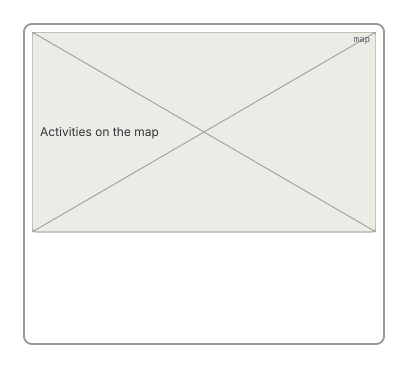

### `banner`

A message across the screen, such as a warning or a notice.

```yaml
- {region: offline, kind: banner, label: Offline · changes sync later}
```

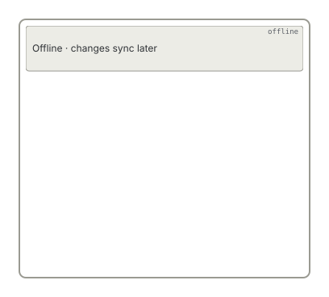

### `form`

A form, drawn as one box, when its fields need no names of their own. Use a
`section` of `field`s when they do.

```yaml
- {region: details, kind: form, label: Name · email · password}
```

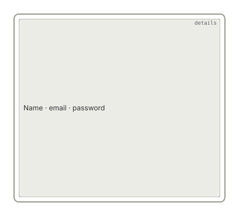

### `field`

One input: a text field, a picker or a toggle.

```yaml
- {region: email, kind: field, label: Email address}
```

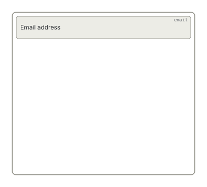

### `action`

A button or link.

```yaml
- {region: packing, kind: action, label: Packing list, status: proposed}
```

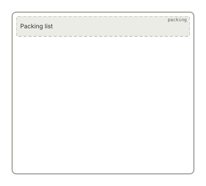

### `primary-action`

The screen's main action, drawn darker than an `action`.

```yaml
- {region: add-activity, kind: primary-action, label: Add activity, requires: editLogistics}
```

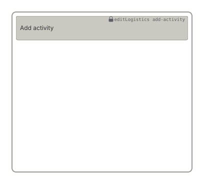
