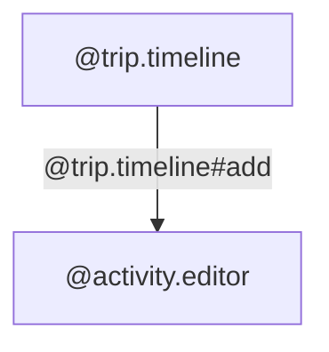
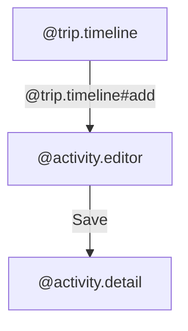

## What it catches

In a flow with a Mermaid diagram (a fenced code block tagged `mermaid`), an
`@` reference outside the diagram to a screen that no reference inside the
diagram names.
A reference to a region counts as its screen: `@trip.timeline#add` in the
diagram covers `@trip.timeline` in the steps. Each missing screen is reported
once, at its first reference. A flow with no diagram is not checked.

## Why it matters

The diagram is the flow at a glance. A screen the steps visit but the
diagram leaves out makes the two tell different stories, and a reader who
trusts the picture misses a step.

## How to fix

Add the screen to the diagram as a node, written as its reference, such as
`C["@activity.detail"]`, with the edges that lead to and from it. If the
step does not really go to that screen, correct the reference.

## Example

The timeline opens the editor, which saves to the activity:

<!-- given: docs/flows/screens.yaml -->
```yaml
screens:
  trip.timeline:
    title: Timeline
    area: trip
    presentation: root
    layout:
      - {region: add, kind: primary-action, label: Add activity, to: activity.editor}
  activity.detail:
    title: Activity
    area: activity
    presentation: push
  activity.editor:
    title: Edit activity
    area: activity
    presentation: sheet
    layout:
      - {region: save, kind: primary-action, label: Save, to: activity.detail}
```

The steps end on the activity's detail screen, which the diagram does not
show:

<!-- example: docs/flows/flows/add-activity.md -->
````markdown
---
id: add-activity
title: Add an activity
status: proposed
entry: trip.timeline
---



## Steps

1. Tap @trip.timeline#add.
2. Fill in @activity.editor and save.
3. Review it on @activity.detail.
````

<!-- fixed: docs/flows/flows/add-activity.md -->
````markdown
---
id: add-activity
title: Add an activity
status: proposed
entry: trip.timeline
---



## Steps

1. Tap @trip.timeline#add.
2. Fill in @activity.editor and save.
3. Review it on @activity.detail.
````

## Configuration

`flow-ref-not-in-diagram` is a quality rule. Its default severity is `warn`: lint reports it,
and `starboard lint` still passes unless you run it with `--strict`. Change
its severity under `lint.rules` in `starboard.yaml` to `error`, `warn` or
`off`:

```yaml
lint:
  rules:
    flow-ref-not-in-diagram: error
```
