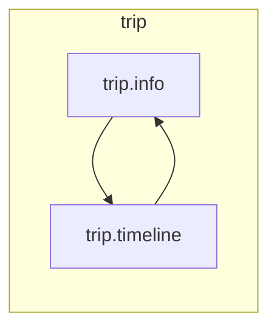
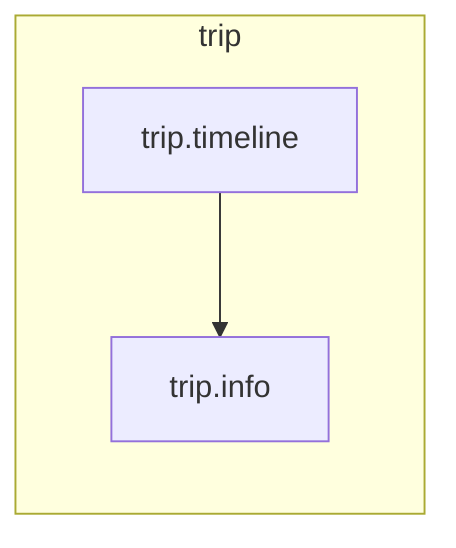

## What it catches

A file `starboard generate` writes under `<content>/generated/` that does not
match what it would write now:

- out of date: its bytes differ from the freshly generated ones, because a
  source changed or the file was edited by hand;
- missing: it would be generated but does not exist;
- no longer generated: it is one of Starboard's (such as the wireframe of a
  screen that was removed) but would not be written now.

Starboard owns exactly `generated/app-map.md`, `generated/screens.md` and the
`.svg` files directly in `generated/wireframes/`. Any other file under
`generated/` is left alone and never reported. Freshness is checked only when
the project loads without errors.

## Why it matters

The generated pages are what most people read: the app map, the screen
catalog and the wireframes. When they lag behind `screens.yaml` and the
flows, readers see an app that no longer exists, and a review of a change
shows the source edit without its effect. Hand edits are lost the next time
anyone generates. This is a correctness rule: it is always an error.

## How to fix

Run `starboard generate`, or `starboard lint --fix`, which also formats the
sources, and commit the result with the change that caused it. To change
what a generated page says, change the source it is generated from.

## Example

`screens.yaml` has a timeline that links to a trip info sheet. Someone added
the way back to the app map by hand:

````markdown
<!-- Generated by starboard. Do not edit. -->

# App map


````

The map shows only the links in `screens.yaml`. Add the link to the sheet's
layout, with a `to: trip.timeline`, and run `starboard generate`; or, if
there is no such link, regenerate to drop the hand edit:

````markdown
<!-- Generated by starboard. Do not edit. -->

# App map


````
