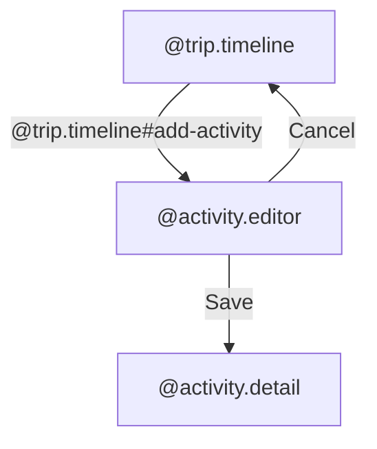

# Starboard — design

Date: 2026-11-26
Status: draft for approval
Repository: `github.com/c65llc/starboard` (to be created; public; AGPL-3.0-only)

## Intent

Teams that ship one product on several platforms (iOS, Android, web, desktop)
lack a single canonical description of **how a person moves through the
product and how each screen is laid out** that every platform adapts. What
usually happens instead: one platform's code becomes the de facto reference and
the others re-derive behaviour from it. Away Team, the first adopter, works this
way today. Its Android port audits against the Swift source.

Design tools (Figma, FigJam) can hold such a reference, but agents cannot
reliably read or edit them, changes cannot be reviewed in a PR, and the
reference lives apart from the code and drifts.

**Starboard** is an open-source CLI that makes that reference **plain text in
each project's repo**:

- a **screen registry** (stable IDs, layout regions, the source files on each
  platform)
- **flow documents** (Mermaid diagrams plus prose that refer to screens by ID)
- **generated grey-box wireframes**, an app map and a screen catalog
- a **drift check** for CI that fails when the reference and the code disagree
  in ways a machine can see

It serves two roles at once:

- **Leading:** edit the reference, marked `proposed`, to drive an agent pass
  that implements it on each platform.
- **Following:** the check keeps the reference truthful about shipped code.

It is designed to be edited **by agents and code first**, with humans reading
the rendered output on GitHub.

The owner's decisions: its own repo, reused across several projects including
desktop and web; Go; open source under AGPL from day one in the C65 LLC org; a
detailed marketing site from day one, like `c65llc/coding-standards`; named
Starboard.

## Goals

1. A single static binary (`starboard`) for macOS, Linux and Windows, needing no
   runtime. Some adopting projects have no Node.
2. Works for any mix of platforms and form factors: phone, tablet, desktop
   window, and web at several widths. Each project configures its own.
3. Grey-box wireframes generated deterministically from layout data, including
   multi-column desktop and web layouts.
4. A drift check usable in any CI, with readable text output and `--json` output
   for agents.
5. A GitHub Action that installs a pinned, checksum-verified release, so
   adoption is one step.
6. Published JSON Schemas for the config and registry files, so editors and
   agents get validation and completion.
7. A detailed marketing and documentation site at launch, whose examples are
   produced by Starboard itself.
8. Away Team adopts it as the first real project. That adoption is a separate PR
   in that repo, outside this design.
9. **A formatter and a linter from day one** (`starboard fmt`, `starboard lint`).
   Every file has one canonical form, and every problem has a stable rule ID, so
   AI agents and people can co-edit the reference and converge.
10. **A PWA viewer and editor** that works on local files with no server backend.
11. **AI agent skills** that ship in the first release: a Starboard skill for
    Claude Code and equivalents for the other agents coding-standards supports.
12. **Built for later clients.** A Tauri desktop app (Windows, macOS) and a
    VS Code extension come later. They are not in v1, but nothing in v1 may
    block them (see Architecture).

## Non-goals

- Visual styling, colour, typography and final copy. Wireframes show structure
  and hierarchy only. Each platform's design system owns the look.
- Enumerating every state of every screen. Only states that change layout are
  named.
- A hosted service or any server backend. The PWA is static files and works
  on the user's local folder.
- The Tauri app, the VS Code extension and a language server (`starboard lsp`)
  in v1. They are planned, and the architecture keeps them cheap.
- A general Markdown formatter. `fmt` normalises flow front matter and
  whitespace only. *(amended 2026-11-26: `@` references are not normalised by
  `fmt` in v0.x; they are checked by lint.)*
- Two-way sync with Figma or any design tool.
- Parsing platform source code to infer screens or layout. The check works on
  file existence and naming patterns, not ASTs.
- Package managers beyond GitHub Releases and the Action at launch: Homebrew,
  Scoop, `go install` (the last works anyway, as a side effect).

## Anti-goals (failure even if it "works")

- A reference that silently drifts from the code.
- Tooling heavier than the content: a schema so strict that adding a screen takes
  an hour, or a renderer nobody dares touch.
- Project-specific knowledge baked into the tool. Away Team's capabilities,
  directory layout and screen names live in Away Team's config, never in
  Starboard.
- Domain rules restated in the reference. A region can *name* the permission
  that gates it. Explaining the rule belongs to the project's own source of
  truth.
- Non-deterministic output: timestamps, map-order iteration, locale-dependent
  formatting. These break the freshness check and produce noisy diffs.

## Constraints

- Go, following `c65llc/coding-standards`: the Go standard (lang-12: Go
  modules, `gofmt`/`goimports`, `golangci-lint` with warnings as errors,
  `go vet`), its CI gate, definition of done, release drafter and changelog
  conventions, and its community files (CONTRIBUTING, CODE_OF_CONDUCT,
  SECURITY). Adopt them the way coding-standards' own installer sets up a
  project.
- License: AGPL-3.0-only. The `LICENSE` file, SPDX headers in source files, and
  the README badge are in the first commit.
- Minimal dependencies: the Go standard library plus a YAML parser, and a JSON
  Schema validator only if hand-written validation proves insufficient.
- Dependency age: new or upgraded dependencies must be at least 3 days old (the
  owner's convention across projects).
- CI runs on `ubuntu-latest`. Release builds cross-compile from Linux. No macOS
  runner is needed.
- Conventional Commits, PRs into `main`, linear history.

## Approaches considered

- **Format.** Markdown plus Mermaid only: nothing catches drift. Everything as
  structured data with every page generated: nobody edits a flow directly.
  **Chosen:** a structured registry plus hand-written flow Markdown, with
  generated wireframes and catalog, and a drift check.
- **Wireframes.** Hand-drawn text boxes are not checked. Hand-written SVG gets
  edited blind by agents. **Chosen:** layout as a region tree in the registry,
  rendered to SVG.
- **Language.** Rust fit Away Team's toolchain. TypeScript compiled with Bun or
  Deno gives 60–90 MB binaries. **Owner chose Go:** trivial cross-compiling,
  small static binaries, and an existing coding-standards entry.

## Design

### Concepts

- **Project.** One repo that adopts Starboard, configured by `starboard.yaml`
  at its root.
- **Platform.** A named implementation target (`ios`, `android`, `web`,
  `macos`, `windows`, …). Each has source roots, the file patterns that count as
  screens, and the form factors it renders at.
- **Form factor.** A named frame size for wireframes (`phone` 390×844,
  `tablet` 820×1180, `desktop` 1280×800, `web-narrow` 390×844, `web-wide`
  1440×900). Starboard ships these defaults and projects may add or override
  them.
- **Screen.** Anything with its own layout that a person navigates to (a pushed
  view, tab, sheet, window, route or dialog with meaningful content). It has a
  stable dotted ID such as `trip.timeline`.
- **Region.** A named part of a screen's layout (`trip.timeline#add-activity`).
- **Flow.** A Markdown document describing one thing a person does, with a
  Mermaid diagram and steps that refer to screens and regions.
- **Status.** `shipped` or `proposed`, per screen, region or flow, optionally
  per platform.

### Project files

```
starboard.yaml                    # project config (root of the adopting repo)
docs/flows/                       # content root (configurable)
  README.md                       # written by `starboard init`; how to read and change the reference
  screens.yaml                    # the registry
  flows/<flow-id>.md              # hand-written flows
  generated/                      # written by `starboard generate`; never hand-edited
    app-map.md                    # Mermaid map of all navigation edges (per area when large)
    screens.md                    # catalog: wireframes, files, screenshots, edges, flows using each screen
    wireframes/<screen-id>.<form-factor>.svg
```

*(amended 2026-11-26)* Starboard owns only these outputs: exactly
`generated/app-map.md`, `generated/screens.md`, and `generated/wireframes/<name>.svg`
directly in `wireframes/`. Any other file under `generated/` is ignored
entirely: `generate`, `lint --fix` and `generated-stale` never report or remove
it, so a content root of `.` can share `generated/` with other tools. An owned
file that is no longer generated (such as the wireframe of a removed screen) is
reported and removed.

### `starboard.yaml`

```yaml
version: 1
content: docs/flows
platforms:
  ios:
    formFactors: [phone]
    roots: [shells/apple/AwayTeam/Sources/Screens]
    screenFiles: ["**/*View.swift"]       # files that must be claimed by a screen (reverse coverage)
  android:
    formFactors: [phone]
    roots: [shells/android/app/src/main/java/com/awayteam/android]
    screenFiles: ["*Screen.kt"]
  web:
    formFactors: [web-narrow, web-wide]
    roots: [apps/web/src/routes]
    screenFiles: ["**/+page.svelte"]
formFactors:                              # optional overrides and additions
  phone: { width: 390, height: 844 }
vocabularies:                             # optional: validate a registry field against a list kept in the project
  requires:
    file: core/vectors/v2/capabilities.json
    select: ".capabilities[].name"         # a small, documented selector syntax; not full jq
areas: [auth, home, trip, activity, people, sharing, inbox, settings, system, import]
```

`vocabularies` is the generic mechanism that replaces anything project-specific.
Away Team points `requires` at its Rust-generated capability list. Other
projects can validate any string field, or nothing.

### The registry: `screens.yaml`

```yaml
screens:
  trip.timeline:
    title: Timeline
    area: trip
    purpose: The trip's days in order with each day's activities; the trip's default tab.
    presentation: tab          # root | push | tab | sheet | dialog | window | route
    status: shipped            # or per platform: { ios: shipped, android: proposed }
    platforms: [ios, android]  # default: every configured platform; a subset needs platformNote
    states: [empty, ended, read-only]
    files:
      ios: [shells/apple/AwayTeam/Sources/Screens/Timeline/TimelineView.swift]
      android: [shells/android/app/src/main/java/com/awayteam/android/TimelineScreen.kt]
    screenshots:
      android: shells/android/app/src/androidTest/assets/goldens/arm64-v8a/signature-light/timeline.png
    layout:                    # default layout, used by every form factor without an override
      - region: app-bar
        kind: bar
        children:
          - { region: title, kind: text, label: Trip name · dates }
          - { region: info, kind: action, label: Info, to: trip.info }
      - { region: day-heading, kind: header, label: Day · place · weather }
      - region: activities
        kind: list
        item: { kind: card, label: Time · activity · attendance, to: activity.detail }
        empty: { label: No activities yet }
      - { region: add-activity, kind: primary-action, label: Add activity, to: activity.editor, requires: editLogistics }
      - region: tabs
        kind: tabs
        items:
          - { label: Timeline, to: trip.timeline }
          - { label: Checklist, to: trip.checklist }
    layouts:                   # optional per-form-factor overrides (whole-tree replacement)
      web-wide:
        - region: shell
          kind: row
          children:
            - { region: tabs, kind: nav, width: 240, items: [...] }
            - region: main
              kind: column
              children: [ ... ]
unmapped:                      # screen-pattern files deliberately not registered, each with a reason
  - { path: shells/apple/AwayTeam/Sources/Screens/Timeline/LensPickerView.swift, reason: control inside trip.timeline#app-bar }
```

**Region kinds** form a small fixed vocabulary the renderer knows:

- containers: `column`, `row`, `section`, `bar`
- navigation: `tabs`, `nav` (sidebar), `menu`
- content: `header`, `text`, `list`, `card`, `media`, `map`, `banner`, `form`,
  `field`
- actions: `action`, `primary-action`

**Region fields:** `region` (unique per screen and layout), `kind`, `label`
(what the content is, not final copy), `to` (a target screen ID), `requires`,
`status`, `platformNote`, `width` (pixels or a fraction, for `row` children),
`children`, `item`, `empty`, `items`.

**Overrides.** Overrides replace the whole layout tree for one form factor.
Region names are shared across layouts: the same `region` name in two layouts
means the same thing, so `@trip.timeline#tabs` resolves whether it is a bottom
tab bar on a phone or a sidebar on the web.

### Format rules (settled during review; my calls unless noted)

These pin the grammar the JSON Schemas, checks and renderer share.

- **Region node.** Every region node is
  `{ region, kind, label?, to?, requires?, status?, platformNote?, width?, children?, item?, empty?, items? }`.
  - `region` is required on every node except list `item`s, `empty` and
    `items` entries, where it is optional.
  - `children` is allowed only on containers (`column`, `row`, `section`,
    `bar`).
  - `item` (a single region node) and `empty` (`{ label }`) are allowed only
    on `list`.
  - `items` (a list of `{ label, to?, requires?, status? }`) is allowed only on
    `tabs`, `nav` and `menu`.
- **Region name uniqueness.** Names are unique within one layout tree,
  including `item` subtrees. The same name across the default layout and an
  override denotes the same region.
- **`to`.** The value is a screen ID only, not `screen#region`. It may appear on
  any node and on `items` entries. It must resolve to a registered screen. If
  that screen is not on one of the current screen's platforms, that is an error
  unless the source node has a `platformNote`.
- **`requires`.** A single string. It is optional even when a vocabulary is
  configured, and validated only when present.
- **`width`.** A positive integer (pixels) or a string fraction such as
  `"1/3"`. It is meaningful only on children of a `row`.
- **Edges.** Edges are every `to` in a layout tree, including inside `item` and
  `items`. Edge parity (check 8) compares the set of `(screen, target)` pairs
  between the default layout and each override.
- **Status resolution.** For a given platform, effective status =
  `proposed` if the screen's status for that platform is `proposed`, otherwise
  the region's own status, defaulting to `shipped`.
  - A `proposed` region on a `shipped` screen is allowed. It is the usual way to
    propose a change.
  - A region that says `shipped` under a `proposed` screen is an error.
  - Check 3 uses the screen's status for the platform. Check 6 uses effective
    status on each of the flow's platforms.
- **Globs.** `roots` are repo-relative directories. `screenFiles` patterns are
  matched relative to each root, using `doublestar` semantics, so `**` spans
  directories and `*` does not. `*Screen.kt` therefore matches only the root's
  own directory. `files` and `screenshots` entries are exact repo-relative
  paths, not globs.
  - A file claimed by two screens is allowed. This is common for shared editors.
  - A file both claimed and in `unmapped` is an error.
  - A platform without `screenFiles` has no reverse coverage.
  - *(This relaxes "stdlib plus YAML only" to allow one small glob library,
    `github.com/bmatcuk/doublestar`.)*
- **Paths** are always written and compared with `/`, on every OS.
- **Wireframe set.** A screen gets one SVG per form factor in the union of its
  platforms' `formFactors`. A form factor with an override uses it, and all
  others use `layout`. Geometry for `sheet`, `dialog`, `window`, `menu` and
  `field` is the builder's call within the renderer rules below.
- **Generated Markdown is byte-pinned.**
  - LF line endings on every OS, and the init command writes a
    `.gitattributes` entry (`docs/flows/generated/** -text`) so autocrlf cannot
    break freshness.
  - *(amended 2026-11-26)* Windows line endings: `init` writes, before that
    entry, `starboard.yaml text eol=lf` and `docs/flows/** text eol=lf`, so
    sources are checked out LF even with `core.autocrlf=true`; the generated
    entry comes last, so it wins for generated files. Each line is appended
    only if missing (the generated line is appended again when the content line
    is added after it). Independently, `fmt --check` and the `not-formatted`
    rule treat a file whose only difference from its canonical form is CRLF
    instead of LF line endings as formatted; `fmt` never rewrites such a file,
    and any file it does write has LF endings.
  - Screens are sorted by area order from config, then by ID. Edges are sorted
    by source, then target.
  - Mermaid node IDs are the screen ID with `.` and `-` replaced by `_`.
    *(amended 2026-11-26: `.` becomes `_` and `-` becomes `__`, so two
    screen IDs never share a node ID.)*
  - The exact wording and section templates are the builder's call, then pinned
    by golden tests.
- **Vocabulary selector.** The selector supports only `.key` field access and
  `[]` array iteration, chained. That covers `.capabilities[].name`. Anything
  else is a config error.
- **Toolchain.** The latest stable Go release that is at least 3 days old,
  recorded in `go.mod`'s `go`/`toolchain` lines. golangci-lint v2 with the
  `.golangci.yml` from coding-standards' updated Go standard (`standards/agents/go/`),
  which lands before Starboard development starts.
- **Release plumbing.** The release workflow runs GoReleaser on a `v*` tag. Its
  archive names follow `starboard_<version>_<os>_<arch>.{tar.gz,zip}` with
  `checksums.txt`, which `action.yml` must match. After a successful release, the
  same workflow moves the floating `v<major>` and `v<major>.<minor>` tags. The
  site's publish workflow is copied from coding-standards (it fast-forwards
  `live` on release or blog change).
- **Away Team's config is not an input to this plan.** Starboard ships generic.
  `examples/` exercise every feature, including a vocabulary.

### Flows

Markdown with front matter (`id`, `title`, `status`, `actors`, `entry`, optional
`platforms`), a **Goal** paragraph, a Mermaid flowchart, numbered **Steps**, and
optional **Platform adaptations**. References are `@screen.id` or
`@screen.id#region`, anywhere in the text:



Non-screen nodes (decisions, system events) are plain text. The `@` form is
plain text, so it survives every Markdown renderer and agents can grep for it.

### Architecture: one core, many hosts

*(Owner confirmed, 2026-11-26.)* All logic lives in one Go
library, `core`: parsing, validation and lint rules, formatting, editing
operations, rendering and generation. The library does no I/O of its own: it
reads and writes through an `io/fs`-style interface the host provides, and its
public API is a small JSON-in/JSON-out surface: `parse`, `lint`, `fmt`, `edit`,
`render`, `generate`.

It compiles two ways:

- **Native:** `cmd/starboard`, the CLI, reading and writing the disk.
- **WebAssembly** (`GOOS=js GOARCH=wasm`, standard Go, not TinyGo, because the
  YAML library relies on reflection): `wasm/starboard.wasm` plus a thin
  TypeScript wrapper (`@c65llc/starboard-core`). It is used by:
  - the PWA, through the browser's File System Access API
  - later, the Tauri app, through Tauri's file system API
  - later, the VS Code extension, through the workspace file system API

Every client therefore validates, formats and renders exactly like CI. The
expected size is about 2–4 MB, roughly 1 MB compressed, cached by the PWA's
service worker. The alternative was a Rust core, which gives smaller
WebAssembly and fits Tauri natively. It was not chosen because Go is the
owner's language decision and nothing here rules it out.

### Formatter (`starboard fmt`)

- **`starboard.yaml` and `screens.yaml`:**
  - key order fixed by the schema
  - 2-space indent
  - a region with no `children`, `item` or `items` written on one line
    (`{ … }`) when it fits in 100 columns, otherwise in block form
    *(amended 2026-11-26: the canonical inline mapping has no spaces inside
    the braces, `{a: b}`)*
  - screens grouped by area in config order, then sorted by ID
  - comments preserved (attached to the node they precede)
  - LF line endings and a final newline
- **Flow files:**
  - front matter in canonical key order
  - ~~`@` references normalised (no stray spaces, known IDs only left as-is)~~
    *(amended 2026-11-26: not done by `fmt`; references are checked by lint)*
  - trailing whitespace removed
  - Mermaid and prose content untouched
- `fmt --check` exits 1 if any file would change.
- *(amended 2026-11-26)* `fmt` and `fmt --check` print the load's
  error-severity diagnostics to stderr and exit 1 when there are any (files
  that parse are still formatted). A file the formatter refuses (for example
  because formatting would drop a comment) is printed as
  `cannot format <path>: <reason>` and makes the run exit 1; lint reports it
  under `not-formatted` as `cannot be formatted: <reason>`. A file that does not
  parse is left to its syntax rule.
- The formatter is idempotent: formatting a formatted file changes nothing.
  This is pinned by tests on every fixture.
- **Editor saves are always formatted output.** Because every file has one
  canonical form, editors, agents and people converge, and diffs show only real
  changes.

### Linter (`starboard lint`)

`lint` replaces the earlier `check` command. Every finding carries a stable rule
ID.

- **Correctness rules** are always errors and cannot be downgraded. They are the
  checks listed under Checks: schema, edges, files, reverse coverage, flow
  references, status consistency, vocabularies and freshness.
- **Quality rules** have severities configurable under `lint.rules` in
  `starboard.yaml` (`error`, `warn`, `off`). The starter set:
  - `unreachable-screen`: no inbound edge, and not `presentation: root` or a
    flow `entry`
  - `orphan-screen`: no flow references it
  - `missing-purpose`
  - `label-too-long` (default 40 characters)
  - `flow-ref-not-in-diagram`: a step references a screen the diagram omits
  - `duplicate-edge`
  - `deep-nesting` (default depth 5)
  - `edge-parity` (check 8)
- `--fix` applies safe fixes: formatting and regenerating stale output.
  *(amended 2026-11-26: reference normalisation is not a fix in v0.x.)*
- `--json` gives, for each finding, `{ rule, severity, file, path, message,
  fix? }`.
- Each rule has its own page on the site: what it catches, why, and how to fix
  it. The `message` links to it.

### PWA viewer and editor

A static web app in `web/`, built with TypeScript and Vite *(the UI framework
is the builder's call; keep it small)*, installable as a PWA and served from the
site at `/app`. It has no backend and no telemetry.

- **Open a project:** pick the project folder (the one holding
  `starboard.yaml`). On Chromium browsers, the File System Access API gives
  in-place read/write with the permission remembered per folder. On Safari and
  Firefox, it is a read-only viewer: a folder is opened by picker or drag-drop,
  and edits are offered as downloaded files.
- **View:**
  - the app map
  - a screen catalog with live wireframes per form factor
  - each flow with its Mermaid diagram rendered and references clickable
  - lint findings in a panel, each linking to the file and node
  - **the app map and flows stay distinct** (owner feedback on the mockup,
    2026-11-26):
    - The map shows navigation structure only: every `to:` edge, with no order
      and no action wording. Selecting a screen highlights its links in and
      out.
    - A flow is one ordered path. Each flow has two modes:
      - **Edit:** the Markdown source plus the rendered diagram.
      - **Walk through:** a storyboard of its numbered steps. Each step's first
        `@screen#region` reference picks the wireframe shown and the region
        highlighted. Branches come from the step's sub-bullets.
    - So that the core can produce it, a step in a flow file is a numbered list
      item, and its first reference is the step's location. Lint rule
      `step-without-ref` (quality, default `warn`) flags a step with no
      reference.
- **Edit:**
  - screen fields and the region tree, with a form-based tree editor plus a
    live wireframe preview
  - flow front matter and body, with a Markdown editor and live diagram
  - edits go through the core's `edit` operation, then `fmt`, then a write; the
    linter re-runs on every change
  - edits never change files outside the project's content root and config
- **Offline-first:** the service worker caches the app and WebAssembly module.
- **Accessibility:** keyboard-navigable and screen-reader-labelled, meeting
  WCAG 2.2 AA.

### AI agent skills (ship in v1)

Kept in `skills/` in this repo, versioned with the CLI, and installed with one
command in the same way coding-standards installs its agent skills.

- **A Starboard skill for Claude Code** that teaches:
  - how to read the registry and flows
  - the leading loop: mark a change `proposed`, implement it on each platform,
    add the file paths, flip it to `shipped` in the same PR
  - running `starboard fmt` then `starboard lint --json` after every edit to
    reference files
  - fixing findings by rule ID
  - never hand-editing `generated/`
- **Equivalent instructions for the other agents coding-standards supports**
  (Codex, Cursor, Gemini, Copilot, Aider), in each one's native format.
- **Docs:** ready-to-paste hooks (a Claude Code hook and a pre-commit hook) that
  run `fmt` and `lint` after edits, and an AGENTS.md snippet.
- *(Builder's call: whether the skill content is generated from one source for
  all agents, as coding-standards does.)*

### CLI

```
starboard init                  # write starboard.yaml, .gitattributes entry, docs/flows/{README.md,screens.yaml}, one example flow
starboard fmt [--check]         # canonical formatting of the whole project
starboard lint [--json] [--fix] [--strict]  # correctness + quality rules; exit 1 on any error (warnings too with --strict)
starboard generate              # write docs/flows/generated/*
starboard generate --check      # freshness only (lint includes it)
starboard render <screen-id> [--form-factor f] [-o file.svg]   # one wireframe, for quick iteration
starboard schema <config|screens> # print the JSON Schema
starboard version
```

*(amended 2026-11-27)* Agent skills, added by Plan 3:

```
starboard skills install [--agent a]... [--dry-run]  # install the skills for each detected agent, or each --agent
starboard skills list                                 # list the skills this release carries
starboard skills hooks <agent|pre-commit>             # print hook configuration; edits nothing
```

`starboard hook claude-code` is a hidden command the Claude Code hook runs;
it is not in the usage. See `docs/guides/agents.md`.

*(amended 2026-11-26)*

- `fmt [paths]` is not supported in v0.x: `fmt` always formats the whole
  project.
- `render -o` takes a path the person typed: it resolves against the working
  directory (not the project root, and regardless of `--dir`), may be absolute,
  must end in `.svg` (anything else is a usage error, exit 2), and is written
  atomically (a temporary file in the same directory, then a rename).
- `generate --check` prints `would write <path>` and `would remove <path>`.

`--json` output is a stable, versioned shape:
`{ "version": 1, "errors": [{ "rule", "severity", "file", "path", "line"?, "message", "fix"? }], "warnings": [...] }`.
*(amended 2026-11-26: the key is `rule`, not `code`, matching the lint
section.)*
Error codes are stable strings (`file-missing`, `ref-unresolved`,
`unregistered-screen-file`, …) and are documented on the site, so agents can act
on them without parsing prose.

### Checks

1. **Schema.** IDs are well formed and unique. Region names are unique per
   layout. Kinds and presentations are in the vocabulary. Platform and
   form-factor names are configured. A platform subset requires a
   `platformNote`.
2. **Edges.** Every `to:` resolves to a screen.
3. **Files.** Every `files` and `screenshots` path exists, except where the
   status for that platform is `proposed`.
4. **Reverse coverage.** Every file matching a platform's `screenFiles` under its
   `roots` is claimed by a screen or listed in `unmapped` with a reason.
5. **Flow references.** Every `@` reference resolves. Front matter is valid and
   `id` matches the filename.
6. **Status consistency.** A `shipped` flow references no screen or region that
   is `proposed` on any of the flow's platforms.
7. **Vocabularies.** Configured fields only use values from their source file.
8. **Edge parity (warning).** A form-factor override that drops a `to:` edge
   present in the default layout is reported, because navigation usually should
   not disappear on another form factor.
9. **Freshness.** The generated output matches what is committed.

### Wireframe renderer

- SVG output with fixed geometry: one file per screen per form factor its
  platforms use.
- It is a simple box layout, not a layout engine. `column` stacks, and `row`
  divides width by fixed `width` or fraction, with the remainder shared equally.
  `bar`, `tabs` and bottom-placed `nav` pin to frame edges. `list` repeats
  `item` three times. Fixed heights per kind, and overflow is clipped with an
  ellipsis marker. `sheet` and `dialog` draw over a dimmed generic parent, and
  `window` draws window chrome.
- Grey-box styling with one visual treatment per kind. Region names appear in
  small monospace so they map back to YAML. `proposed` is dashed. `requires`
  shows a lock and the name.
- Readable on light and dark GitHub themes: an opaque light card under the
  frame.
- Byte-stable: deterministic ordering, fixed number formatting, a fixed generic
  font stack, no timestamps. Golden-file tests pin the output.

### GitHub Action

A composite action at the repo root (`action.yml`), used as `uses:
c65llc/starboard@v0` with `version:` (an exact release, required) and `args:`
(default `lint`). It downloads the release archive for the runner's
OS/architecture, verifies its SHA-256 against the release's `checksums.txt`,
and runs it. Floating `v<major>` and `v<major>.<minor>` tags are moved on each
release that isn't a pre-release, so the Action ref is `@v0` during 0.x and
`@v1` from 1.0.0.

### Releases

- GoReleaser builds `darwin/{amd64,arm64}`, `linux/{amd64,arm64}` and
  `windows/{amd64,arm64}` archives with `checksums.txt`, triggered by a version
  tag. Release notes come from release-drafter and the changelog, per
  coding-standards.
- Semantic versioning. The file formats carry `version: 1`. A breaking format
  change bumps the format version and ships a `starboard migrate`.
- *(Builder's call)* Whether to add build provenance or attestation at launch.

### Repository layout

```
cmd/starboard/          # main
internal/config/        # starboard.yaml load + validate
internal/registry/      # screens.yaml model + validate
internal/flows/         # front matter + reference extraction
internal/check/         # the checks; text and JSON reporters
internal/render/        # wireframe SVG
internal/generate/      # app map, catalog, wireframe files
internal/schema/        # embedded JSON Schemas
examples/               # complete example projects, with committed generated output (CI runs `starboard lint` on them)
  travel-app/           # phone + web: the flagship example
  desktop-notes/        # desktop + web: a multi-column/window example
website/                # marketing + docs site
action.yml
.goreleaser.yaml
LICENSE                 # AGPL-3.0
```

### Marketing site

Built like coding-standards' site: **Astro + Starlight with the starlight-blog
plugin** in `website/`, deployed by **Cloudflare Pages** from a `live` branch
that a publish workflow fast-forwards only on a release or a blog-post change.
It needs no secrets.

Content at launch:

- **Landing page:**
  - the problem (one platform's code becoming the spec)
  - what Starboard is
  - a hero built from real generated output: a flow diagram beside the
    wireframes it references
  - agent-first editing
  - the drift check in CI
  - install in one line
  - the license
- **Why Starboard:** the leading-and-following model, and why plain text beats
  design tools for agent-driven teams.
- **Getting started:** install (binary, Action, `go install`), `starboard init`,
  the first screen, the first flow, adding to CI.
- **Concepts:** projects, platforms, form factors, screens, regions, flows,
  status.
- **Reference:**
  - `starboard.yaml`
  - `screens.yaml` (every field and kind, with a rendered example of each kind)
  - flow format
  - CLI
  - JSON output and error codes
  - the GitHub Action
  - the JSON Schemas (downloadable)
- **Guides:**
  - working with agents (the leading loop, prompts, and what to put in
    AGENTS.md / CLAUDE.md)
  - adopting Starboard in an existing app
  - desktop and web layouts
  - per-platform status
- **Examples gallery:** the `examples/` projects rendered: wireframes, app maps,
  flows.
- **Blog:** a launch post.
- **Legal and community:** AGPL explanation and FAQ, contributing, security,
  code of conduct.

Gallery and reference images come from the committed generated output in
`examples/`, copied in by the site's prebuild step. The site build needs no Go
toolchain, and the images can't drift, because CI runs `starboard lint` on the
examples.

Domain: `starboard.c65llc.com` (owner decision). The PWA is served at `starboard.c65llc.com/app`.

### Testing

- Unit tests per package. Table-driven tests for validation, with each error code
  exercised.
- Golden-file tests for the renderer and generators, updated explicitly with
  `-update`.
- End-to-end CLI tests over fixture projects: a valid one, and one fixture per
  error code.
- `examples/` checked in CI by the freshly built binary.
- Cross-platform: unit tests run on Linux, macOS and Windows in CI. Path handling
  must be correct on Windows.
- Coverage target per coding-standards for Go (builder to confirm the number
  from lang-12 or the CI gate template).

## Delivery

1. Create `c65llc/starboard`: public, AGPL-3.0, first commit with LICENSE,
   README stub, community files and coding-standards setup.
2. PRs, in order. The plan finalises the split, each through review:
   1. core model + `fmt` + correctness lint rules + `init` + JSON Schemas
   2. renderer + `generate` + quality lint rules + `--fix`
   3. WebAssembly build + the TypeScript wrapper
   4. CLI polish, the Action, GoReleaser, `v0.1.0`
   5. examples
   6. agent skills and hook docs
   7. the PWA
   8. website (landing, docs, rule pages, gallery, `/app`)
3. Away Team adoption: a separate design and PR in that repo, started after
   `v0.1.0`.

## Left to the builder

- Exact SVG geometry, per-kind heights and styling, within the constraints above.
- The selector syntax for `vocabularies` (keep it small and documented).
- Default `screenFiles` suggestions emitted by `init` per known platform.
- Whether app maps split per area, and at what size.
- Provenance or attestation at launch.
- The PR split in Delivery.
