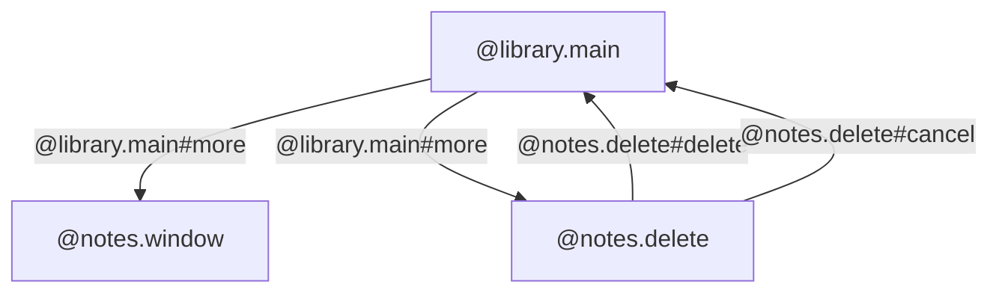

**Goal:** read two notes side by side, then throw away the one that is no
longer needed.

## Steps

1. Open the first note in @notes.window: select it in @library.main#notes
   and choose Open in new window from @library.main#more.
2. Select the second note in @library.main#notes and read the two side by
   side.
3. Choose Delete from @library.main#more.
4. Tap @notes.delete#delete; the note moves to the trash.
   - @notes.delete#cancel closes the dialog and keeps the note.
