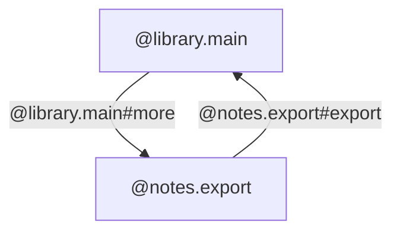

**Goal:** keep a copy of a note as a file another app can open.

## Steps

1. Select the note in @library.main#notes.
2. Choose Export from @library.main#more.
3. Choose a format in @notes.export#format and a place in
   @notes.export#location.
4. Tap @notes.export#export.

## Platform adaptations

- **web:** @notes.export is proposed; the web app cannot export yet.
