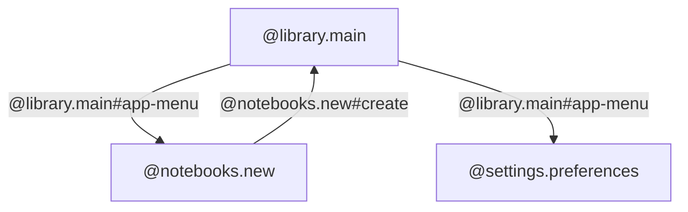

**Goal:** make a notebook for a new subject and set the editor up the way
you like it.

## Steps

1. Choose New notebook from @library.main#app-menu.
2. Name it in @notebooks.new#name and tap @notebooks.new#create; it is
   selected in @library.main#notebooks.
3. Choose Preferences from @library.main#app-menu to open
   @settings.preferences.
4. Pick a theme in @settings.preferences#theme and a font in
   @settings.preferences#font.

## Platform adaptations

- **web:** there is no preferences window; steps 3 and 4 do not apply.
