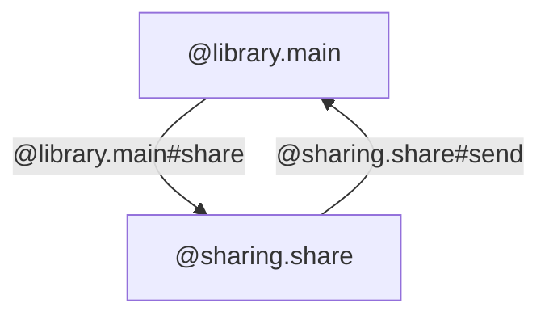

**Goal:** write a new note and let someone else read it.

## Steps

1. Pick a notebook in @library.main#notebooks, then tap
   @library.main#new-note.
2. Type a title in @library.main#title and the text in @library.main#body.
   - The note saves as you type; there is no save button.
3. Tap @library.main#share.
4. Type who to share with in @sharing.share#people and choose
   @sharing.share#access.
5. Tap @sharing.share#send; they appear in @sharing.share#shared-with the
   next time it opens.
