<!-- Generated by starboard. Do not edit. -->

# Screens

## library

### Library (`library.main`)

- Purpose: The main window, in three panes - notebooks, the notes in one, and the note being written.
- Presentation: window
- Status: shipped
- Platforms: macos, windows, web

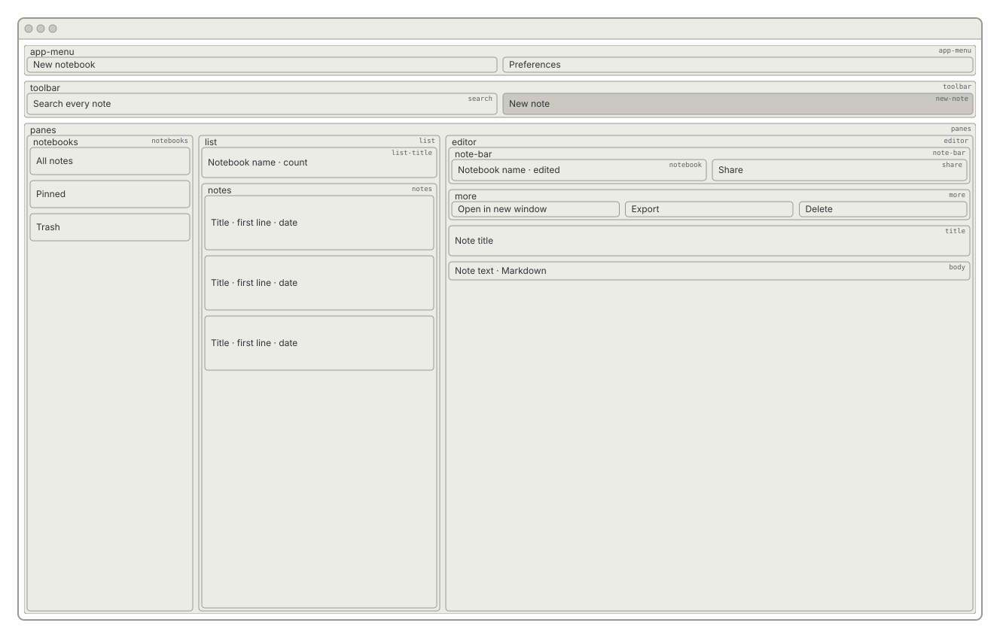
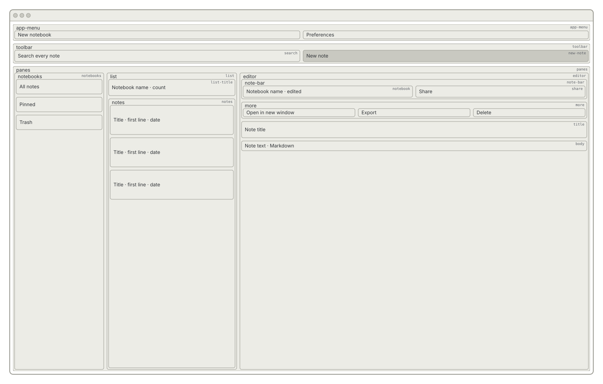

Files:

- macos: [src/macos/Library/LibraryWindow.swift](../../../src/macos/Library/LibraryWindow.swift)
- windows: [src/windows/Library/LibraryWindow.xaml](../../../src/windows/Library/LibraryWindow.xaml)
- web: [src/web/pages/library.page.tsx](../../../src/web/pages/library.page.tsx)

Screenshots: none.

Navigates to:

- `notebooks.new`
- `notes.delete`
- `notes.export`
- `notes.window`
- `settings.preferences`
- `sharing.share`

Reached from:

- `notebooks.new`
- `notes.delete`
- `notes.export`
- `sharing.share`

Used in flows:

- [Compare and delete notes](../flows/compare-and-delete-notes.md)
- [Export a note](../flows/export-a-note.md)
- [Set up the library](../flows/set-up-the-library.md)
- [Write and share a note](../flows/write-and-share-a-note.md)

### New notebook (`notebooks.new`)

- Purpose: Name a new notebook to keep notes in.
- Presentation: dialog
- Status: shipped
- Platforms: macos, windows, web

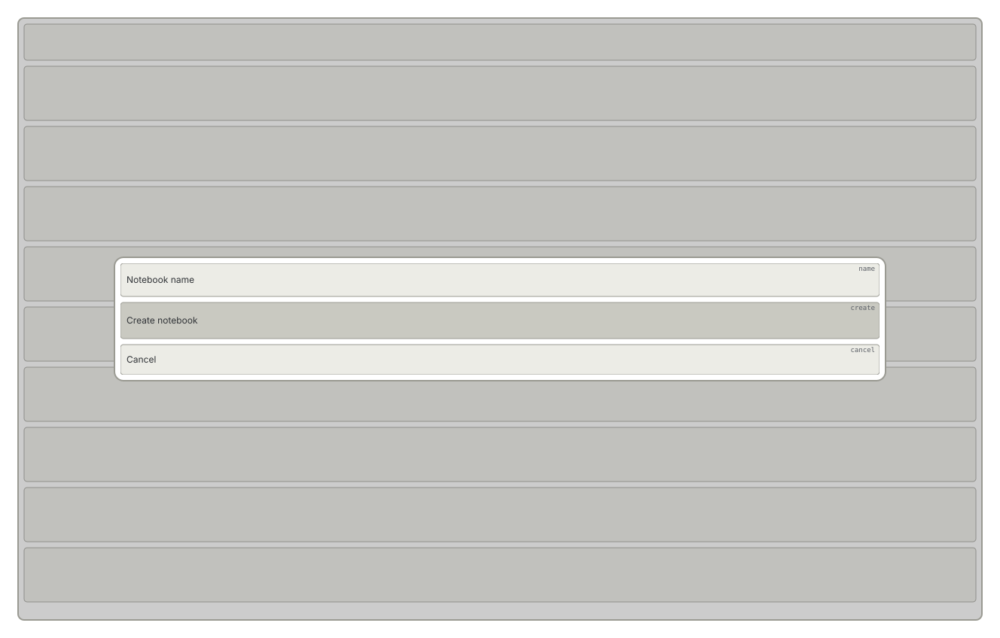
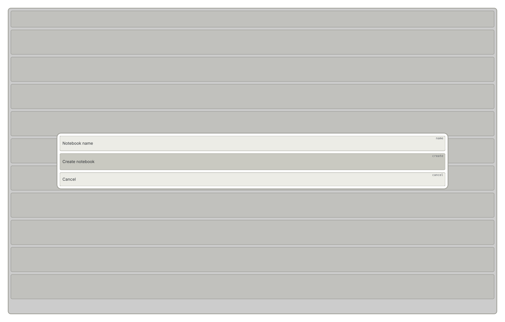

Files:

- macos: [src/macos/Library/NewNotebookDialog.swift](../../../src/macos/Library/NewNotebookDialog.swift)
- windows: [src/windows/Library/NewNotebookDialog.xaml](../../../src/windows/Library/NewNotebookDialog.xaml)
- web: [src/web/components/NewNotebookDialog.tsx](../../../src/web/components/NewNotebookDialog.tsx)

Screenshots: none.

Navigates to:

- `library.main`

Reached from:

- `library.main`

Used in flows:

- [Set up the library](../flows/set-up-the-library.md)

## notes

### Delete note (`notes.delete`)

- Purpose: Confirm moving a note to the trash.
- Presentation: dialog
- Status: shipped
- Platforms: macos, windows, web

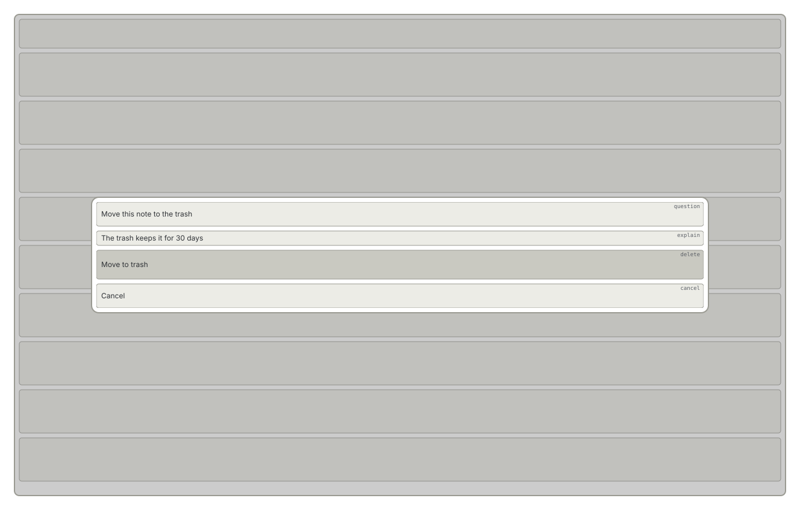
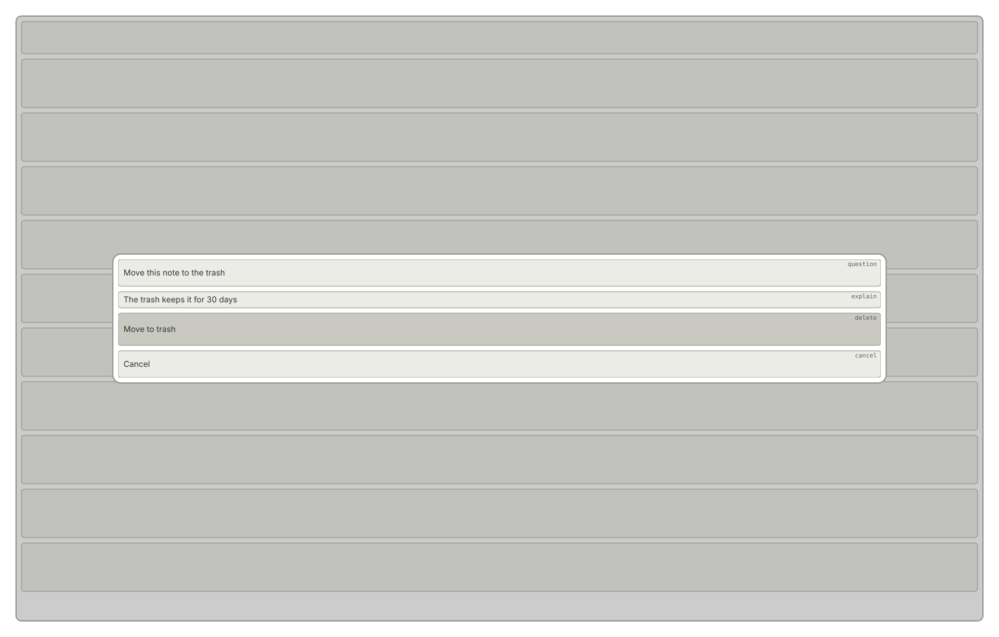

Files:

- macos: [src/macos/Notes/DeleteNoteDialog.swift](../../../src/macos/Notes/DeleteNoteDialog.swift)
- windows: [src/windows/Notes/DeleteNoteDialog.xaml](../../../src/windows/Notes/DeleteNoteDialog.xaml)
- web: [src/web/components/DeleteNoteDialog.tsx](../../../src/web/components/DeleteNoteDialog.tsx)

Screenshots: none.

Navigates to:

- `library.main`

Reached from:

- `library.main`

Used in flows:

- [Compare and delete notes](../flows/compare-and-delete-notes.md)

### Export note (`notes.export`)

- Purpose: Save a copy of a note as a file, in a format other apps read.
- Presentation: sheet
- Status: macos: shipped, windows: shipped, web: proposed
- Platforms: macos, windows, web

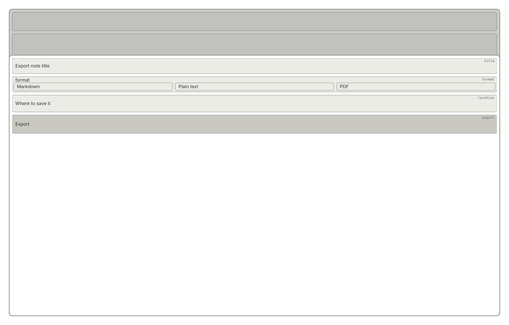
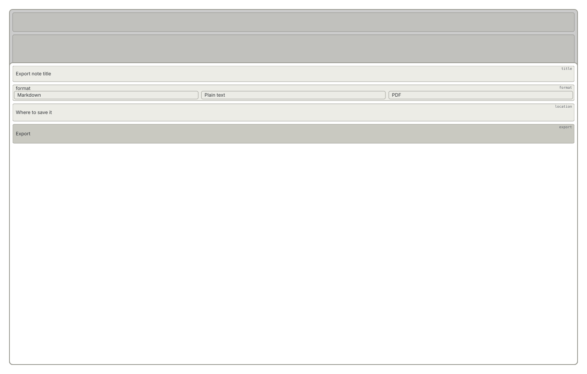

Files:

- macos: [src/macos/Notes/ExportSheet.swift](../../../src/macos/Notes/ExportSheet.swift)
- windows: [src/windows/Notes/ExportSheet.xaml](../../../src/windows/Notes/ExportSheet.xaml)
- web: [src/web/components/ExportSheet.tsx](../../../src/web/components/ExportSheet.tsx)

Screenshots: none.

Navigates to:

- `library.main`

Reached from:

- `library.main`

Used in flows:

- [Export a note](../flows/export-a-note.md)

### Note window (`notes.window`)

- Purpose: One note in a window of its own, to read beside another or write full screen.
- Presentation: window
- Status: shipped
- Platforms: macos, windows, web

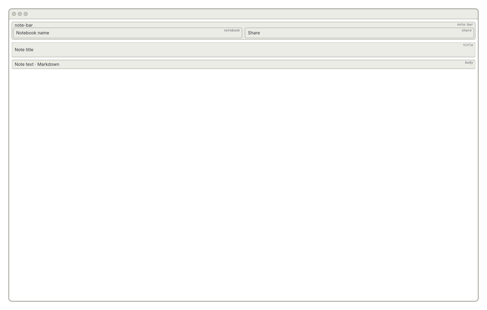
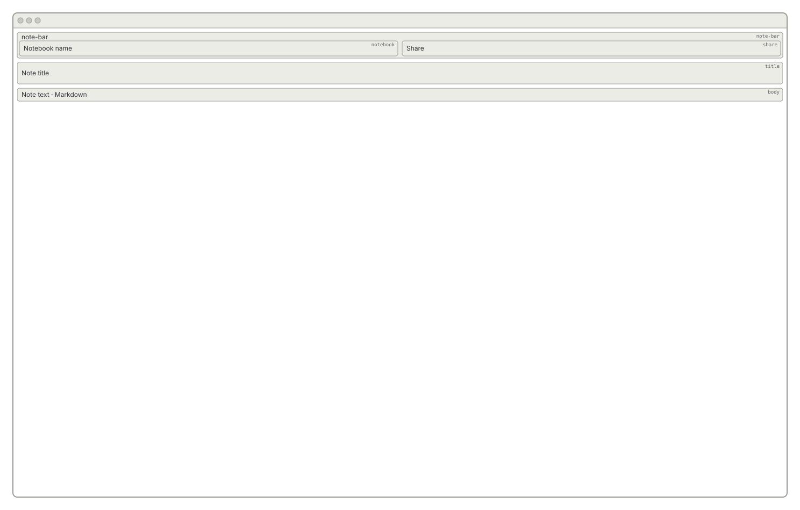

Files:

- macos: [src/macos/Notes/NoteWindow.swift](../../../src/macos/Notes/NoteWindow.swift)
- windows: [src/windows/Notes/NoteWindow.xaml](../../../src/windows/Notes/NoteWindow.xaml)
- web: [src/web/pages/note.page.tsx](../../../src/web/pages/note.page.tsx)

Screenshots: none.

Navigates to:

- `sharing.share`

Reached from:

- `library.main`

Used in flows:

- [Compare and delete notes](../flows/compare-and-delete-notes.md)

## sharing

### Share note (`sharing.share`)

- Purpose: Let other people read or edit a note.
- Presentation: sheet
- Status: shipped
- Platforms: macos, windows, web

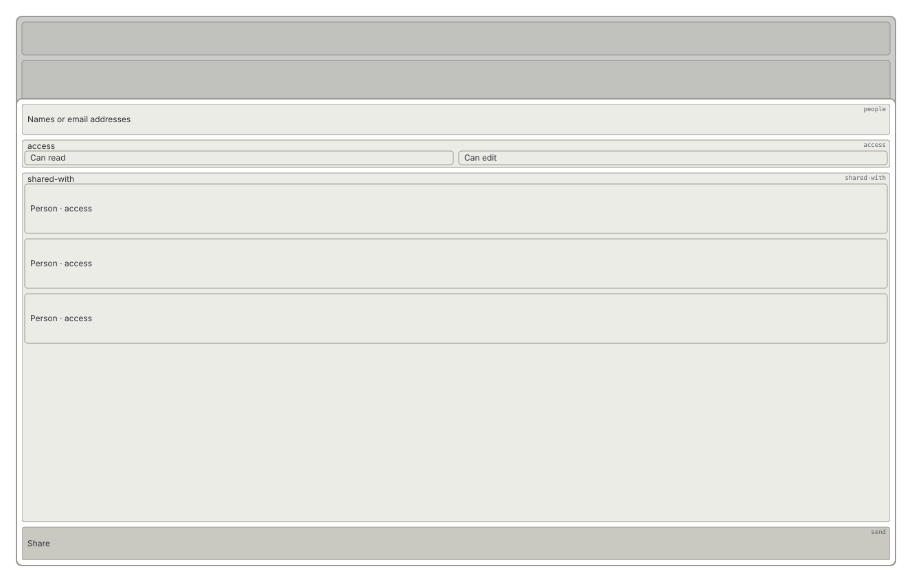

Files:

- macos: [src/macos/Sharing/ShareSheet.swift](../../../src/macos/Sharing/ShareSheet.swift)
- windows: [src/windows/Sharing/ShareSheet.xaml](../../../src/windows/Sharing/ShareSheet.xaml)
- web: [src/web/components/ShareSheet.tsx](../../../src/web/components/ShareSheet.tsx)

Screenshots: none.

Navigates to:

- `library.main`

Reached from:

- `library.main`
- `notes.window`

Used in flows:

- [Write and share a note](../flows/write-and-share-a-note.md)

## settings

### Preferences (`settings.preferences`)

- Purpose: How the app looks, where notes are kept, and how they sync.
- Presentation: window
- Status: shipped
- Platforms: macos, windows

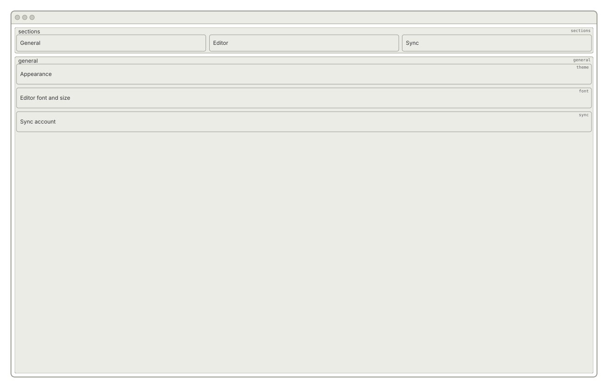

Files:

- macos: [src/macos/Settings/PreferencesWindow.swift](../../../src/macos/Settings/PreferencesWindow.swift)
- windows: [src/windows/Settings/PreferencesWindow.xaml](../../../src/windows/Settings/PreferencesWindow.xaml)

Screenshots: none.

Navigates to: none.

Reached from:

- `library.main`

Used in flows:

- [Set up the library](../flows/set-up-the-library.md)
