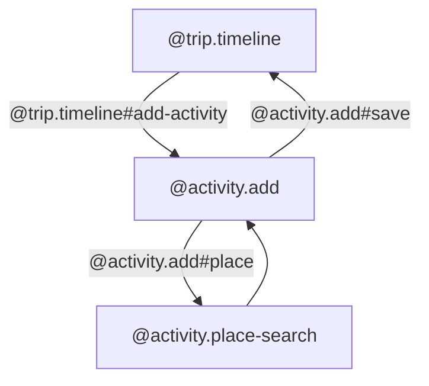

## Steps

1. Tap @trip.timeline#add-activity.
   - If the traveller cannot edit logistics, the button is hidden.
2. Name it in @activity.add#title.
3. Choose the day in @activity.add#day.
4. Pick a place in @activity.place-search#results.
5. Tap @activity.add#save; the activity appears on @trip.timeline#days.
