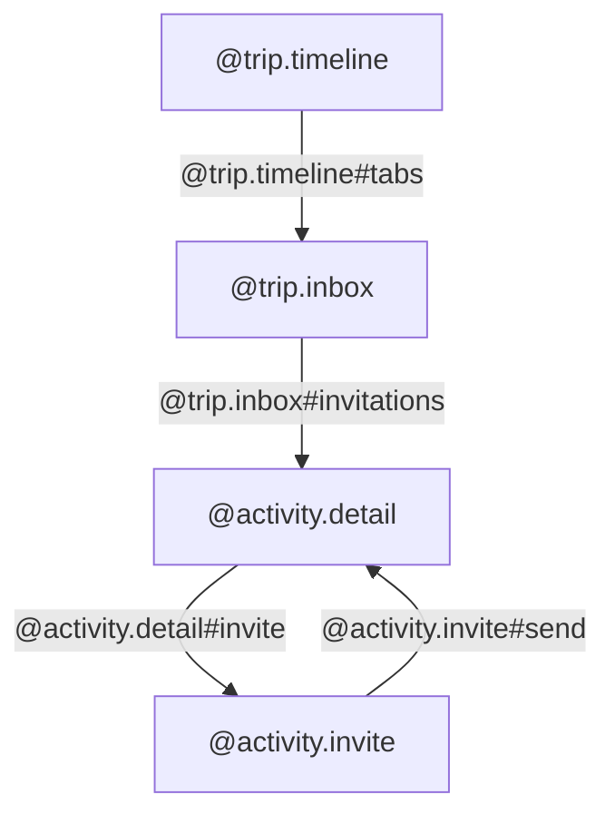

**Goal:** say whether you are going to the activities you were invited to,
and bring someone else along.

## Steps

1. Open @trip.inbox from @trip.timeline#tabs.
2. Tap an invitation in @trip.inbox#invitations to open @activity.detail.
3. Answer in @activity.detail#answer; the invitation leaves the inbox.
4. To bring someone along, tap @activity.detail#invite.
5. Pick travellers in @activity.invite#travellers and tap
   @activity.invite#send; they show in @activity.detail#going as invited.
