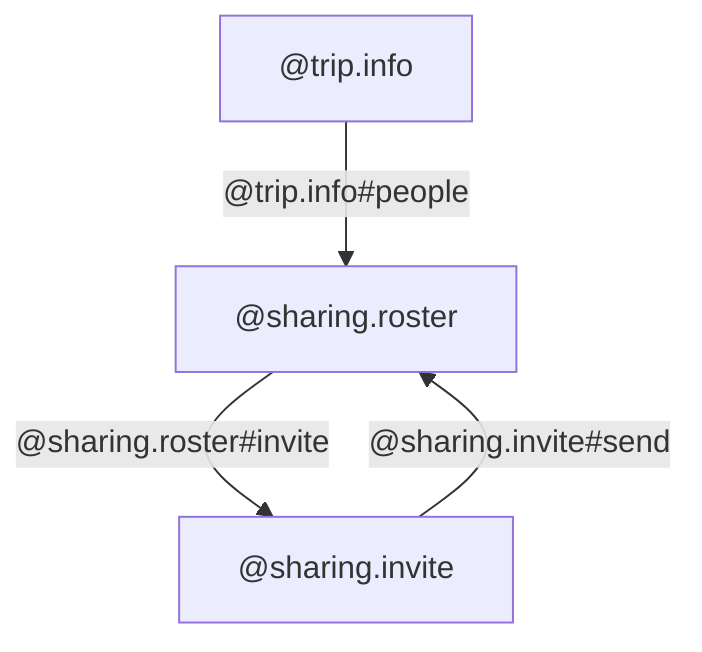

**Goal:** bring someone onto the trip by email, with the role they need.

## Steps

1. Tap @trip.info#people to open @sharing.roster.
2. Tap @sharing.roster#invite.
   - Without the manageMembers capability, the button is hidden.
3. Type their address in @sharing.invite#email.
4. Choose what they may do in @sharing.invite#role.
5. Tap @sharing.invite#send; they appear in @sharing.roster#people as
   invited.

## Platform adaptations

- **android:** @sharing.invite is proposed; until it ships, organizers on
  Android share the join code from @trip.info#join-code instead.
