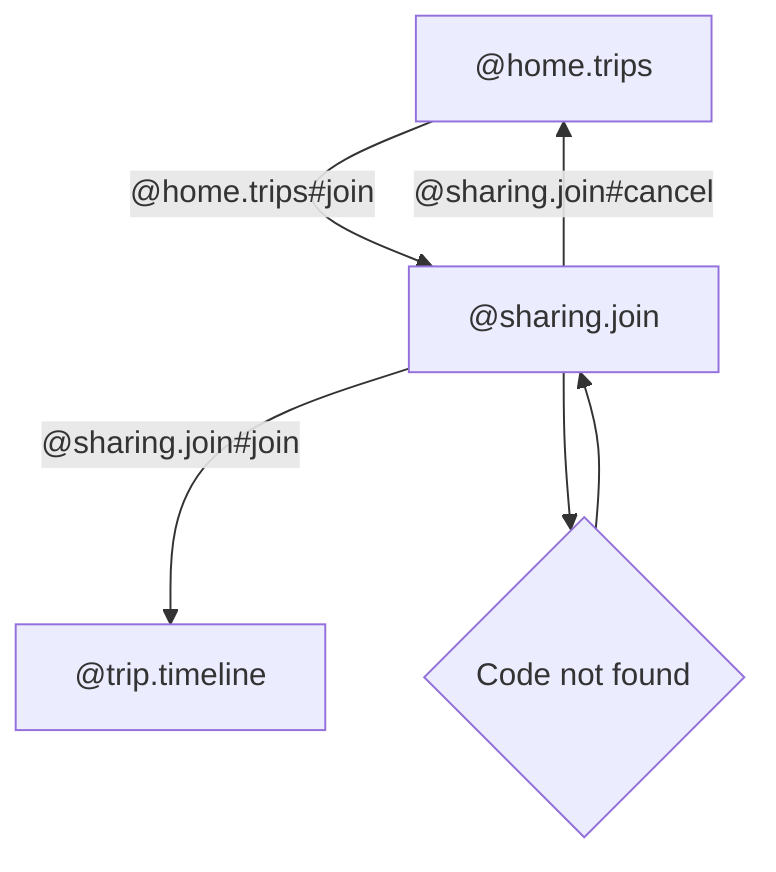

**Goal:** join a trip someone else planned, with the code they shared.

## Steps

1. Tap @home.trips#join.
2. Type the code in @sharing.join#code.
3. Tap @sharing.join#join.
   - If no trip has that code, @sharing.join stays open and says so.
4. The trip's @trip.timeline opens, and the trip is now in @home.trips#trips.
