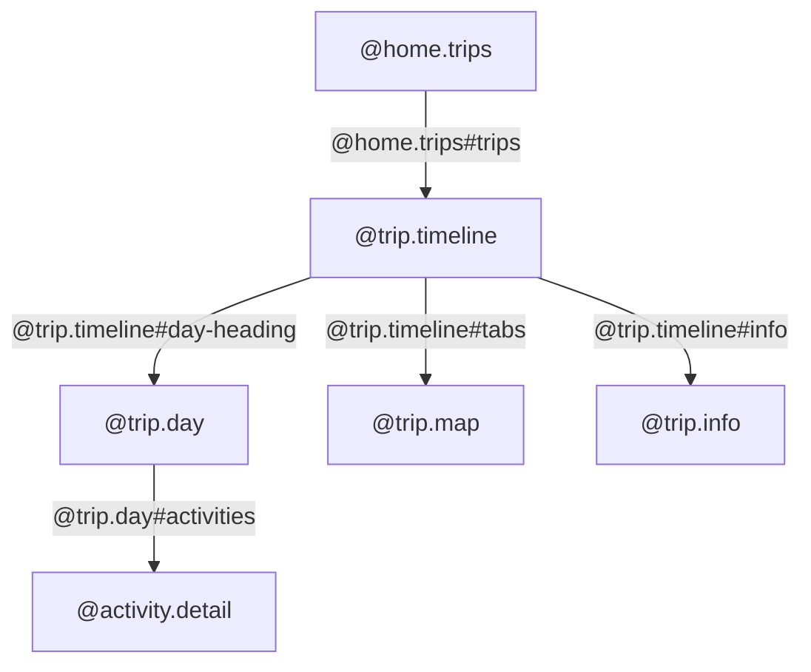

**Goal:** see what is planned, day by day and on the map, without changing
anything.

## Steps

1. Tap a trip in @home.trips#trips.
2. On @trip.timeline, tap @trip.timeline#day-heading to see the whole day on
   @trip.day.
3. Tap an activity in @trip.day#activities to open @activity.detail.
4. Back on the timeline, switch to @trip.map from @trip.timeline#tabs.
5. Tap @trip.timeline#info for the dates and places on @trip.info.
   - Once the trip is over, @trip.info#ended says so.

## Platform adaptations

- **web-wide:** the tabs are a sidebar, and @trip.timeline#day-map shows the
  day's places beside the timeline.
