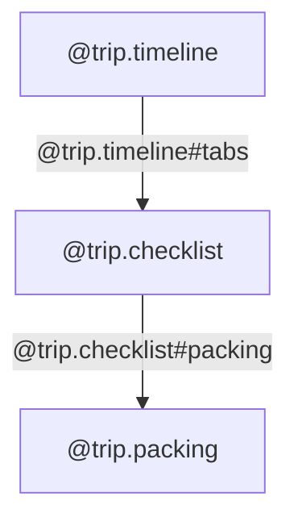

**Goal:** agree who brings what, so nothing is packed twice or forgotten.

## Steps

1. Open @trip.checklist from @trip.timeline#tabs.
2. Tap @trip.checklist#packing.
3. Add what to bring with @trip.packing#add-item.
4. Each entry in @trip.packing#items says who packs it; tick it off once it
   is in a bag.
