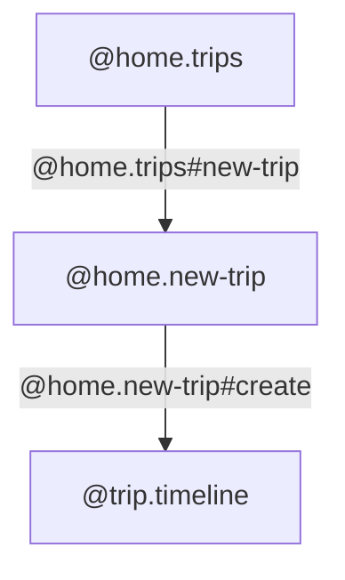

**Goal:** start a new trip and land on its timeline, ready for activities.

## Steps

1. Tap @home.trips#new-trip.
2. Name the trip in @home.new-trip#name.
3. Choose the dates in @home.new-trip#dates and the place in
   @home.new-trip#where.
4. Tap @home.new-trip#create to open @trip.timeline, empty until the first
   activity is added.
