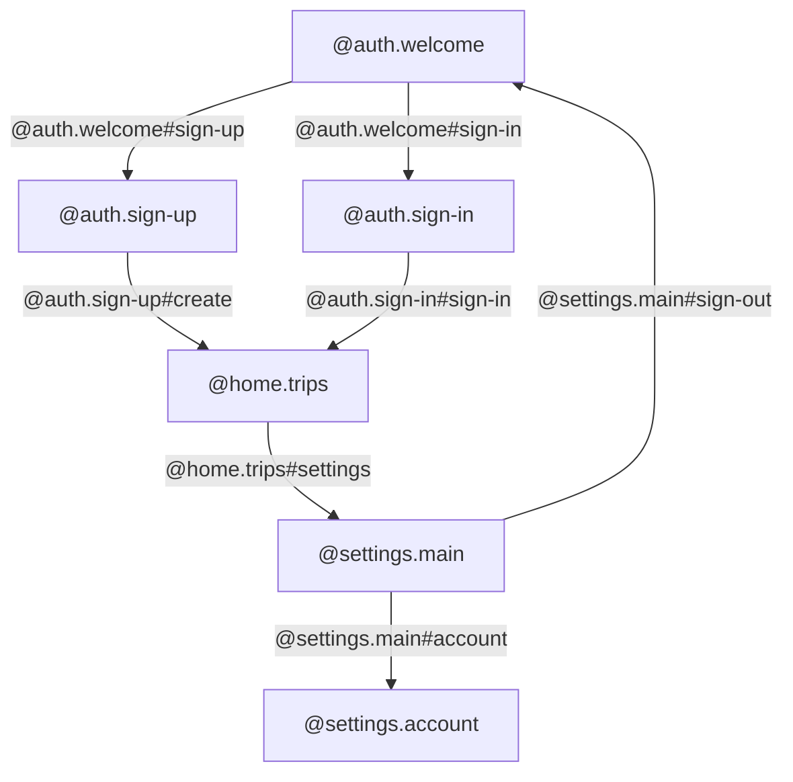

**Goal:** get from a signed-out app to your trips, check the account, and
sign out again.

## Steps

1. Tap @auth.welcome#sign-up, or @auth.welcome#sign-in with an account
   already.
2. To sign up, fill in @auth.sign-up#details and tap @auth.sign-up#create.
3. To sign in, fill in @auth.sign-in#credentials and tap
   @auth.sign-in#sign-in.
4. Either way @home.trips opens, empty until you plan or join a trip.
5. Tap @home.trips#settings to open @settings.main.
6. See your name and email on @settings.account, opened with
   @settings.main#account.
7. Back on @settings.main, tap @settings.main#sign-out to return to
   @auth.welcome.

## Platform adaptations

- **web:** there is no account screen; step 6 happens in
  @settings.main#profile.
