<!-- Generated by starboard. Do not edit. -->

# Screens

## trips

### Your trips (`trips.list`)

- Purpose: Every trip you plan or travel on, the next one first.
- Presentation: root
- Status: shipped
- Platforms: ios, android, web

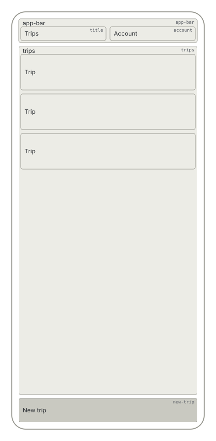
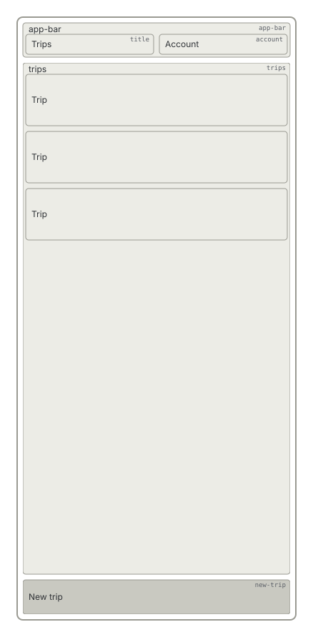
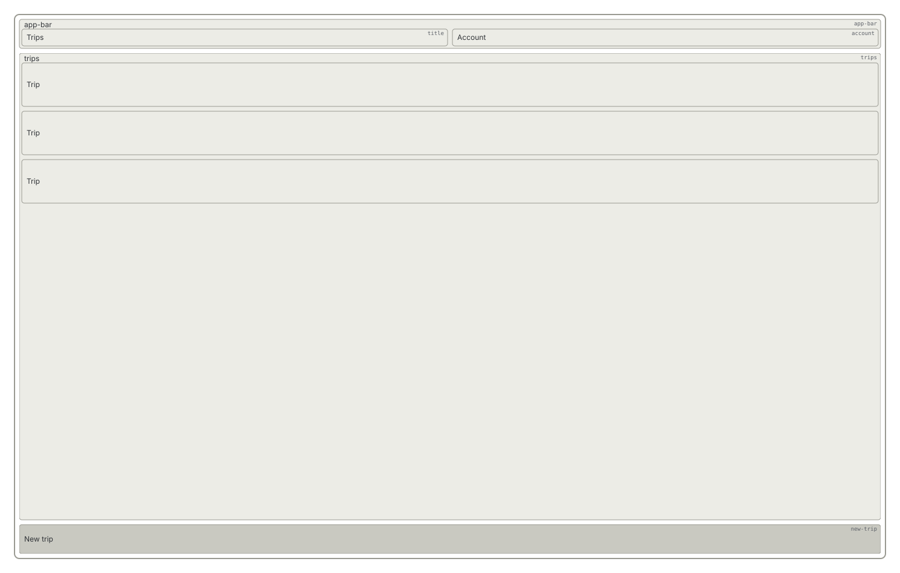

Files: none.

Screenshots: none.

Navigates to:

- `account.settings`
- `trip.timeline`
- `trips.new`

Reached from:

- `account.settings`

Used in flows:

- [Look around a trip](../flows/look-around-a-trip.md)
- [Plan a trip](../flows/plan-a-trip.md)

### New trip (`trips.new`)

- Purpose: Name a trip and choose its dates.
- Presentation: sheet
- Status: shipped
- Platforms: ios, android, web

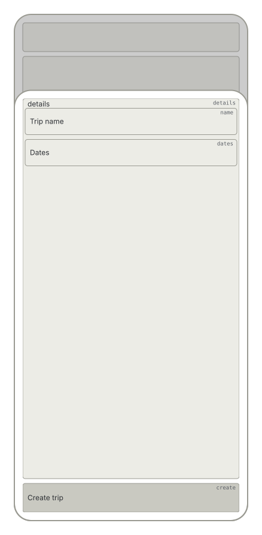
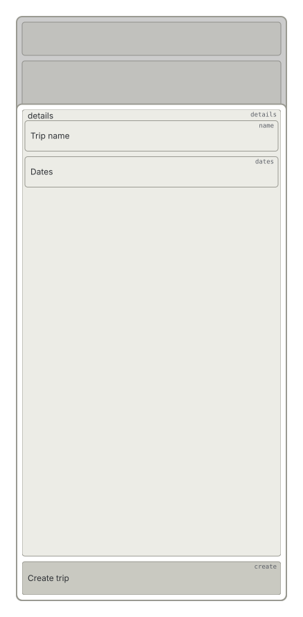
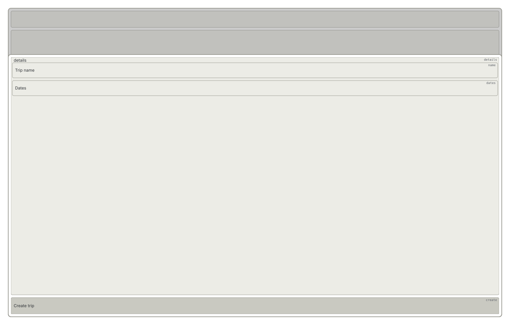

Files: none.

Screenshots: none.

Navigates to:

- `trip.timeline`

Reached from:

- `trips.list`

Used in flows:

- [Plan a trip](../flows/plan-a-trip.md)

## trip

### Invite someone (`trip.invite`)

- Purpose: Send an invitation by email.
- Presentation: sheet
- Status: ios: shipped, android: proposed, web: shipped
- Platforms: ios, android, web

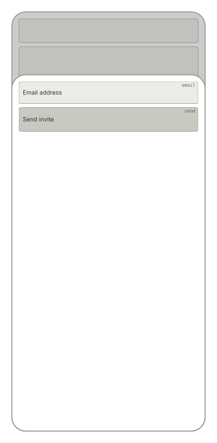
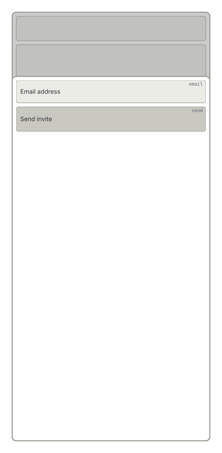
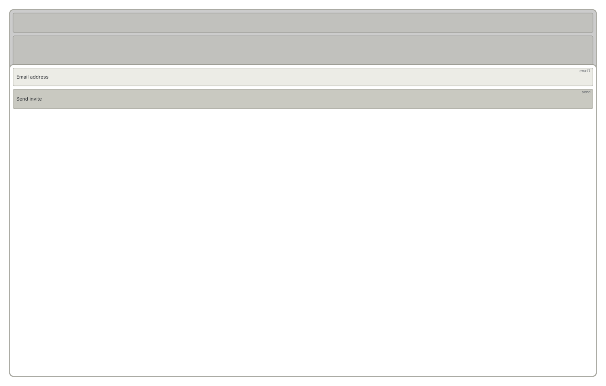

Files: none.

Screenshots: none.

Navigates to:

- `trip.members`

Reached from:

- `trip.members`

Used in flows:

- [Invite a traveller](../flows/invite-a-traveller.md)

### Trip map (`trip.map`)

- Purpose: Where each activity is, day by day.
- Presentation: tab
- Status: shipped
- Platforms: ios, android, web

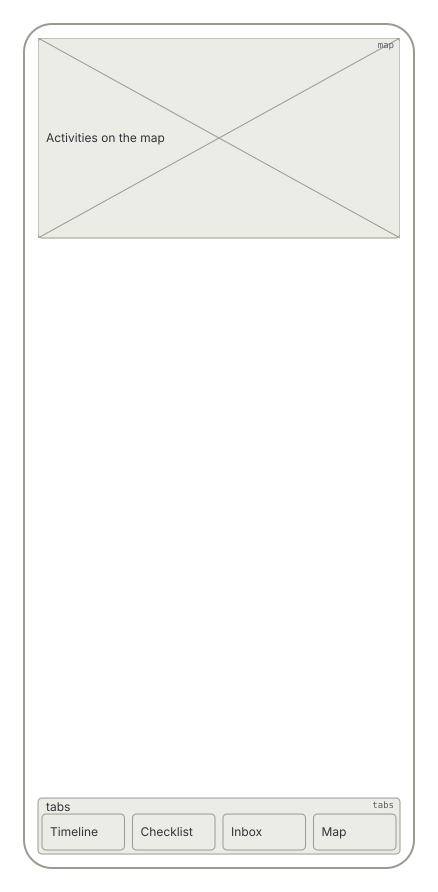
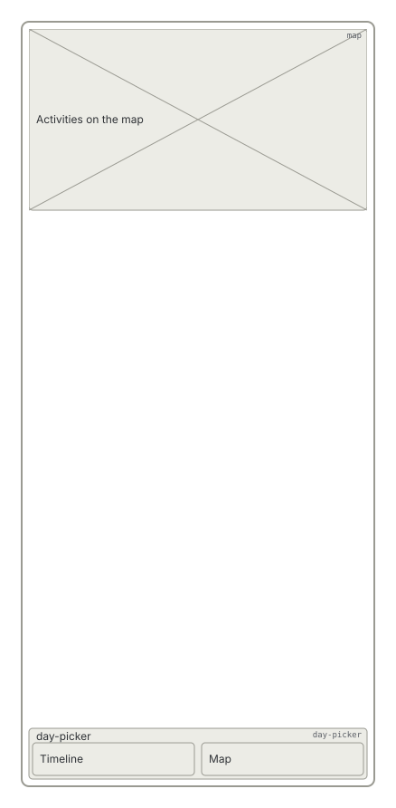
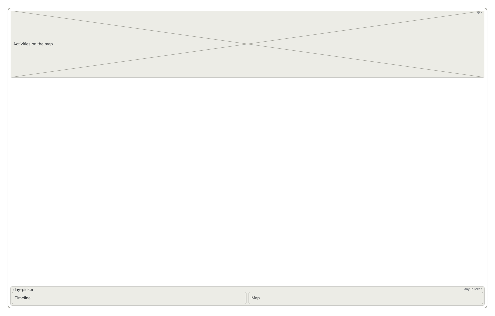

Files: none.

Screenshots: none.

Navigates to:

- `trip.map`
- `trip.timeline`

Reached from:

- `trip.map`
- `trip.timeline`

Used in flows:

- [Look around a trip](../flows/look-around-a-trip.md)

### People (`trip.members`)

- Purpose: Who is on the trip and what each person may do.
- Presentation: tab
- Status: shipped
- Platforms: ios, android, web

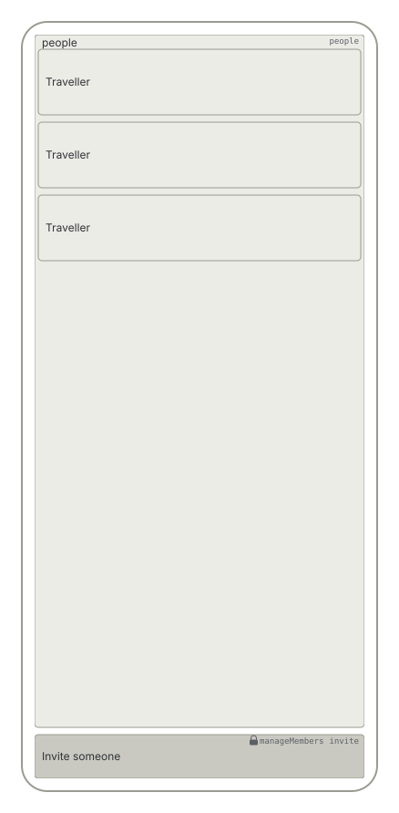
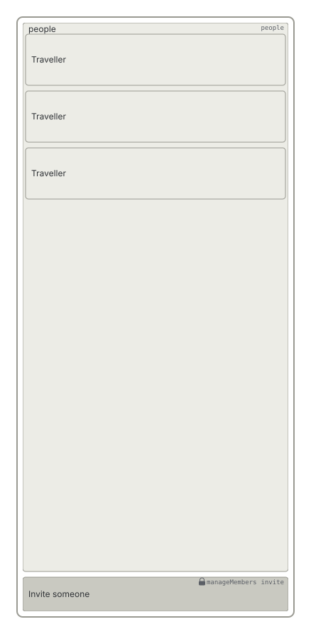
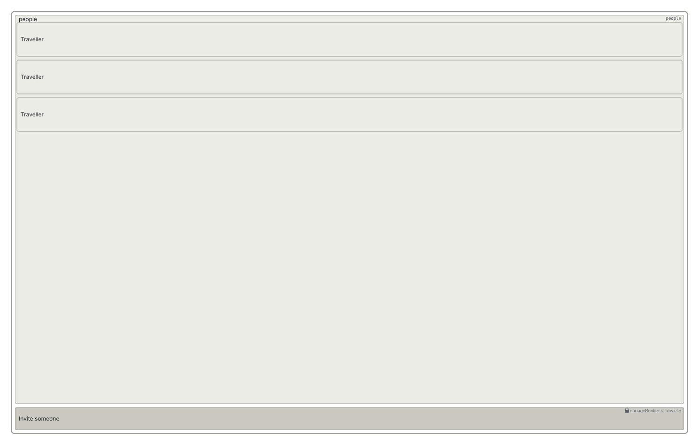

Files: none.

Screenshots: none.

Navigates to:

- `trip.invite`

Reached from:

- `trip.invite`
- `trip.timeline`

Used in flows:

- [Invite a traveller](../flows/invite-a-traveller.md)

### Timeline (`trip.timeline`)

- Purpose: The trip's days in order, with what happens on each.
- Presentation: push
- Status: shipped
- Platforms: ios, android, web

Files: none.

Screenshots: none.

Navigates to:

- `activity.add`
- `activity.detail`
- `trip.map`
- `trip.members`
- `trip.timeline`

Reached from:

- `activity.add`
- `trip.map`
- `trip.timeline`
- `trips.list`
- `trips.new`

Used in flows:

- [Add an activity](../flows/add-activity.md)
- [Look around a trip](../flows/look-around-a-trip.md)
- [Plan a trip](../flows/plan-a-trip.md)

## activity

### Add activity (`activity.add`)

- Purpose: Put something on one day of the trip.
- Presentation: sheet
- Status: shipped
- Platforms: ios, android, web

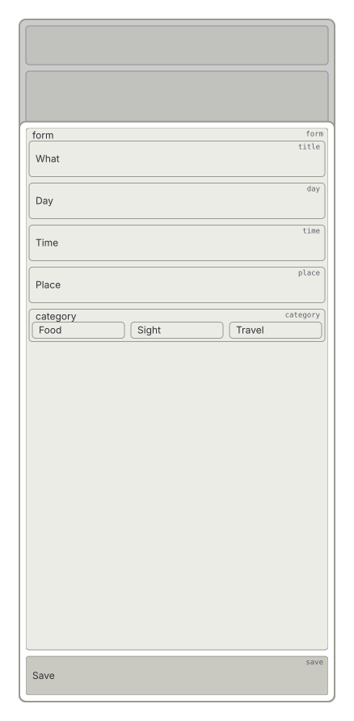
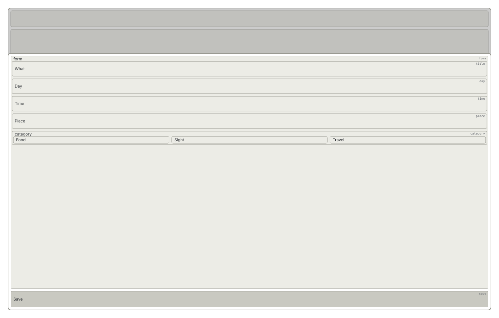

Files: none.

Screenshots: none.

Navigates to:

- `activity.place-search`
- `trip.timeline`

Reached from:

- `activity.detail`
- `activity.place-search`
- `trip.timeline`

Used in flows:

- [Add an activity](../flows/add-activity.md)

### Activity (`activity.detail`)

- Purpose: One activity's time, place and notes.
- Presentation: push
- Status: shipped
- Platforms: ios, android, web

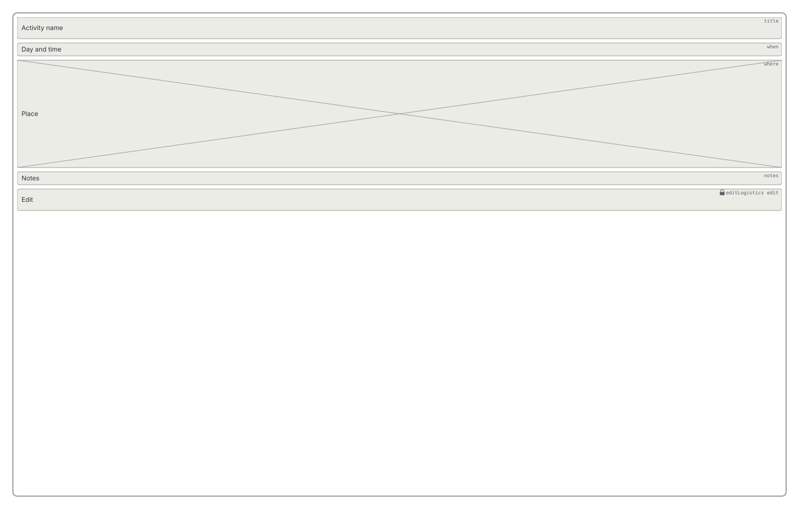

Files: none.

Screenshots: none.

Navigates to:

- `activity.add`

Reached from:

- `trip.timeline`

Used in flows:

- [Look around a trip](../flows/look-around-a-trip.md)

### Find a place (`activity.place-search`)

- Purpose: Search for the place an activity happens.
- Presentation: push
- Status: shipped
- Platforms: ios, android, web

Files: none.

Screenshots: none.

Navigates to:

- `activity.add`

Reached from:

- `activity.add`

Used in flows:

- [Add an activity](../flows/add-activity.md)

## account

### Account (`account.settings`)

- Purpose: Your name, email and sign-out.
- Presentation: push
- Status: shipped
- Platforms: ios, android, web

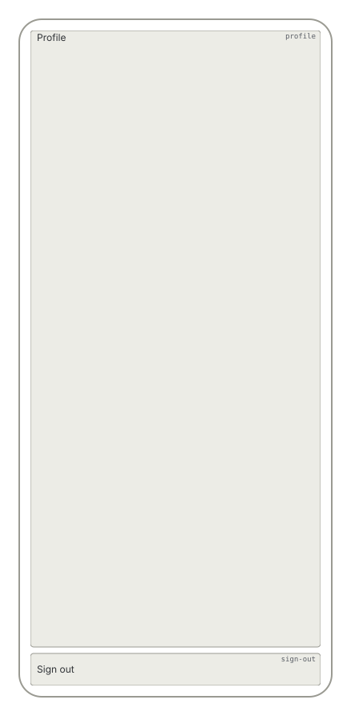
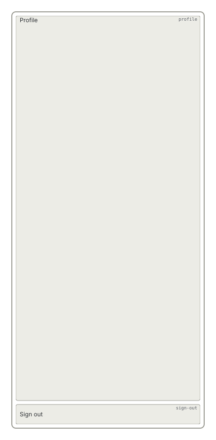
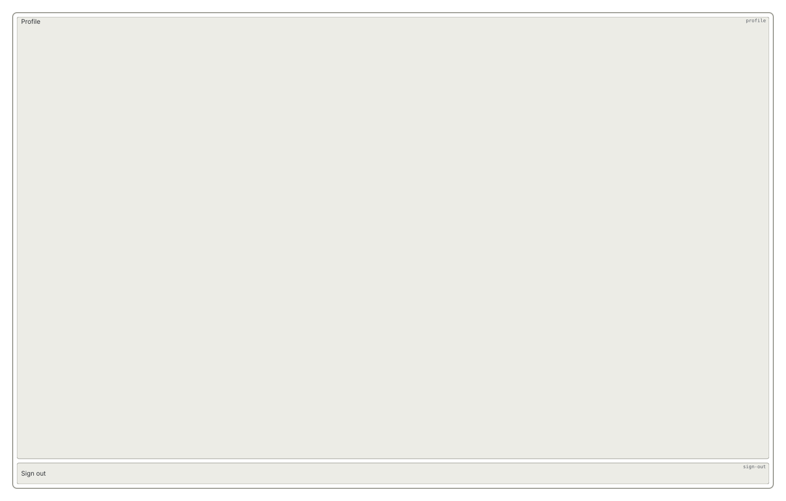

Files: none.

Screenshots: none.

Navigates to:

- `trips.list`

Reached from:

- `trips.list`

Used in flows:

- [Look around a trip](../flows/look-around-a-trip.md)
