<!-- Generated by starboard. Do not edit. -->

# Screens

## auth

### Sign in (`auth.sign-in`)

- Purpose: Sign in with an email address and a password.
- Presentation: push
- Status: shipped
- Platforms: ios, android, web

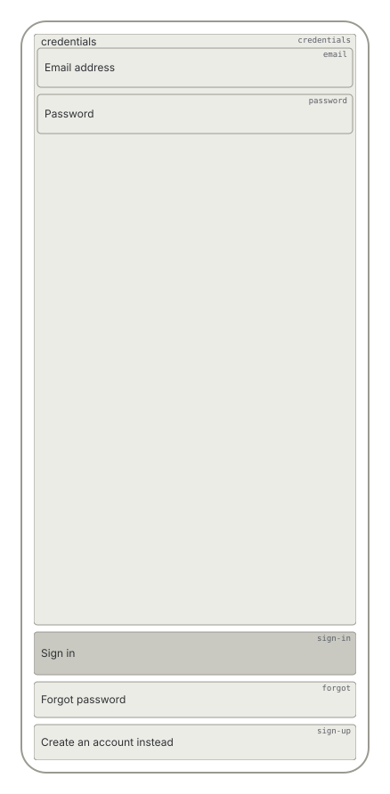
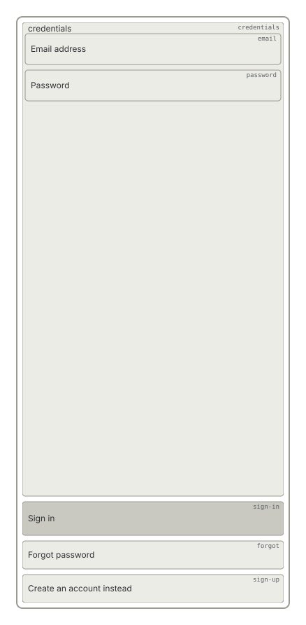
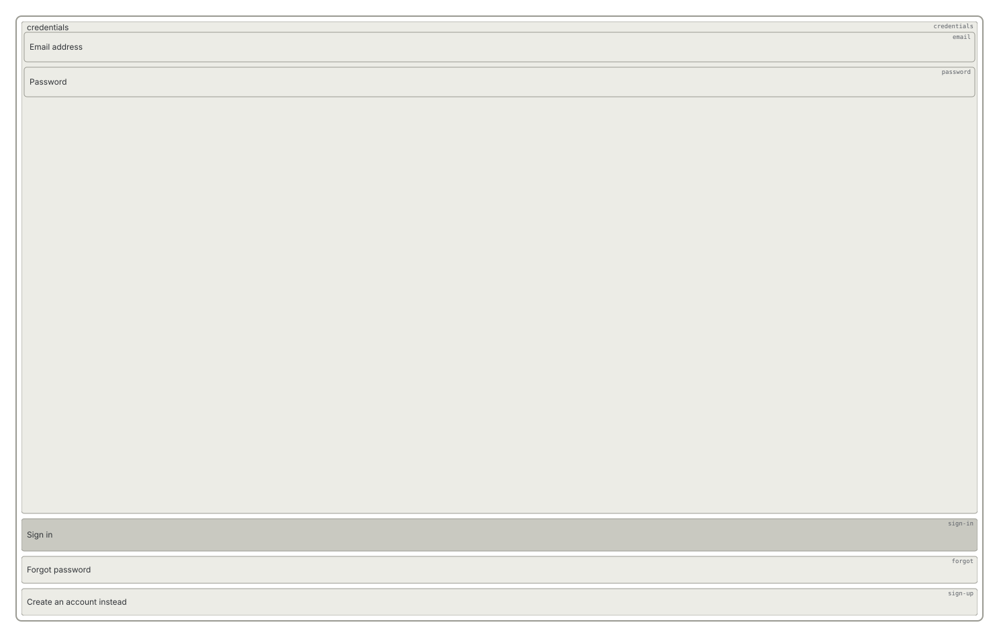

Files:

- ios: [src/ios/Screens/Auth/SignInView.swift](../../../src/ios/Screens/Auth/SignInView.swift)
- android: [src/android/SignInScreen.kt](../../../src/android/SignInScreen.kt)
- web: [src/web/routes/sign-in/+page.svelte](../../../src/web/routes/sign-in/+page.svelte)

Screenshots: none.

Navigates to:

- `auth.sign-up`
- `home.trips`

Reached from:

- `auth.sign-up`
- `auth.welcome`

Used in flows:

- [Sign up, sign in and sign out](../flows/sign-in-and-out.md)

### Create an account (`auth.sign-up`)

- Purpose: Create an account with a name, an email address and a password.
- Presentation: push
- Status: shipped
- Platforms: ios, android, web

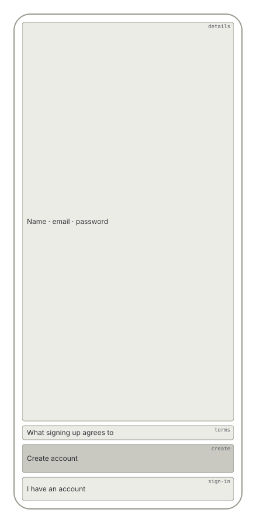
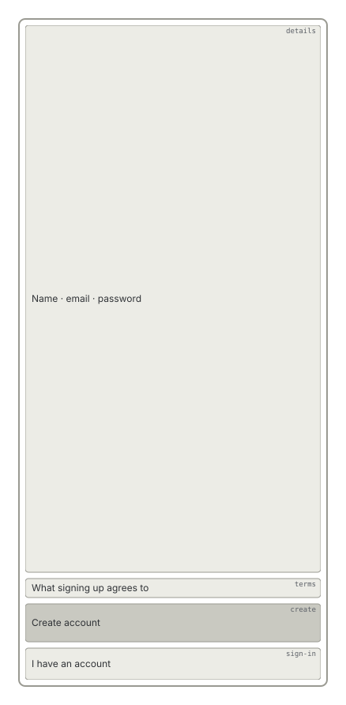
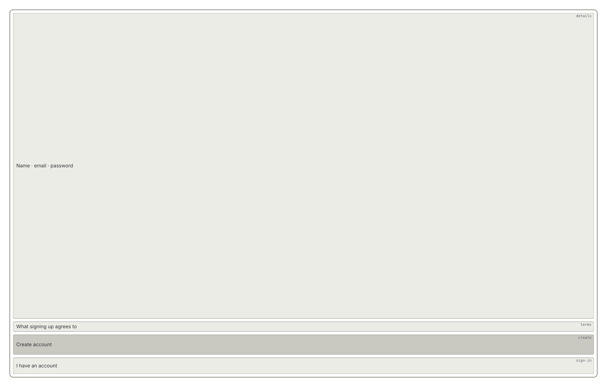

Files:

- ios: [src/ios/Screens/Auth/SignUpView.swift](../../../src/ios/Screens/Auth/SignUpView.swift)
- android: [src/android/SignUpScreen.kt](../../../src/android/SignUpScreen.kt)
- web: [src/web/routes/sign-up/+page.svelte](../../../src/web/routes/sign-up/+page.svelte)

Screenshots: none.

Navigates to:

- `auth.sign-in`
- `home.trips`

Reached from:

- `auth.sign-in`
- `auth.welcome`

Used in flows:

- [Sign up, sign in and sign out](../flows/sign-in-and-out.md)

### Welcome (`auth.welcome`)

- Purpose: The first screen of a signed-out app; create an account or sign in.
- Presentation: root
- Status: shipped
- Platforms: ios, android, web

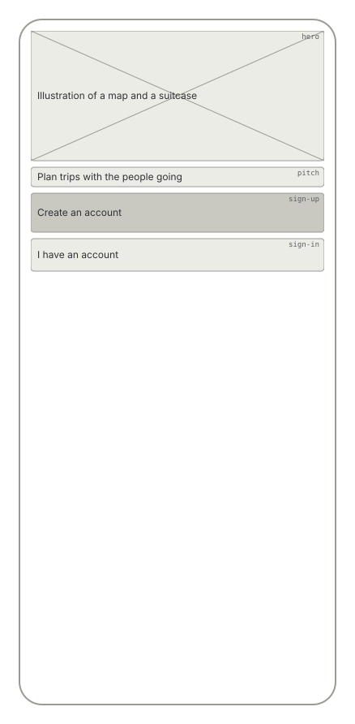
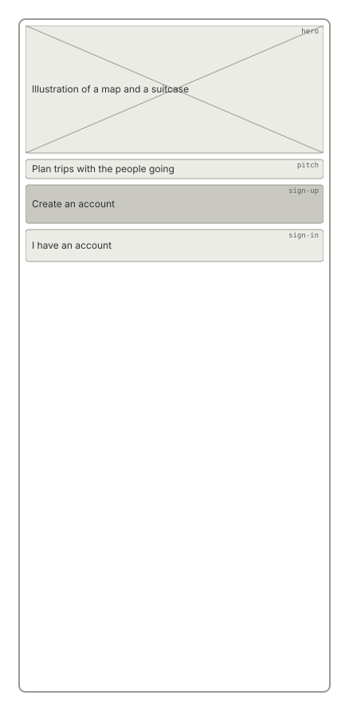
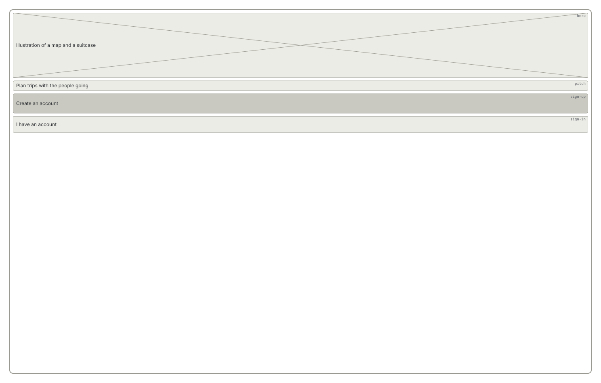

Files:

- ios: [src/ios/Screens/Auth/WelcomeView.swift](../../../src/ios/Screens/Auth/WelcomeView.swift)
- android: [src/android/WelcomeScreen.kt](../../../src/android/WelcomeScreen.kt)
- web: [src/web/routes/welcome/+page.svelte](../../../src/web/routes/welcome/+page.svelte)

Screenshots: none.

Navigates to:

- `auth.sign-in`
- `auth.sign-up`

Reached from:

- `settings.account`
- `settings.main`

Used in flows:

- [Sign up, sign in and sign out](../flows/sign-in-and-out.md)

## home

### New trip (`home.new-trip`)

- Purpose: Name a trip and choose its dates.
- Presentation: sheet
- Status: shipped
- Platforms: ios, android, web

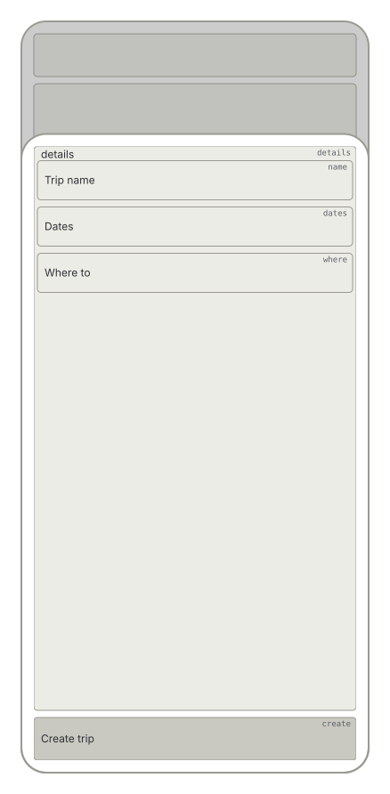
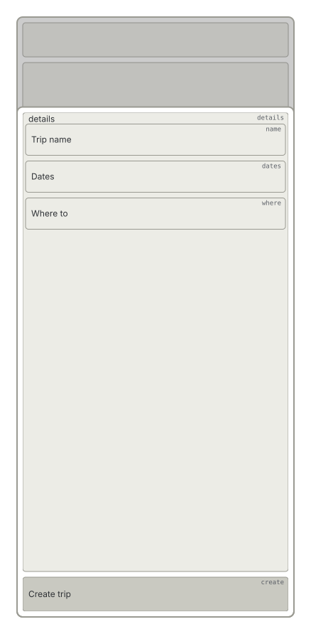
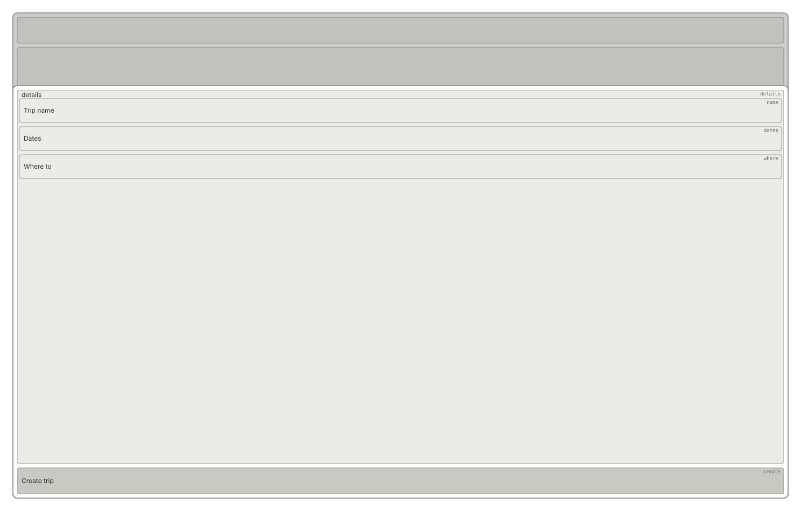

Files:

- ios: [src/ios/Screens/Home/NewTripView.swift](../../../src/ios/Screens/Home/NewTripView.swift)
- android: [src/android/NewTripScreen.kt](../../../src/android/NewTripScreen.kt)
- web: [src/web/components/NewTripSheet.svelte](../../../src/web/components/NewTripSheet.svelte)

Screenshots: none.

Navigates to:

- `trip.timeline`

Reached from:

- `home.trips`

Used in flows:

- [Plan a trip](../flows/plan-a-trip.md)

### Your trips (`home.trips`)

- Purpose: Every trip you plan or travel on, the next one first.
- Presentation: root
- Status: shipped
- Platforms: ios, android, web

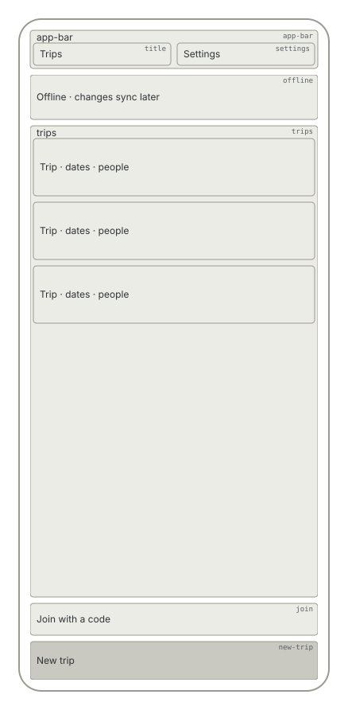
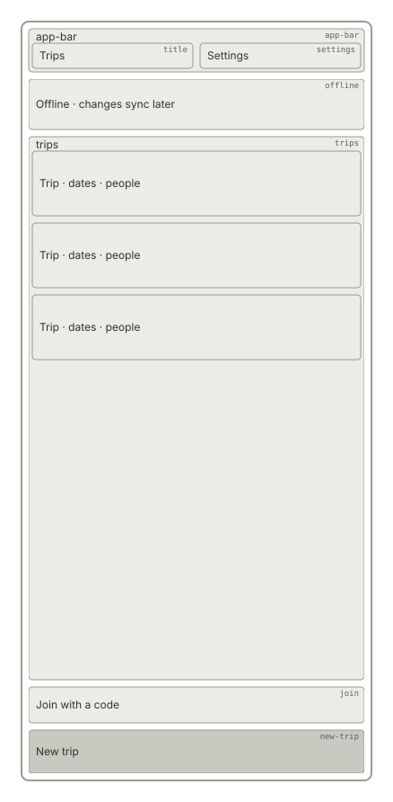
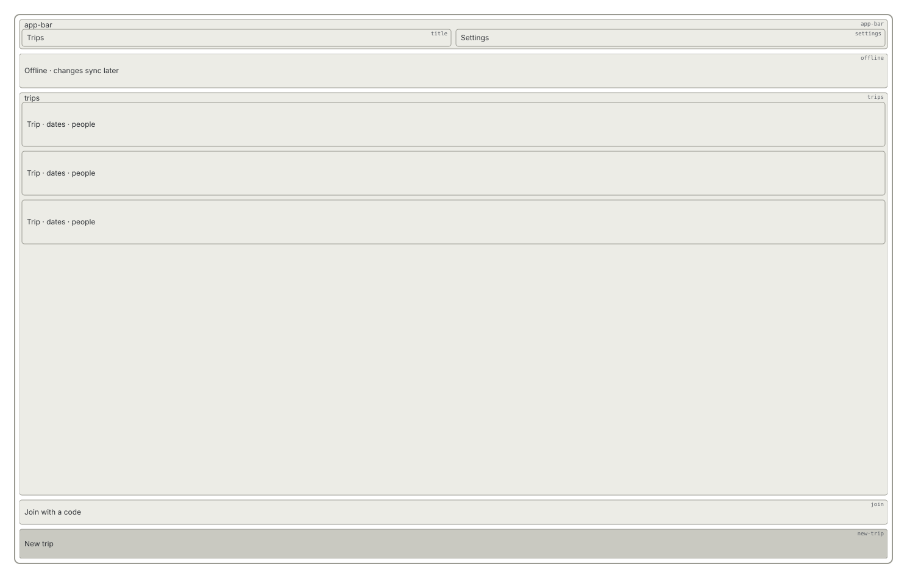

Files:

- ios: [src/ios/Screens/Home/TripsView.swift](../../../src/ios/Screens/Home/TripsView.swift)
- android: [src/android/TripsScreen.kt](../../../src/android/TripsScreen.kt)
- web: [src/web/routes/+page.svelte](../../../src/web/routes/+page.svelte)

Screenshots: none.

Navigates to:

- `home.new-trip`
- `settings.main`
- `sharing.join`
- `trip.timeline`

Reached from:

- `auth.sign-in`
- `auth.sign-up`
- `sharing.join`

Used in flows:

- [Join a trip](../flows/join-a-trip.md)
- [Look around a trip](../flows/look-around-a-trip.md)
- [Plan a trip](../flows/plan-a-trip.md)
- [Sign up, sign in and sign out](../flows/sign-in-and-out.md)

## trip

### Checklist (`trip.checklist`)

- Purpose: What has to be done before the trip, and who is doing it.
- Presentation: tab
- Status: shipped
- Platforms: ios, android, web

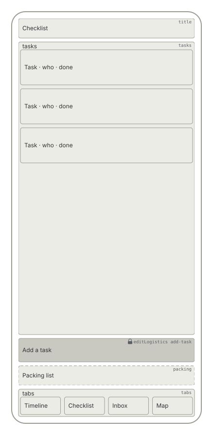
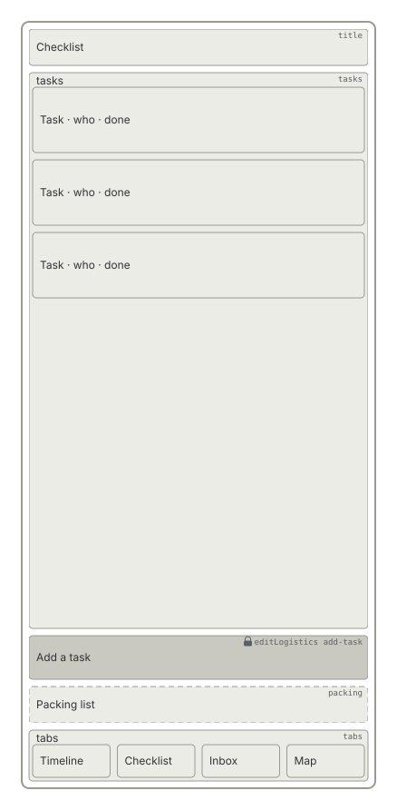
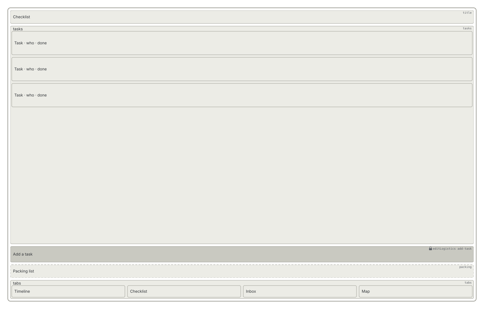

Files:

- ios: [src/ios/Screens/Trip/ChecklistView.swift](../../../src/ios/Screens/Trip/ChecklistView.swift)
- android: [src/android/ChecklistScreen.kt](../../../src/android/ChecklistScreen.kt)
- web: [src/web/routes/trip/checklist/+page.svelte](../../../src/web/routes/trip/checklist/+page.svelte)

Screenshots: none.

Navigates to:

- `trip.checklist`
- `trip.inbox`
- `trip.map`
- `trip.packing`
- `trip.timeline`

Reached from:

- `trip.checklist`
- `trip.inbox`
- `trip.map`
- `trip.timeline`

Used in flows:

- [Pack for a trip](../flows/pack-for-a-trip.md)

### Day (`trip.day`)

- Purpose: One day of the trip on its own, with its places on a map.
- Presentation: push
- Status: shipped
- Platforms: ios, android, web

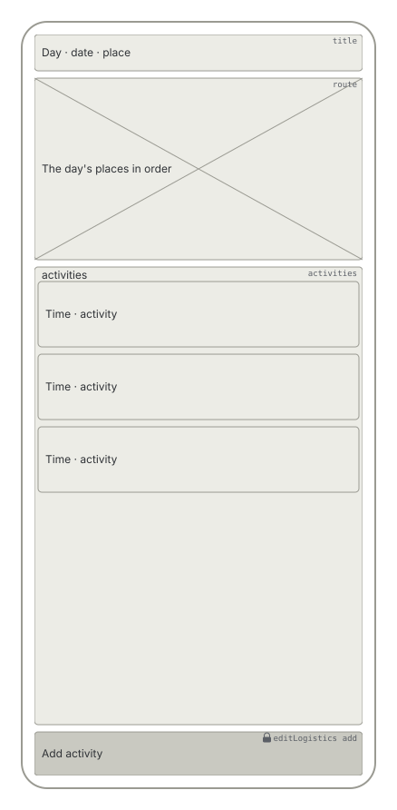
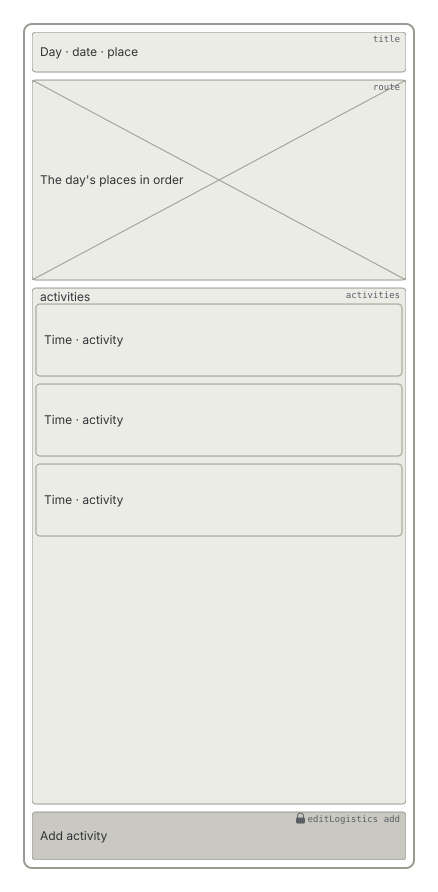
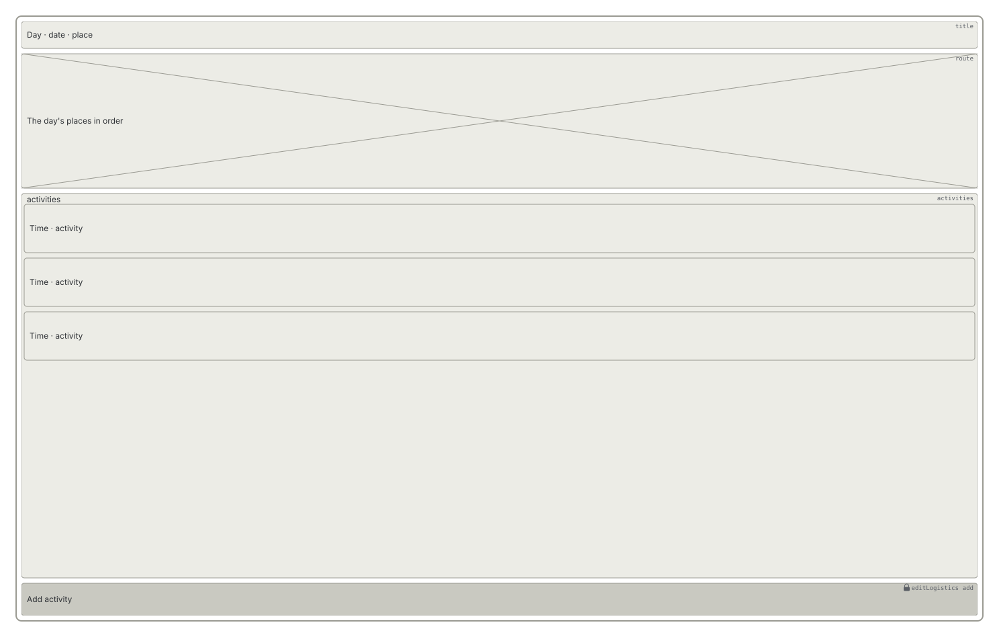

Files:

- ios: [src/ios/Screens/Trip/DayView.swift](../../../src/ios/Screens/Trip/DayView.swift)
- android: [src/android/DayScreen.kt](../../../src/android/DayScreen.kt)
- web: [src/web/routes/trip/day/+page.svelte](../../../src/web/routes/trip/day/+page.svelte)

Screenshots: none.

Navigates to:

- `activity.add`
- `activity.detail`

Reached from:

- `trip.timeline`

Used in flows:

- [Look around a trip](../flows/look-around-a-trip.md)

### Inbox (`trip.inbox`)

- Purpose: The invitations to activities that you have not answered yet.
- Presentation: tab
- Status: shipped
- Platforms: ios, android, web

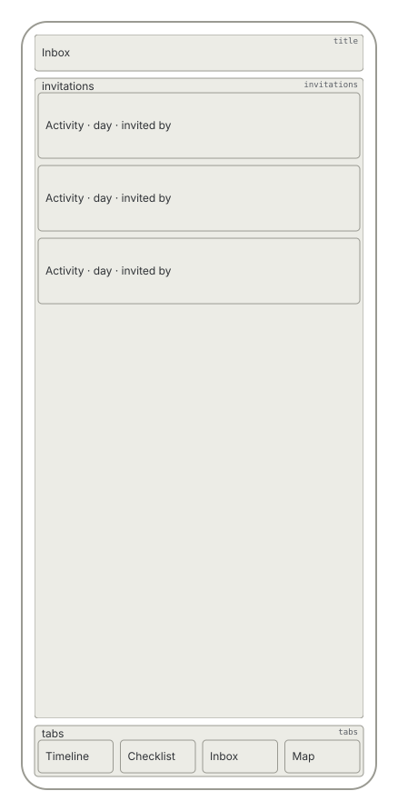
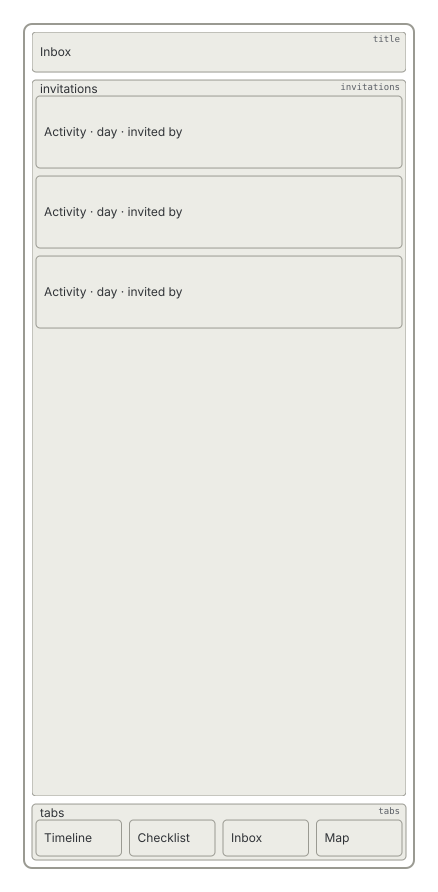
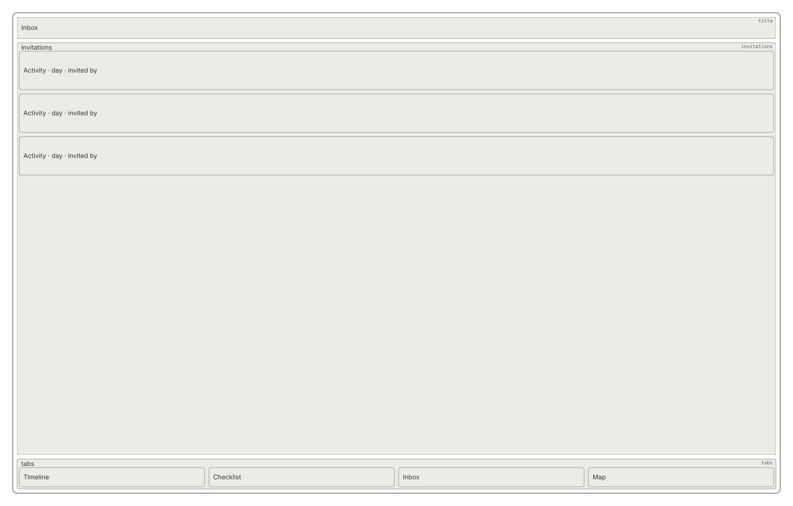

Files:

- ios: [src/ios/Screens/Trip/InboxView.swift](../../../src/ios/Screens/Trip/InboxView.swift)
- android: [src/android/InboxScreen.kt](../../../src/android/InboxScreen.kt)
- web: [src/web/routes/trip/inbox/+page.svelte](../../../src/web/routes/trip/inbox/+page.svelte)

Screenshots: none.

Navigates to:

- `activity.detail`
- `trip.checklist`
- `trip.inbox`
- `trip.map`
- `trip.timeline`

Reached from:

- `trip.checklist`
- `trip.inbox`
- `trip.map`
- `trip.timeline`

Used in flows:

- [Answer the inbox](../flows/answer-the-inbox.md)

### Trip info (`trip.info`)

- Purpose: The trip's dates, places and people, and its join code.
- Presentation: push
- Status: shipped
- Platforms: ios, android, web

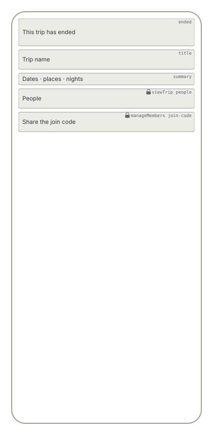
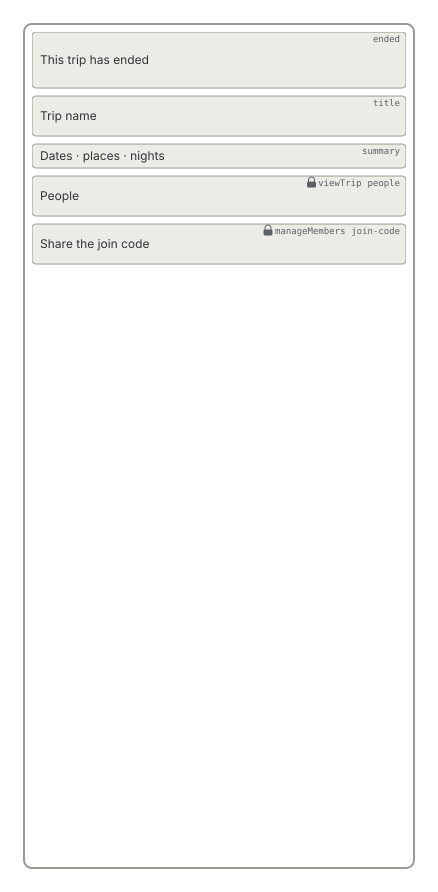
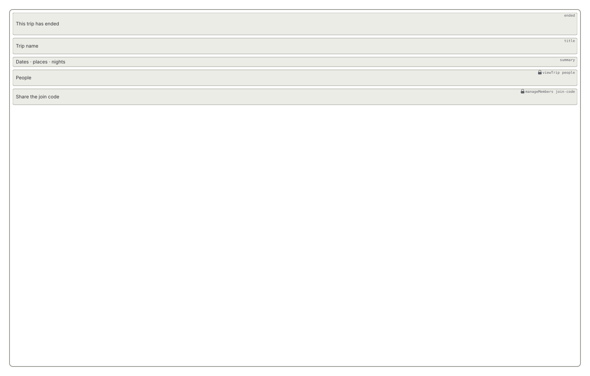

Files:

- ios: [src/ios/Screens/Trip/TripInfoView.swift](../../../src/ios/Screens/Trip/TripInfoView.swift)
- android: [src/android/TripInfoScreen.kt](../../../src/android/TripInfoScreen.kt)
- web: [src/web/routes/trip/info/+page.svelte](../../../src/web/routes/trip/info/+page.svelte)

Screenshots: none.

Navigates to:

- `sharing.roster`

Reached from:

- `trip.timeline`

Used in flows:

- [Invite a traveller](../flows/invite-a-traveller.md)
- [Look around a trip](../flows/look-around-a-trip.md)

### Trip map (`trip.map`)

- Purpose: Where each activity is, day by day.
- Presentation: tab
- Status: shipped
- Platforms: ios, android, web

Files:

- ios: [src/ios/Screens/Trip/TripMapView.swift](../../../src/ios/Screens/Trip/TripMapView.swift)
- android: [src/android/TripMapScreen.kt](../../../src/android/TripMapScreen.kt)
- web: [src/web/routes/trip/map/+page.svelte](../../../src/web/routes/trip/map/+page.svelte)

Screenshots: none.

Navigates to:

- `trip.checklist`
- `trip.inbox`
- `trip.map`
- `trip.timeline`

Reached from:

- `trip.checklist`
- `trip.inbox`
- `trip.map`
- `trip.timeline`

Used in flows:

- [Look around a trip](../flows/look-around-a-trip.md)

### Packing list (`trip.packing`)

- Purpose: What to bring, and who brings each thing so nothing is packed twice.
- Presentation: push
- Status: proposed
- Platforms: ios, android, web

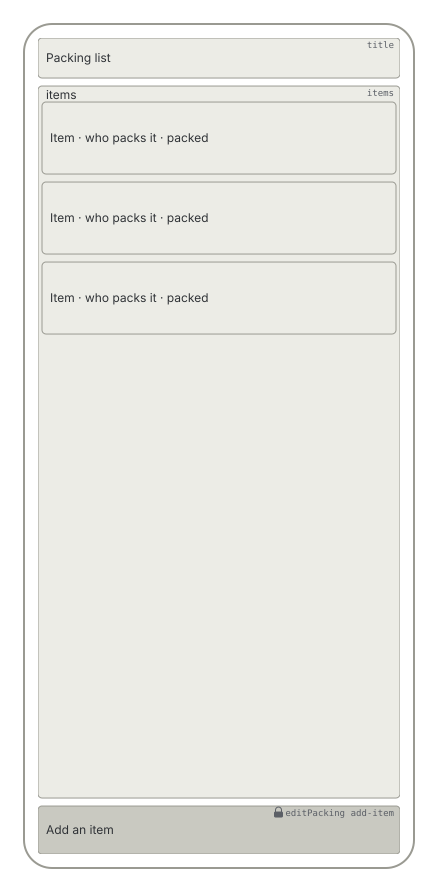
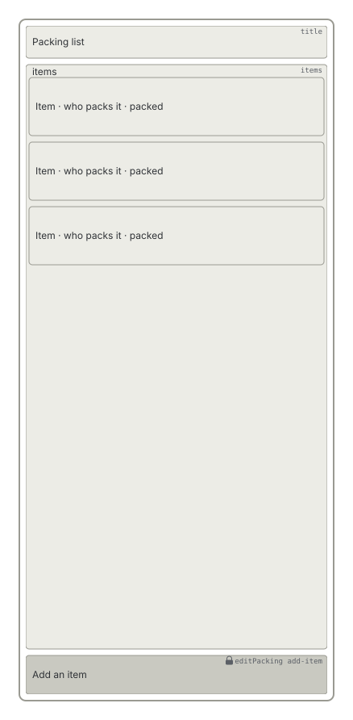
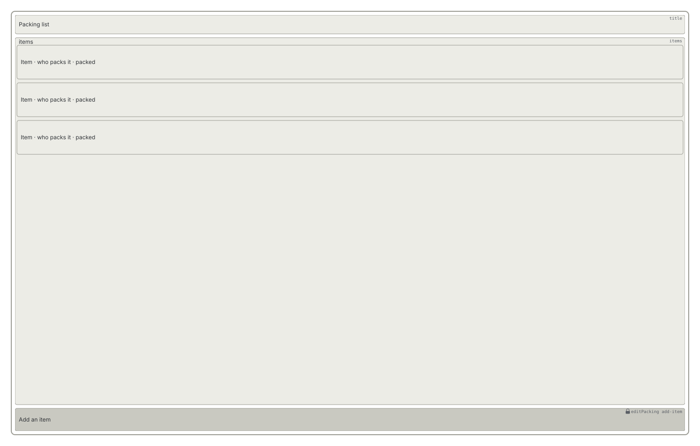

Files:

- ios: [src/ios/Screens/Trip/PackingView.swift](../../../src/ios/Screens/Trip/PackingView.swift)
- android: [src/android/PackingScreen.kt](../../../src/android/PackingScreen.kt)
- web: [src/web/routes/trip/packing/+page.svelte](../../../src/web/routes/trip/packing/+page.svelte)

Screenshots: none.

Navigates to: none.

Reached from:

- `trip.checklist`

Used in flows:

- [Pack for a trip](../flows/pack-for-a-trip.md)

### Timeline (`trip.timeline`)

- Purpose: The trip's days in order, with what happens on each; the trip's first tab.
- Presentation: tab
- Status: shipped
- Platforms: ios, android, web

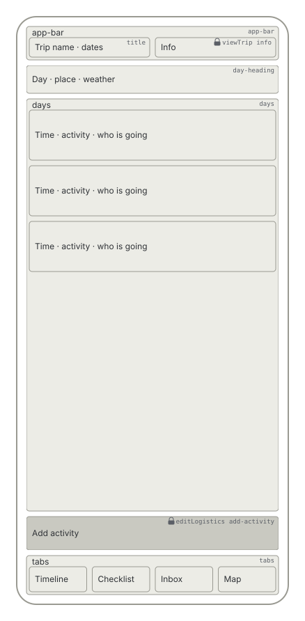
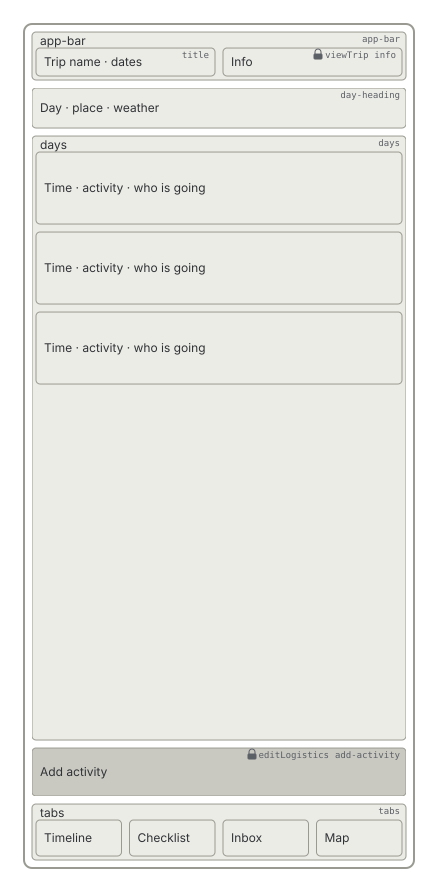
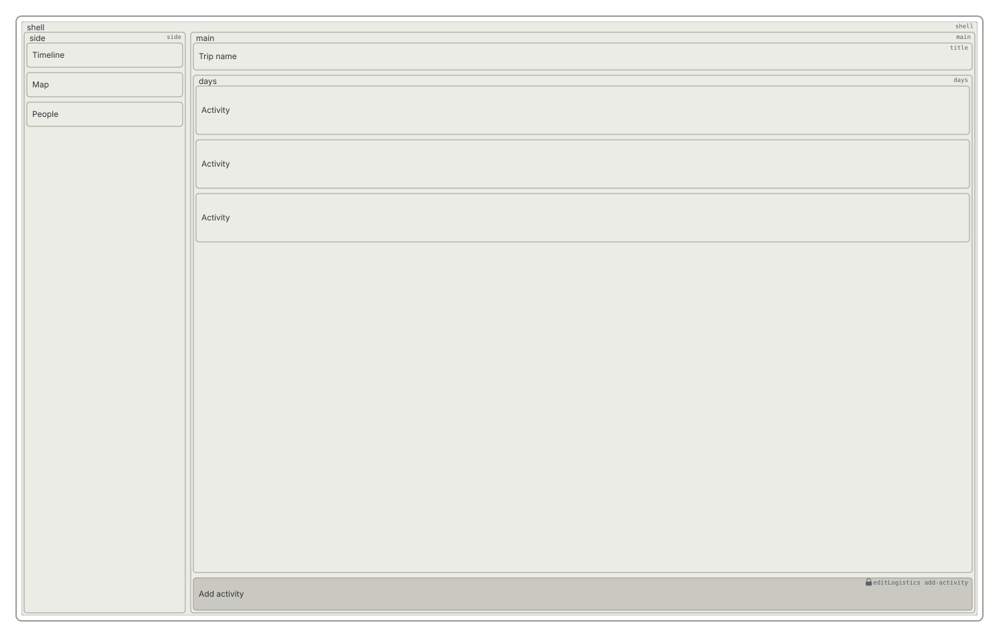

Files:

- ios: [src/ios/Screens/Trip/TimelineView.swift](../../../src/ios/Screens/Trip/TimelineView.swift)
- android: [src/android/TimelineScreen.kt](../../../src/android/TimelineScreen.kt)
- web: [src/web/routes/trip/timeline/+page.svelte](../../../src/web/routes/trip/timeline/+page.svelte)

Screenshots: none.

Navigates to:

- `activity.add`
- `activity.detail`
- `trip.checklist`
- `trip.day`
- `trip.inbox`
- `trip.info`
- `trip.map`
- `trip.timeline`

Reached from:

- `activity.add`
- `home.new-trip`
- `home.trips`
- `sharing.join`
- `trip.checklist`
- `trip.inbox`
- `trip.map`
- `trip.timeline`

Used in flows:

- [Add an activity](../flows/add-activity.md)
- [Answer the inbox](../flows/answer-the-inbox.md)
- [Join a trip](../flows/join-a-trip.md)
- [Look around a trip](../flows/look-around-a-trip.md)
- [Pack for a trip](../flows/pack-for-a-trip.md)
- [Plan a trip](../flows/plan-a-trip.md)

## activity

### Add activity (`activity.add`)

- Purpose: Put something on one day of the trip.
- Presentation: sheet
- Status: shipped
- Platforms: ios, android, web

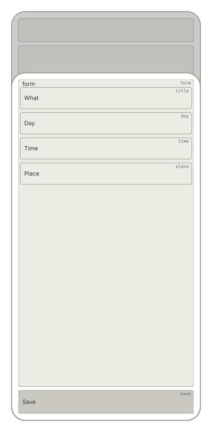

Files:

- ios: [src/ios/Screens/Activity/ActivityEditorView.swift](../../../src/ios/Screens/Activity/ActivityEditorView.swift)
- android: [src/android/ActivityEditorScreen.kt](../../../src/android/ActivityEditorScreen.kt)
- web: [src/web/components/ActivityEditorSheet.svelte](../../../src/web/components/ActivityEditorSheet.svelte)

Screenshots: none.

Navigates to:

- `activity.place-search`
- `trip.timeline`

Reached from:

- `activity.detail`
- `activity.place-search`
- `trip.day`
- `trip.timeline`

Used in flows:

- [Add an activity](../flows/add-activity.md)

### Activity (`activity.detail`)

- Purpose: One activity's time, place, notes and who is going.
- Presentation: push
- Status: shipped
- Platforms: ios, android, web

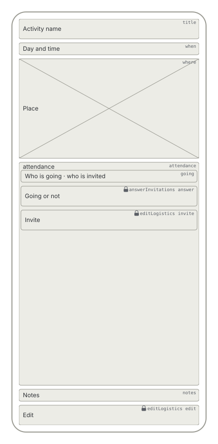
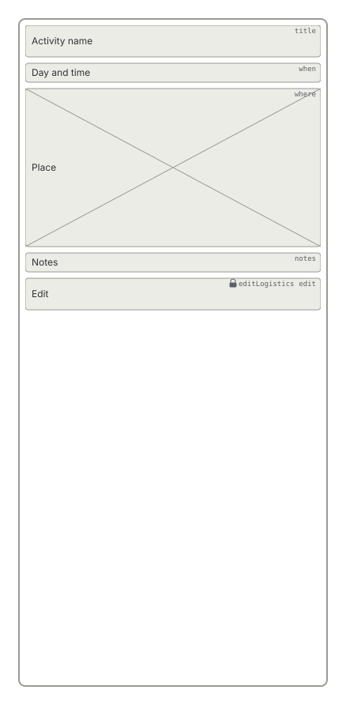

Files:

- ios: [src/ios/Screens/Activity/ActivityDetailView.swift](../../../src/ios/Screens/Activity/ActivityDetailView.swift)
- android: [src/android/ActivityDetailScreen.kt](../../../src/android/ActivityDetailScreen.kt)
- web: [src/web/routes/trip/activity/+page.svelte](../../../src/web/routes/trip/activity/+page.svelte)

Screenshots: none.

Navigates to:

- `activity.add`
- `activity.invite`

Reached from:

- `activity.invite`
- `trip.day`
- `trip.inbox`
- `trip.timeline`

Used in flows:

- [Answer the inbox](../flows/answer-the-inbox.md)
- [Look around a trip](../flows/look-around-a-trip.md)

### Invite to activity (`activity.invite`)

- Purpose: Ask travellers on the trip to come to one activity.
- Presentation: sheet
- Status: shipped
- Platforms: ios, android, web

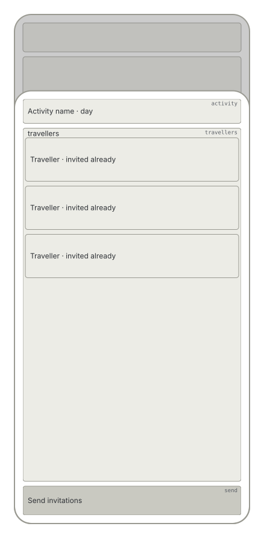
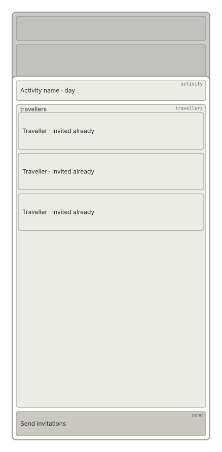
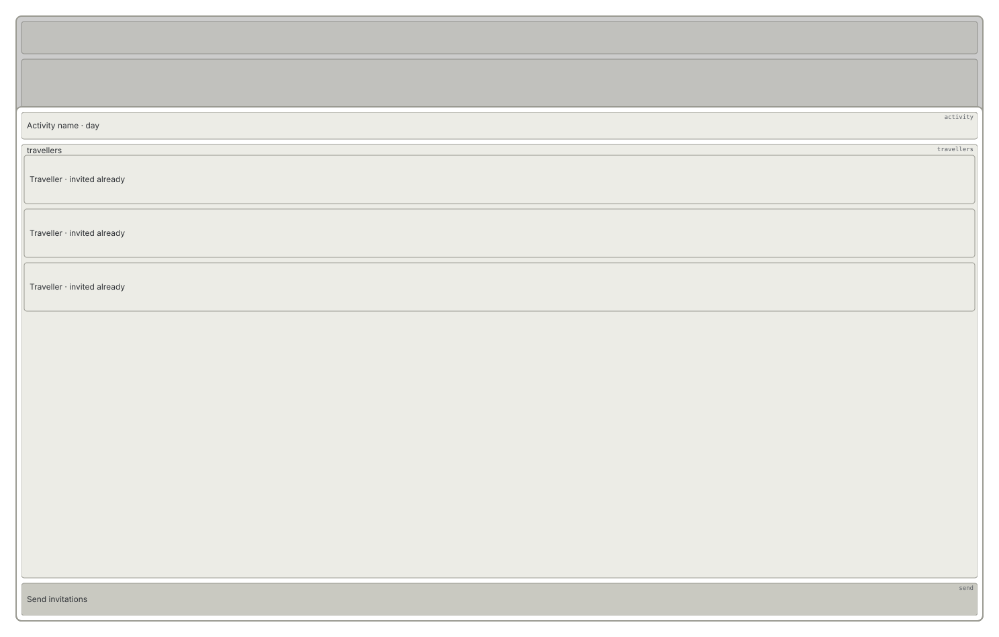

Files:

- ios: [src/ios/Screens/Activity/ActivityInviteView.swift](../../../src/ios/Screens/Activity/ActivityInviteView.swift)
- android: [src/android/ActivityInviteScreen.kt](../../../src/android/ActivityInviteScreen.kt)
- web: [src/web/components/ActivityInviteSheet.svelte](../../../src/web/components/ActivityInviteSheet.svelte)

Screenshots: none.

Navigates to:

- `activity.detail`

Reached from:

- `activity.detail`

Used in flows:

- [Answer the inbox](../flows/answer-the-inbox.md)

### Find a place (`activity.place-search`)

- Purpose: Search for the place an activity happens.
- Presentation: push
- Status: shipped
- Platforms: ios, android, web

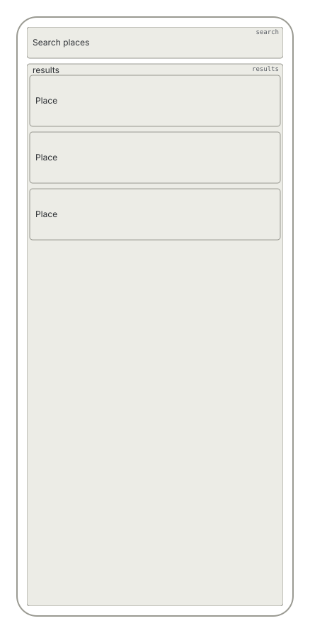
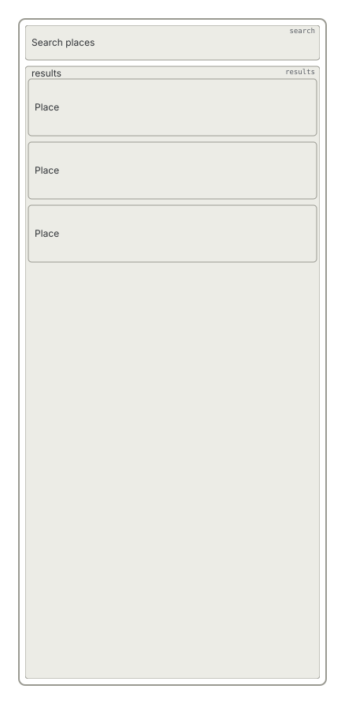
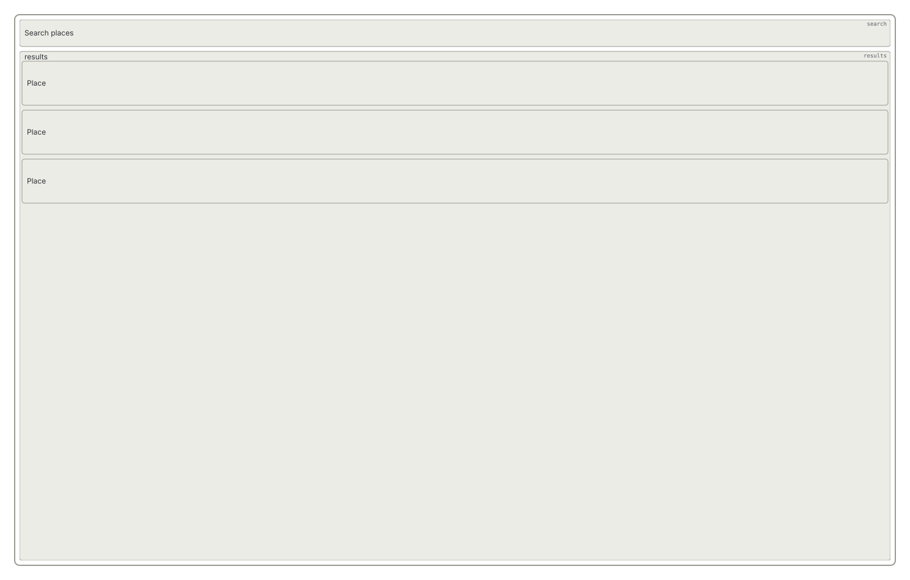

Files:

- ios: [src/ios/Screens/Activity/PlaceSearchView.swift](../../../src/ios/Screens/Activity/PlaceSearchView.swift)
- android: [src/android/PlaceSearchScreen.kt](../../../src/android/PlaceSearchScreen.kt)
- web: [src/web/components/PlaceSearch.svelte](../../../src/web/components/PlaceSearch.svelte)

Screenshots: none.

Navigates to:

- `activity.add`

Reached from:

- `activity.add`

Used in flows:

- [Add an activity](../flows/add-activity.md)

## sharing

### Invite someone (`sharing.invite`)

- Purpose: Send an invitation to the trip by email.
- Presentation: sheet
- Status: ios: shipped, android: proposed, web: shipped
- Platforms: ios, android, web

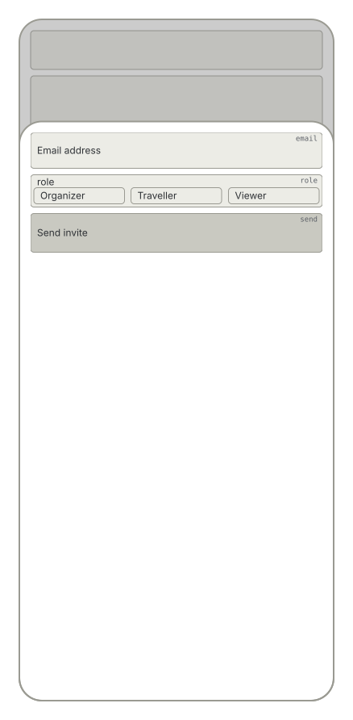
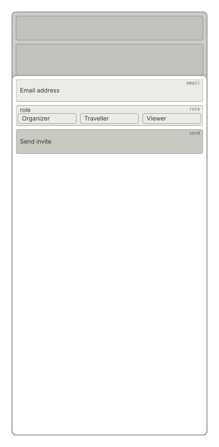
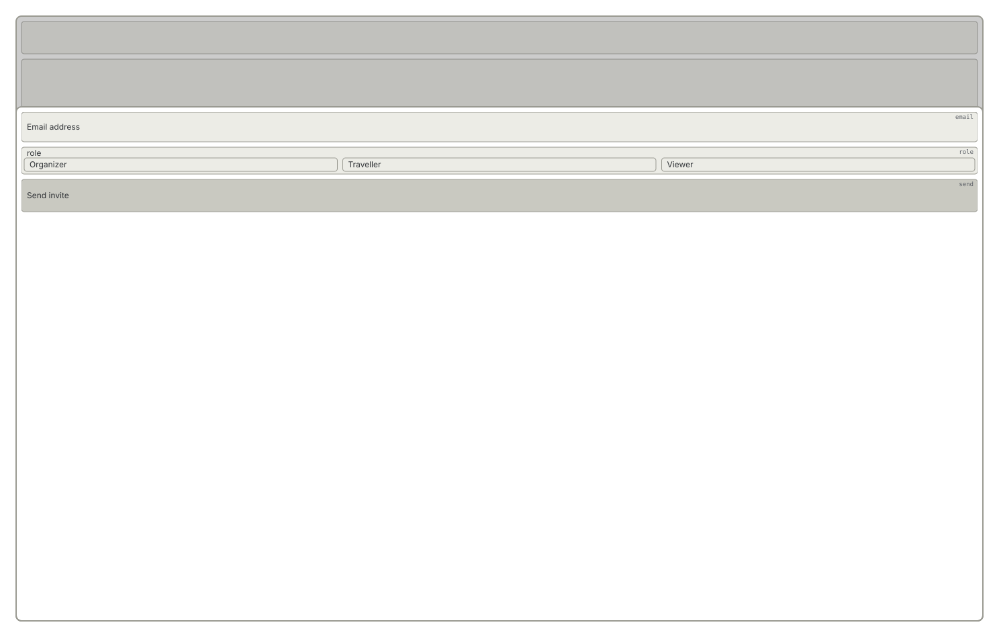

Files:

- ios: [src/ios/Screens/Sharing/InviteView.swift](../../../src/ios/Screens/Sharing/InviteView.swift)
- android: [src/android/InviteScreen.kt](../../../src/android/InviteScreen.kt)
- web: [src/web/components/InviteSheet.svelte](../../../src/web/components/InviteSheet.svelte)

Screenshots: none.

Navigates to:

- `sharing.roster`

Reached from:

- `sharing.roster`

Used in flows:

- [Invite a traveller](../flows/invite-a-traveller.md)

### Join a trip (`sharing.join`)

- Purpose: Join a trip with the code its organizer shared.
- Presentation: dialog
- Status: shipped
- Platforms: ios, android, web

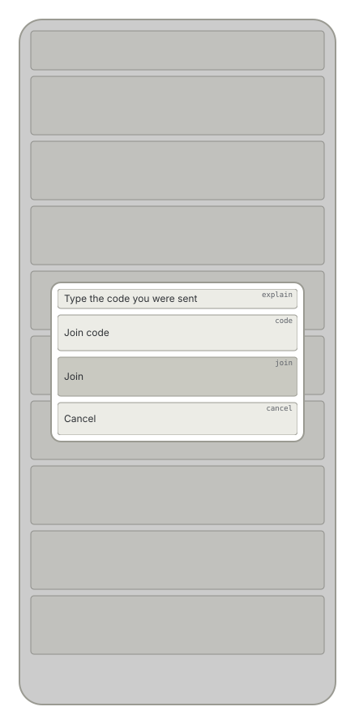

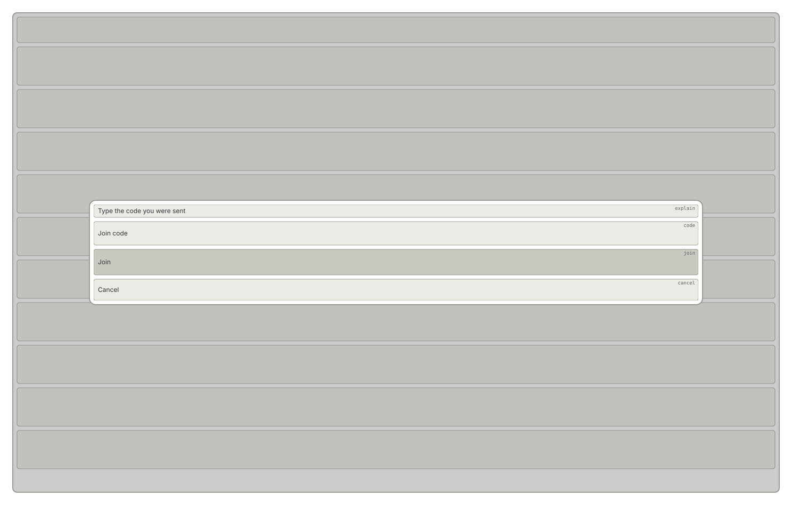

Files:

- ios: [src/ios/Screens/Sharing/JoinView.swift](../../../src/ios/Screens/Sharing/JoinView.swift)
- android: [src/android/JoinScreen.kt](../../../src/android/JoinScreen.kt)
- web: [src/web/components/JoinDialog.svelte](../../../src/web/components/JoinDialog.svelte)

Screenshots: none.

Navigates to:

- `home.trips`
- `trip.timeline`

Reached from:

- `home.trips`

Used in flows:

- [Join a trip](../flows/join-a-trip.md)

### People (`sharing.roster`)

- Purpose: Who is on the trip and what each person may do.
- Presentation: push
- Status: shipped
- Platforms: ios, android, web

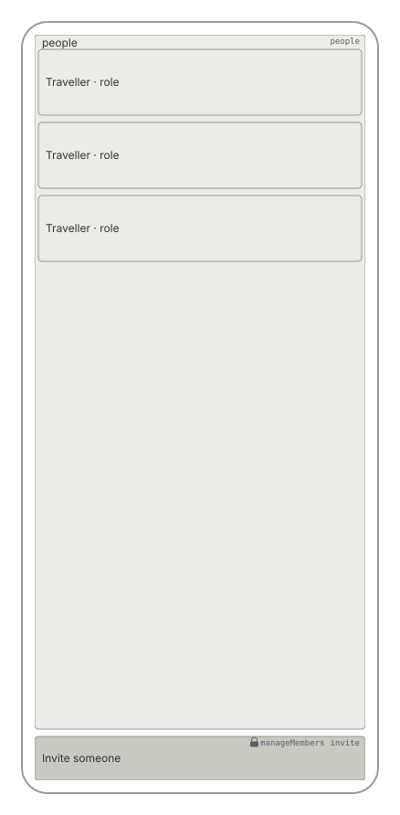
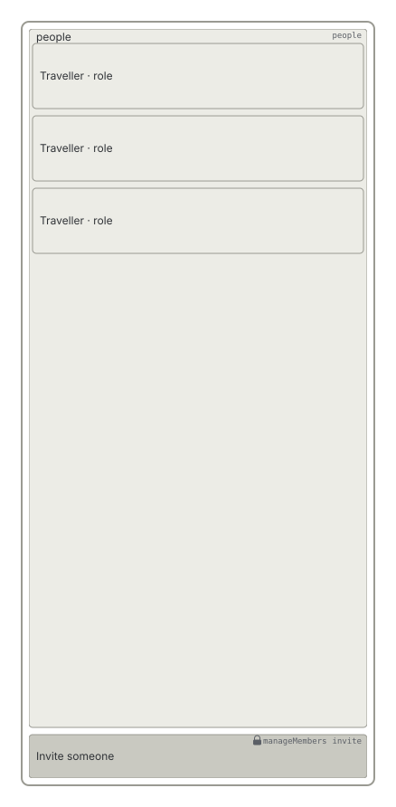
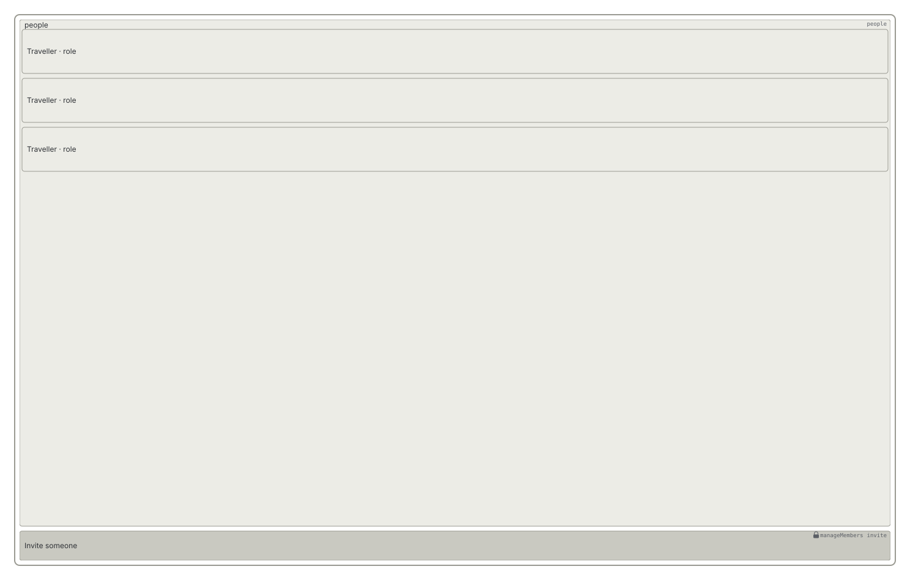

Files:

- ios: [src/ios/Screens/Sharing/RosterView.swift](../../../src/ios/Screens/Sharing/RosterView.swift)
- android: [src/android/RosterScreen.kt](../../../src/android/RosterScreen.kt)
- web: [src/web/routes/trip/people/+page.svelte](../../../src/web/routes/trip/people/+page.svelte)

Screenshots: none.

Navigates to:

- `sharing.invite`

Reached from:

- `sharing.invite`
- `trip.info`

Used in flows:

- [Invite a traveller](../flows/invite-a-traveller.md)

## settings

### Account (`settings.account`)

- Purpose: Change your name, email and password, or delete the account.
- Presentation: push
- Status: shipped
- Platforms: ios, android

Files:

- ios: [src/ios/Screens/Settings/AccountView.swift](../../../src/ios/Screens/Settings/AccountView.swift)
- android: [src/android/AccountScreen.kt](../../../src/android/AccountScreen.kt)

Screenshots: none.

Navigates to:

- `auth.welcome`

Reached from:

- `settings.main`

Used in flows:

- [Sign up, sign in and sign out](../flows/sign-in-and-out.md)

### Settings (`settings.main`)

- Purpose: Your profile, how the app behaves, and signing out.
- Presentation: push
- Status: shipped
- Platforms: ios, android, web

Files:

- ios: [src/ios/Screens/Settings/SettingsView.swift](../../../src/ios/Screens/Settings/SettingsView.swift)
- android: [src/android/SettingsScreen.kt](../../../src/android/SettingsScreen.kt)
- web: [src/web/routes/settings/+page.svelte](../../../src/web/routes/settings/+page.svelte)

Screenshots: none.

Navigates to:

- `auth.welcome`
- `settings.account`

Reached from:

- `home.trips`

Used in flows:

- [Sign up, sign in and sign out](../flows/sign-in-and-out.md)
