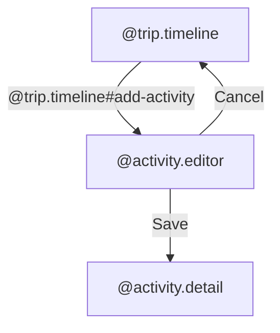

# Add an activity

References are `@screen.id` or `@screen.id#region`, anywhere in the text:

Non-screen nodes (decisions, system events) are plain text. The `@` form is
plain text, so it survives every Markdown renderer and agents can grep for it.
