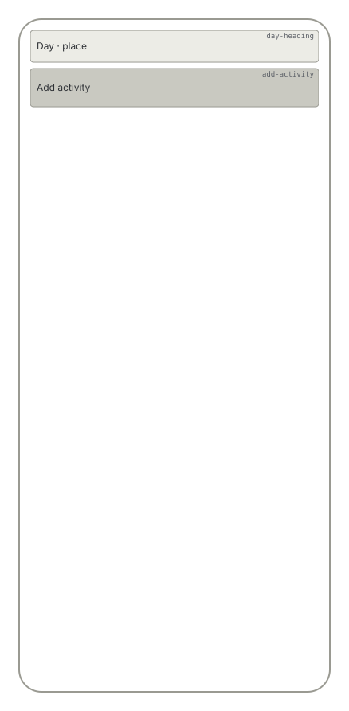
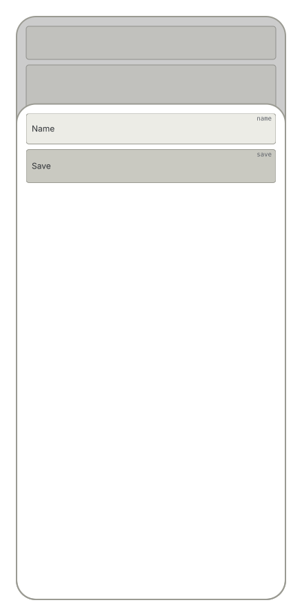

<!-- Generated by starboard. Do not edit. -->

# Screens

## trip

### Timeline (`trip.timeline`)

- Purpose: The trip's days in order with each day's activities.
- Presentation: root
- Status: shipped
- Platforms: ios

Files: none.

Screenshots: none.

Navigates to:

- `activity.editor`

Reached from:

- `activity.editor`

Used in flows:

- [Add an activity](../flows/add-activity.md)

## activity

### Activity editor (`activity.editor`)

- Purpose: Create or change one activity.
- Presentation: sheet
- Status: proposed
- Platforms: ios

Files: none.

Screenshots: none.

Navigates to:

- `trip.timeline`

Reached from:

- `trip.timeline`

Used in flows:

- [Add an activity](../flows/add-activity.md)
